# OmniTech — інтернет-магазин техніки

Навчальний командний проєкт з дисципліни «Основи програмної інженерії».
OmniTech складається з двох частин в одному репозиторії:
- **`backend/`** — REST API на FastAPI (лабораторна 05);
- **`frontend/`** — сайт на Vite + JavaScript (лабораторна 06). Кожна сторінка отримує й надсилає дані лише через це API.
Версії сайту на Flask з лабораторних 03 і 04 збережено в історії Git, позначки `lab03` і `lab04`.

## Команда

| Учасник | Роль | GitHub | Частина API (лабораторна 05) | Частина сайту (лабораторна 06) |
|---|---|---|---|---|
| Дмитрук Назар | Team Lead | [@Hyrysake](https://github.com/Hyrysake) | основа: налаштування, база, вхід (JWT), профіль | дизайн-система (теми, шапка, меню, ефекти, спільний вхідний скрипт), головна, каталог з плаваючими фільтрами, сторінка товару з відгуками, список бажань, модерація відгуків |
| Бардюк Станіслав | QA | [@st009bar-dot](https://github.com/st009bar-dot) | каталог, відгуки, список бажань, картинки, API v2 | реєстрація, профіль, адмін-панель: товари з фото, категорії, користувачі |
| Махнюк Андрій | Developer | [@rotterdamsterdam](https://github.com/rotterdamsterdam) | кошик, замовлення, зворотний зв'язок, адмін-статистика, Postman | «Про нас», «Контакти», «Часті питання», кошик, оформлення та історія замовлень, адмін: замовлення й повідомлення |

## Технології

| Що | Чим | Навіщо |
|---|---|---|
| Вебфреймворк | FastAPI | маршрути, перевірка даних, автоматична документація `/docs` |
| Сервер | Uvicorn | запускає застосунок FastAPI (ASGI-сервер) |
| Перевірка даних | Pydantic v2 | схеми запитів і відповідей, усі помилки полів разом (422) |
| База даних | SQLite + SQLAlchemy 2.0 (ORM) | таблиці як класи Python; перейти на PostgreSQL — змінити одну адресу |
| Налаштування | pydantic-settings, файл `.env` | секретний ключ і адреси не пишуться в коді |
| Вхід | OAuth2 + JWT (PyJWT), паролі argon2 (pwdlib) | вхід без сесій на сервері: токен у заголовку `Authorization` |
| Картинки | python-multipart, Pillow | завантаження файлів і перевірка, що це справді картинка |
| Тестування API | Postman | колекція `backend/postman/postman_collection.json` |
| Клієнтська частина | Vite 8 + JavaScript (ES-модулі), без фреймворків | сервер розробки з миттєвим оновленням, збирання сторінок у `dist/` |
| Оформлення | Tailwind CSS 4 (npm, плагін `@tailwindcss/vite`) | дизайн-система з лабораторних 03–04: кольори, кнопки, картки, темна тема |
| Шрифти й іконки | Fontsource (Montserrat, Cormorant), Phosphor Icons — з npm | сайт однаково виглядає і без доступу до сторонніх серверів |
| Анімація прокрутки | GSAP 3.15.1 з плагіном ScrollTrigger (ліцензія GSAP «no charge», безкоштовна, але **не MIT**) | закріплена розповідь на головній (`src/layout/scroll-fx.js`) і спільний таймер з Lenis; завантажується окремим файлом лише на публічних сторінках |
| Плавна прокрутка | Lenis 1.3.27 (ліцензія MIT) | м'яка прокрутка коліщатком (lerp 0.1); вимикається перемикачем «Рух», системним «Зменшити рух» і в полях форм |
| Живе тло | власний WebGL2-шейдер (`src/layout/gl-contours.js`) з чужим кодом шуму simplex: `webgl-noise`, Ashima Arts і Stefan Gustavson (ліцензія MIT) | золоті контурні лінії на тлі; без WebGL2 — SVG-плитка `public/contours.svg` |

Повний список сторонніх бібліотек і ліцензій: [THIRD-PARTY.md](THIRD-PARTY.md).

## Як запустити

Потрібні два термінали VS Code: в одному працює API (`backend`), у другому — сайт (`frontend`).

### API (backend)

Потрібен Python 3.11 або новіший. Усі команди — у терміналі VS Code, з папки `backend`:

```powershell
cd backend
python -m venv .venv
.venv\Scripts\activate
pip install -r requirements.txt
```

Файл налаштувань `backend/.env` із власним секретним ключем (у Git не потрапляє; зразок усіх налаштувань — `.env.example`):

```powershell
python -c "import secrets; open('.env', 'w').write('SECRET_KEY=' + secrets.token_urlsafe(32) + chr(10))"
```

Демо-дані й запуск:

```powershell
python -m app.seed --reset
uvicorn app.main:app --reload
```

- API: <http://127.0.0.1:8000/api/v1/products>
- Документація (Swagger UI): <http://127.0.0.1:8000/docs>, альтернативний вигляд: <http://127.0.0.1:8000/redoc>

**Демо-акаунти** (створює `python -m app.seed`):

| Роль | Пошта | Пароль |
|---|---|---|
| Адміністратор | `admin@omnitech.example` | `admin123` |
| Клієнт | `client@omnitech.example` | `client123` |

**Як увійти в `/docs`:** кнопка **Authorize** → пошта в полі `username`, пароль у полі `password` → **Authorize**. Після цього кожен запит із `/docs` надсилає токен сам.

### Сайт (frontend)

Потрібен Node.js 20.19+ або 22.12+ (перевірити: `node -v`). У другому терміналі:

```powershell
cd frontend
npm ci
npm run dev
```

- `npm ci` встановлює пакети точно тих версій, що записані в `package-lock.json` (у Git папка `node_modules` не потрапляє).
- Сайт: <http://localhost:5173>. API при цьому має працювати в першому терміналі.
- Адреса API за замовчуванням — `http://127.0.0.1:8000`. Іншу можна вказати у файлі `frontend/.env` (зразок — `.env.example`).
- Готовий сайт для розміщення на сервері: `npm run build` (папка `frontend/dist`), перегляд зібраного: `npm run preview`.

## Структура бекенду

```text
backend/
├── app/
│   ├── main.py            застосунок: CORS, обробники помилок, підключення маршрутів, /media
│   ├── api/
│   │   ├── router.py      усі адреси API в одному місці (/api/v1, /api/v2)
│   │   └── deps.py        залежності: сесія бази, поточний користувач, адмін, сторінки
│   ├── core/              налаштування, безпека (хеші, JWT), помилки, спільні перевірки
│   ├── db/                підключення до бази, базовий клас моделей, пагінація
│   ├── models/            таблиці бази (класи SQLAlchemy)
│   ├── schemas/           що API приймає і віддає (класи Pydantic)
│   ├── services/          логіка: що саме робити з даними (без HTTP)
│   ├── routers/           ендпоінти: v1/ і v2/
│   └── seed/              демонстраційні дані (python -m app.seed)
├── postman/               колекція Postman і картинка для тесту завантаження
├── data/                  файл бази omnitech.db (у Git не потрапляє)
├── media/                 завантажені картинки (у Git не потрапляють)
├── requirements.txt
└── .env.example           зразок налаштувань; справжній .env у Git не потрапляє
```

Запит проходить шари по черзі: **router** (адреса, коди відповіді) → **schema** (перевірка даних) → **service** (логіка) → **model** (база). Кожен шар знає лише про сусідній, тому код легко читати й перевіряти частинами.

## Структура фронтенду

```text
frontend/
├── index.html, catalog.html, …   сторінки сайту: розмітка й порожні блоки для даних
├── admin/                       сторінки адмін-панелі
├── public/                      файли без обробки: значок сайту, картинка-заглушка, contours.svg (запасне тло)
├── src/
│   ├── api/                     client.js — єдина функція запитів apiRequest(); config.js — адреса API
│   ├── auth/                    токен у localStorage, перехід на вхід і повернення назад
│   ├── store/                   кошик у localStorage, список бажань (дані на сервері)
│   ├── boot.inline.js           єдиний вхідний скрипт усіх сторінок (тема, рух, режим сторінки, заставка)
│   ├── layout/                  шапка з меню на весь екран, підвал, ефекти (заставка, WebGL-тло, змійки, поява слів, шторка між сторінками, плавна прокрутка), спільний старт сторінки
│   ├── ui/                      будова елементів, повідомлення, стани списків, форми, картки
│   ├── pages/                   код кожної сторінки (pages/admin — адмін-панелі)
│   └── styles/                  main.css (Tailwind, токени), site.css (оболонка й ефекти), pages.css (окремі сторінки), icons.css
├── vite.config.js               список сторінок для збирання, порт 5173
├── package.json, package-lock.json
└── .env.example                 зразок адреси API
```

У кожній HTML-сторінці замість довгого скрипта в `<head>` стоїть лише маркер `<!--boot-->`: Vite підставляє на його місце вміст `src/boot.inline.js` (плагін у `vite.config.js`), тож правити його треба в одному місці. Кожна сторінка — це HTML-файл і однойменний модуль у `src/pages`. HTML містить сталу розмітку (заголовки, форми), а модуль завантажує дані з API й будує з них списки та картки.

## Ефекти і рух

Усі ефекти лежать у `src/layout/` і `src/styles/site.css`. Вони лише прикраса: без них сайт працює так само.

- **Режими сторінок.** Скрипт `src/boot.inline.js` ставить на `<html>` атрибут `data-mode`. `full` (публічні сторінки): усі ефекти. `calm` (кошик, оформлення, вхід, реєстрація, профіль, замовлення, список бажань): тло, поява тексту й шторка між сторінками. `admin`: без ефектів.
- **Перемикач «Рух».** Кнопка в підвалі й меню, вибір у `localStorage` (ключ `motion`). Системне налаштування `prefers-reduced-motion` за замовчуванням вимикає рух. Без руху: немає заставки, плавної прокрутки, закріплення розповіді й шторки; лінії повністю намальовані, текст видно одразу, тло — один нерухомий кадр.
- **Тло.** Фрагментний WebGL2-шейдер малює повільні золоті контурні лінії (на курсор вони не реагують). Запасний варіант: SVG-плитка `public/contours.svg`; вона вмикається, коли немає WebGL2, відеокарта програмна, пристрій слабкий, увімкнена економія трафіку або сторінка спокійна.
- **Заставка** (лічильник 0 → 100, «+», діагональне вікно, близько 2,5 с): один раз за сесію (`sessionStorage`), лише при вході з головної.
- **Змійки** (`snake.js`): SVG-лінії малюються прокруткою через `stroke-dashoffset`; під текстом лінія зникає, щоб не псувати контраст.
- **Шторка між сторінками**: міждокументні View Transitions (Chrome, Edge); в інших браузерах звичайний перехід.
- **Закріплена розповідь, плавна прокрутка**: GSAP + ScrollTrigger і Lenis, окремий файл `scroll-fx.js`, лише на екрані від 768 px.
- **Курсор-крапка**: лише з мишею, від 1024 px, на публічних сторінках, коли рух увімкнено.
- **Каталог**: плаваючі фільтри (`ui/floating-filters.js`) і власний випадний список (`ui/select.js`, ARIA combobox у верхньому шарі браузера).

## Сторінки сайту

| Сторінка | Файли | Запити до API | Доступ |
|---|---|---|---|
| Головна | `index.html`, `pages/home.js` | `GET /api/v2/products?featured=true` | усі |
| Каталог | `catalog.html`, `pages/catalog.js` | `GET /api/v1/categories`, `GET /api/v2/products?q&category_id&min_price&max_price&sort&page` | усі |
| Товар | `product.html?id=…`, `pages/product.js` | `GET /api/v2/products/{id}`, `GET /api/v1/products/{id}/reviews` | усі |
| Відгук на сторінці товару | `ui/review-form.js` | `POST /api/v1/products/{id}/reviews`, `PATCH`/`DELETE /api/v1/reviews/{id}` | покупець |
| Вхід | `login.html`, `pages/login.js` | `POST /api/v1/auth/token` (поля форми `username`, `password`) | гість |
| Реєстрація | `register.html`, `pages/register.js` | `POST /api/v1/auth/register`, потім вхід | гість |
| Профіль | `profile.html`, `pages/profile.js` | `GET`/`PATCH`/`DELETE /api/v1/users/me`, `POST /api/v1/users/me/password` | покупець |
| Адмінка: огляд | `admin/index.html`, `pages/admin/dashboard.js` | `GET /api/v1/admin/stats` | адмін |
| Адмінка: товари | `admin/products.html`, `pages/admin/products.js` | `GET /api/v2/products`, `PATCH`/`DELETE /api/v1/products/{id}` | адмін |
| Адмінка: товар | `admin/product.html`, `pages/admin/product-form.js` | `POST /api/v1/products`, `PATCH /api/v1/products/{id}`, `POST`/`DELETE /api/v1/products/{id}/image` | адмін |
| Адмінка: категорії | `admin/categories.html`, `pages/admin/categories.js` | `GET`/`POST /api/v1/categories`, `PATCH`/`DELETE /api/v1/categories/{id}` | адмін |
| Адмінка: користувачі | `admin/users.html`, `pages/admin/users.js` | `GET /api/v1/admin/users?q&page` | адмін |
| Про нас, Часті питання | `about.html`, `faq.html`, `pages/static.js` | — | усі |
| Контакти | `contacts.html`, `pages/contacts.js` | `POST /api/v1/feedback` | усі |
| Кошик | `cart.html`, `pages/cart.js` | `POST /api/v1/cart/preview` | усі |
| Оформлення | `checkout.html`, `pages/checkout.js` | `POST /api/v1/cart/preview`, `POST /api/v1/orders` | усі (з входом — в історію) |
| Замовлення оформлено | `order-done.html`, `pages/order-done.js` | — (дані з оформлення) | усі |
| Мої замовлення | `orders.html`, `order.html`, `pages/orders.js`, `pages/order.js` | `GET /api/v1/users/me/orders`, `GET /api/v1/users/me/orders/{id}` | покупець |
| Адмінка: замовлення | `admin/orders.html`, `admin/order.html` | `GET /api/v1/admin/orders?status`, `GET`/`PATCH`/`DELETE /api/v1/admin/orders/{id}` | адмін |
| Адмінка: повідомлення | `admin/feedback.html` | `GET /api/v1/admin/feedback?unread`, `PATCH`/`DELETE /api/v1/admin/feedback/{id}` | адмін |
| Список бажань | `wishlist.html`, `pages/wishlist.js`, серця на картках | `GET /api/v1/users/me/wishlist`, `PUT`/`DELETE /api/v1/users/me/wishlist/{id}` | покупець |
| Адмінка: відгуки | `admin/reviews.html` | `GET /api/v1/admin/reviews`, `DELETE /api/v1/reviews/{id}` | адмін |

## Як сайт працює з API

- **Один шлях для всіх запитів.** Сторінки викликають `apiRequest()` з `src/api/client.js`, а не `fetch()` напряму. Там зібрано все спільне: адреса API, формат JSON, тайм-аут 10 секунд, перевірка `response.ok` і перетворення будь-якої невдачі на `ApiError` з українським текстом.
- **Помилки, які бачить користувач:**
  - сервер недоступний → «Не вдалося з'єднатися із сервером…» і кнопка «Спробувати ще»;
  - сервер не відповідає 10 секунд → «Сервер не відповідає…»;
  - 422 → повідомлення під кожним полем форми (сервер повертає список `errors`);
  - 404 → «Не знайдено» на місці вмісту; 409, 400, 5xx → текст `detail` від сервера.
- **Перевірка форм у браузері** повторює правила сервера (довжини, пошта, телефон, ціна), тож людина бачить помилку одразу. Сервер однаково перевіряє все сам.
- **Застарілі відповіді не показуються:** коли фільтр змінено ще до відповіді на попередній запит, той запит скасовується (`AbortController`).
- **Захист від XSS:** дані з API потрапляють на сторінку лише як текст (`src/ui/dom.js` будує елементи й додає рядки текстовими вузлами). У проєкті немає `innerHTML`, тож `<script>` у назві товару чи тексті відгуку так і лишається текстом.
- **CORS:** сайт (порт 5173) і API (порт 8000) — різні джерела (origin), тому API явно дозволяє запити саме з `http://localhost:5173` і `http://127.0.0.1:5173`. Браузер перед запитами з токеном чи JSON робить попередній запит `OPTIONS`; його видно у вкладці Network.
- **Вхід:** токен з відповіді `POST /auth/token` зберігається в `localStorage` разом із часом, коли він перестане діяти. Запити, яким потрібен вхід, додають заголовок `Authorization: Bearer …`. Якщо сервер відповів 401 (токен минув або акаунт видалено), сайт забуває токен і веде на сторінку входу, а після входу повертає туди, де людина була (`?next=`; приймаються лише адреси цього сайту).
- Перевірки «лише для покупця» й «лише для адміна» на сторінках — для зручності. Права перевіряє сервер: без потрібної ролі кожен запит отримає 401 чи 403.
- **Кошик** зберігається в `localStorage` лише як номери товарів і кількість. Ціни й суми щоразу рахує сервер (`POST /cart/preview`), тож підробити ціну в браузері неможливо.

## Ендпоінти

Усі адреси починаються з `/api`. 🔓 — доступно всім, 👤 — потрібен вхід, 🛡️ — лише адміністратор.

| Метод | Адреса | Доступ | Що робить | Коди |
|---|---|---|---|---|
| GET | `/api/health` | 🔓 | стан сервера й бази | 200, 503 |
| POST | `/api/v1/auth/register` | 🔓 | реєстрація клієнта | 201, 409, 422 |
| POST | `/api/v1/auth/token` | 🔓 | вхід (форма OAuth2), повертає токен | 200, 401, 422 |
| GET | `/api/v1/users/me` | 👤 | мій профіль | 200, 401 |
| PATCH | `/api/v1/users/me` | 👤 | змінити ім'я чи пошту | 200, 401, 409, 422 |
| POST | `/api/v1/users/me/password` | 👤 | змінити пароль | 204, 400, 401, 422 |
| DELETE | `/api/v1/users/me` | 👤 | видалити свій акаунт | 204, 401, 409 |
| GET | `/api/v1/admin/users` | 🛡️ | користувачі (сторінками, пошук `q`) | 200, 401, 403, 422 |
| GET | `/api/v1/categories` | 🔓 | категорії з кількістю товарів | 200 |
| POST | `/api/v1/categories` | 🛡️ | нова категорія | 201, 401, 403, 409, 422 |
| PATCH | `/api/v1/categories/{id}` | 🛡️ | перейменувати | 200, 401, 403, 404, 409, 422 |
| DELETE | `/api/v1/categories/{id}` | 🛡️ | видалити порожню категорію | 204, 401, 403, 404, 409 |
| GET | `/api/v1/products` | 🔓 | каталог: `q`, `category_id`, `min_price`, `max_price`, `featured`, `sort`, `page`, `size` | 200, 400, 422 |
| GET | `/api/v1/products/{id}` | 🔓 | один товар | 200, 404 |
| POST | `/api/v1/products` | 🛡️ | новий товар (+ заголовок `Location`) | 201, 401, 403, 422 |
| PUT | `/api/v1/products/{id}` | 🛡️ | замінити товар повністю | 200, 401, 403, 404, 422 |
| PATCH | `/api/v1/products/{id}` | 🛡️ | змінити частину полів | 200, 401, 403, 404, 422 |
| DELETE | `/api/v1/products/{id}` | 🛡️ | видалити товар | 204, 401, 403, 404, 409 |
| POST | `/api/v1/products/{id}/image` | 🛡️ | завантажити картинку (multipart, поле `file`) | 200, 401, 403, 404, 413, 415, 422 |
| DELETE | `/api/v1/products/{id}/image` | 🛡️ | прибрати картинку | 204, 401, 403, 404 |
| GET | `/api/v1/products/{id}/reviews` | 🔓 | відгуки про товар (сторінками) | 200, 404 |
| POST | `/api/v1/products/{id}/reviews` | 👤 | залишити відгук (один на товар) | 201, 401, 404, 409, 422 |
| PATCH | `/api/v1/reviews/{id}` | 👤 | змінити свій відгук | 200, 401, 403, 404, 422 |
| DELETE | `/api/v1/reviews/{id}` | 👤 | видалити відгук (автор або адмін) | 204, 401, 403, 404 |
| GET | `/api/v1/admin/reviews` | 🛡️ | усі відгуки для модерації | 200, 401, 403 |
| GET | `/api/v1/users/me/wishlist` | 👤 | мій список бажань | 200, 401 |
| PUT | `/api/v1/users/me/wishlist/{product_id}` | 👤 | додати товар до списку | 204, 401, 404 |
| DELETE | `/api/v1/users/me/wishlist/{product_id}` | 👤 | прибрати товар зі списку | 204, 401 |
| GET | `/api/v2/products` | 🔓 | каталог v2 (ті самі параметри) | 200, 400, 422 |
| GET | `/api/v2/products/{id}` | 🔓 | один товар v2 | 200, 404 |
| POST | `/api/v1/cart/preview` | 🔓 | порахувати кошик за актуальними цінами | 200, 422 |
| POST | `/api/v1/orders` | 🔓/👤 | оформити замовлення (гість або користувач) | 201, 401, 404, 422 |
| GET | `/api/v1/users/me/orders` | 👤 | мої замовлення | 200, 401 |
| GET | `/api/v1/users/me/orders/{id}` | 👤 | одне моє замовлення | 200, 401, 404 |
| POST | `/api/v1/feedback` | 🔓 | повідомлення з форми «Контакти» | 201, 422 |
| GET | `/api/v1/admin/orders` | 🛡️ | усі замовлення (фільтр `status`) | 200, 401, 403, 422 |
| GET | `/api/v1/admin/orders/{id}` | 🛡️ | одне замовлення | 200, 401, 403, 404 |
| PATCH | `/api/v1/admin/orders/{id}` | 🛡️ | змінити статус | 200, 401, 403, 404, 422 |
| DELETE | `/api/v1/admin/orders/{id}` | 🛡️ | видалити замовлення | 204, 401, 403, 404 |
| GET | `/api/v1/admin/feedback` | 🛡️ | повідомлення (фільтр `unread`) | 200, 401, 403 |
| PATCH | `/api/v1/admin/feedback/{id}` | 🛡️ | позначити прочитаним | 200, 401, 403, 404, 422 |
| DELETE | `/api/v1/admin/feedback/{id}` | 🛡️ | видалити повідомлення | 204, 401, 403, 404 |
| GET | `/api/v1/admin/stats` | 🛡️ | статистика магазину | 200, 401, 403 |

## Вхід і права

- `POST /api/v1/auth/token` приймає форму (`username` = пошта, `password`) і повертає **JWT** — підписаний рядок з номером користувача й терміном дії (60 хв). Роль у токен не записується: сервер щоразу бере її з бази, тож зміна ролі діє одразу.
- Клієнт надсилає токен з кожним запитом: `Authorization: Bearer <токен>`. Сервер нічого не зберігає між запитами (stateless): він лише перевіряє підпис і термін.
- Немає токена або він недійсний → **401**. Токен правильний, але роль не та → **403**.
- Виходу на сервері немає: щоб вийти, клієнт просто видаляє токен.
- Паролі зберігаються лише як хеш argon2. Для неправильної пошти й неправильного пароля відповідь однакова.

## Помилки

Будь-яка помилка має той самий формат:

```json
{
  "detail": "Дані не пройшли перевірку.",
  "errors": [
    {"field": "price", "message": "Має бути більше за 0."},
    {"field": "name", "message": "Мінімальна довжина — 3 симв."}
  ]
}
```

`errors` є лише тоді, коли помилка стосується конкретних полів. Усі помилки полів повертаються разом, тож клієнт виправляє все за один раз.

| Код | Коли |
|---|---|
| 200 / 201 / 204 | успіх / створено (з `Location`) / успіх без тіла |
| 400 | дію виконати не можна (неправильний поточний пароль, мінімальна ціна більша за максимальну) |
| 401 | потрібно увійти |
| 403 | недостатньо прав |
| 404 | запису немає (або чуже замовлення) |
| 405 | метод не підтримується для адреси |
| 409 | конфлікт з даними: пошта зайнята, другий відгук, товар у замовленнях, категорія з товарами |
| 413 / 415 | файл завеликий / не картинка |
| 422 | дані не пройшли перевірку |
| 500 | помилка сервера (подробиці лише в журналі сервера) |

## Валідація

- **Типи й формат** перевіряє Pydantic за схемами в `app/schemas/`. Ціни, оцінки, кількості й номери приймаються лише справжніми цілими числами JSON: `"100"`, `12.5` і `true` не пройдуть.
- **Правила з форм сайту** (лабораторна 04): ім'я від 2 символів, пароль від 6, телефон 10–13 цифр, адреса доставки від 5, назва товару від 3, опис до 1000, відгук від 5 до 1000 символів, повідомлення від 10 до 2000.
- Пробіли на початку й у кінці рядків відрізаються. **Невідоме поле — помилка**, тож одруківку (`prise` замість `price`) видно одразу.
- **Перевірки в базі:** існування категорії, унікальність пошти й назви категорії, один відгук на товар. Обмеження `CHECK`, `UNIQUE` і зовнішні ключі є й у самій базі, як останній рубіж.
- **Картинки:** лише JPEG, PNG або WebP до 5 МБ. Тип визначається за вмістом файлу (Pillow), а не за назвою. Ім'я файлу генерує сервер.

## Версії API

`/api/v1` і `/api/v2` працюють одночасно. v2 змінює формат товару, тому це окрема версія, а не правка v1:

| | v1 | v2 |
|---|---|---|
| категорія | `"category_id": 1` | `"category": {"id": 1, "name": "Ноутбуки"}` |
| рейтинг | окремим запитом до відгуків | `"rating": {"average": 4.5, "count": 2}` у кожному товарі |

Клієнти, написані під v1, працюють без змін.

## Тестування в Postman

Колекція: `backend/postman/postman_collection.json` (102 запити в 11 папках).
- **Імпорт:** Postman → Import → файл колекції.
- **Запуск:** запустіть сервер на свіжій базі (`python -m app.seed --reset`), потім Run collection.
- Для 41 з 43 операцій є і успішний запит, і запит з помилкою (400, 401, 403, 404, 409 або 422). Дві операції — `GET /api/health` і `GET /api/v1/categories` — не мають ні параметрів, ні тіла, тож клієнт не може в них помилитися; для їхніх адрес перевіряється 405 (непідтримуваний метод).
- Окремо перевіряються права: чужий відгук (403), чуже замовлення (404), токен видаленого акаунта (401).
- Токени після входу зберігаються в змінних колекції (`adminToken`, `clientToken`), запити з ними беруть їх самі.
- Остання папка прибирає створені записи, тож колекцію можна запускати повторно.
- Тест завантаження картинки бере файл `sample.png` з тієї самої папки.

## Результати тестування (лабораторна 06)

| Що | Як | Результат |
|---|---|---|
| Усі 25 сторінок | автоматична перевірка в Chrome (511 перевірок, усі пройдено): гість, покупець і адміністратор, ширина 1440 і 390 px, світла й темна тема | Console без помилок, один `<h1>`, немає горизонтальної прокрутки |
| Доступність | axe-core (WCAG 2.2 AA) на головній, каталозі, товарі, питаннях, про нас, контактах і вході; світла й темна тема, 1440 і 390 px | 0 порушень |
| Lighthouse (збірка `npm run build`, мобільний профіль з уповільненням) | доступність 100 на перевірених сторінках; швидкість: головна близько 88–92 (CLS 0,084–0,098 через слово-вивіску), каталог 93–97, товар 75–80 | доступність 100; швидкість нижча за 90 на сторінці товару. У Lab 06 вимог до швидкості немає; на товарі найбільший вміст — текст, який малюється після відповіді API |
| Меню, теми, клавіатура | меню на весь екран відкривається й закривається Esc, фокус не виходить із нього; тема зберігається після оновлення; перше натискання Tab веде на «Перейти до вмісту»; «зменшити рух» показує всі блоки одразу | усе працює |
| Рух | перемикач «Рух» у підвалі й меню; системне `prefers-reduced-motion`; сторінка без WebGL2 | без руху немає заставки, шторки й плавної прокрутки, текст видно одразу; без WebGL2 тло — SVG `public/contours.svg` |
| Сервер API вимкнено | Ctrl+C у терміналі сервера, потім кнопка «Спробувати ще» після запуску | повідомлення замість порожньої сторінки, після запуску дані завантажуються |
| Мережа | DevTools → Network → **Offline** і **Slow 4G** | повідомлення про з'єднання; скелетони, поки йде запит |
| Помилки сервера | 404 (неіснуючий товар), 401 (вхід минув), 403 (покупець в адмінці), 409 (зайнята пошта, другий відгук), 413/415 (файл), 422 (неправильні поля) | кожна помилка має свій зрозумілий текст; помилки полів — під полями |
| Перевірка форм | порожні та неправильні поля у всіх формах | помилки під полями, запит не надсилається |
| Безпека | `<script>` і `` у назві товару, відгуку, імені; `?next=//інший-сайт` при вході | текст показується як текст; переходу на чужий сайт немає |
| Збірка | `npm run build` | 25 сторінок у `frontend/dist`, без попереджень |
| Рев'ю | кожен PR перевіряв інший учасник за чеклістом | PR Назара схвалює Станіслав, PR Станіслава й Андрія — Назар |

## Знімки екрана (лабораторна 06)

**Каталог** з пошуком і фільтром; фільтри в адресі (Назар):

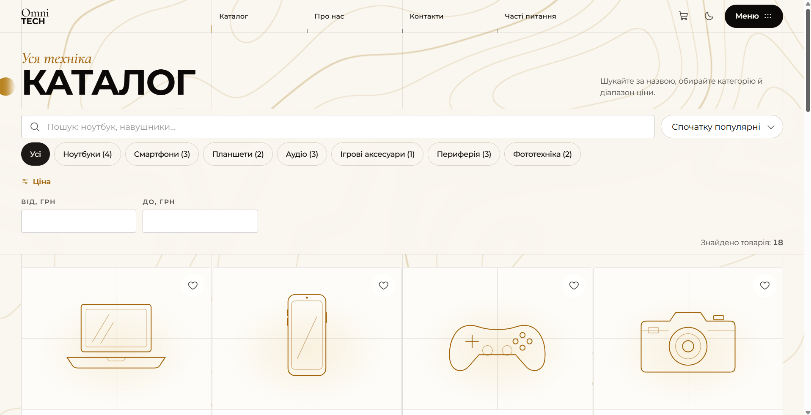

**Сервер вимкнено:** повідомлення й кнопка «Спробувати ще» (Назар):

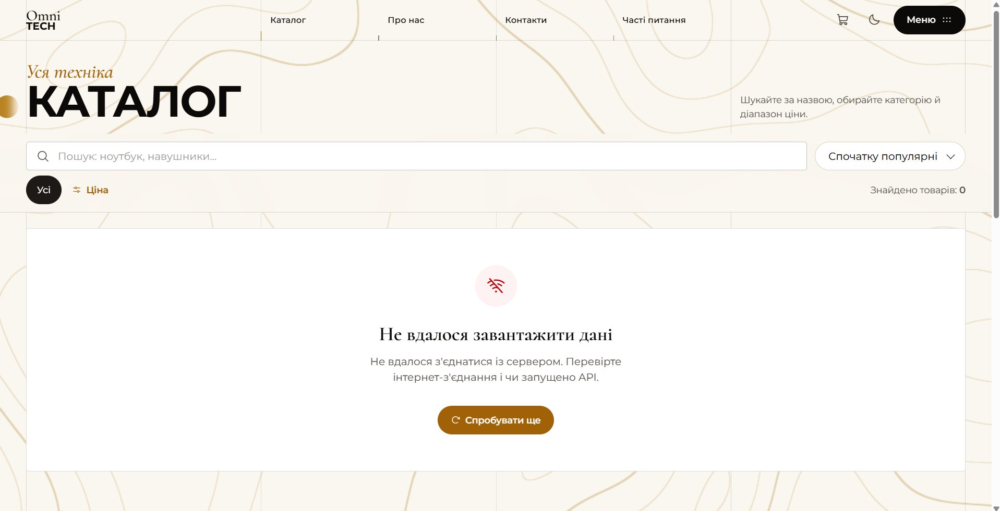

**Вкладка Network:** запит до API і відповідь у JSON (Назар):

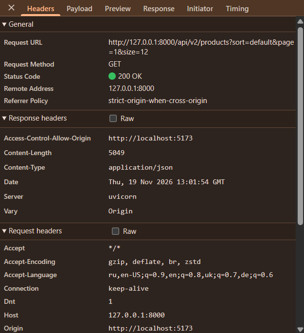

**Відгук додано**, рейтинг оновився (Назар):

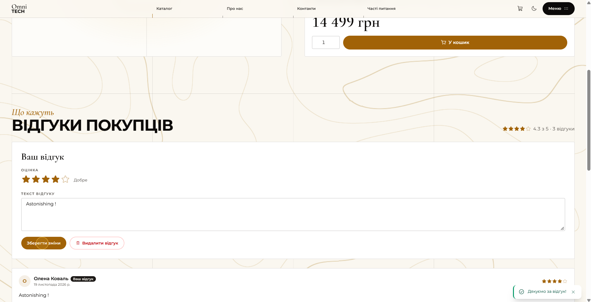

**Форма «Контакти»** з помилками під полями (Андрій):


**Кошик** (Андрій):


**Замовлення оформлено** (Андрій):


**Адмін: замовлення** (Андрій):


**Реєстрація з помилками** під кожним полем (Станіслав):


**Форма товару** з завантаженим фото (Станіслав):


**Товари в адмін-панелі** (Станіслав):


## Внесок учасників (лабораторна 06)

| Учасник | PR | Що зроблено | Звіт |
|---|---|---|---|
| Дмитрук Назар | [усі PR Назара](https://github.com/Hyrysake/omnitech/pulls?q=is%3Apr+author%3AHyrysake) | основа (дизайн-система, клієнт API, вхід, шапка й меню, теми, ефекти), головна, каталог, товар, відгуки, список бажань, модерація відгуків, README | [lab06-report-dmytruk.md](lab-reports/lab06-report-dmytruk.md) |
| Бардюк Станіслав | [усі PR Станіслава](https://github.com/Hyrysake/omnitech/pulls?q=is%3Apr+author%3Ast009bar-dot) | реєстрація, профіль, адмін-панель: товари з фото, категорії, користувачі | [lab06-report-bardiuk.md](lab-reports/lab06-report-bardiuk.md) |
| Махнюк Андрій | [усі PR Андрія](https://github.com/Hyrysake/omnitech/pulls?q=is%3Apr+author%3Arotterdamsterdam) | «Про нас», «Контакти», «Часті питання», кошик, оформлення, історія замовлень, адмін: замовлення й повідомлення | [lab06-report-makhniuk.md](lab-reports/lab06-report-makhniuk.md) |

## Висновки (лабораторна 06)

- API з лабораторної 05 отримав першого справжнього клієнта: кожна сторінка сайту бере й надсилає дані тільки через REST-запити, без жодного HTML від сервера.
- Одна функція `apiRequest` для всіх запитів дала однакову обробку помилок на кожній сторінці: таймаут, перевірка `response.ok`, зрозумілий текст і повторна спроба.
- Людина завжди бачить, що відбувається: скелетони під час завантаження, повідомлення, коли нічого не знайдено, і пояснення з кнопкою «Спробувати ще», коли сервер недоступний.
- Перевірки в браузері роблять форми зручними, але захищає дані сервер: ролі, права й правильність даних перевіряє API, а сайт лише показує його відповідь.
- Вкладки Console і Network у DevTools стали нашим головним інструментом: у них видно кожен запит, токен у заголовку й відповідь сервера.

## Результати тестування (лабораторна 05)

| Що | Як | Результат |
|---|---|---|
| Колекція Postman | **Run collection** на свіжій базі | 102 запити, 299 перевірок, 0 помилок |
| Повторний прогін | ще раз на тій самій базі, без скидання | 0 помилок: папка «Прибирання» повертає базу до початкового стану |
| Документація | `/docs`, вхід через **Authorize**, **Try it out** | 43 операції в 12 розділах; вхід і запити з токеном працюють |
| Рев'ю | кожен PR перевіряв інший учасник за чеклістом | #15 — Станіслав, #16 — Андрій, #17 — Назар |

## Знімки екрана (лабораторна 05)

**Документація `/docs`** після входу: `GET /users/me` повертає адміністратора (Назар):

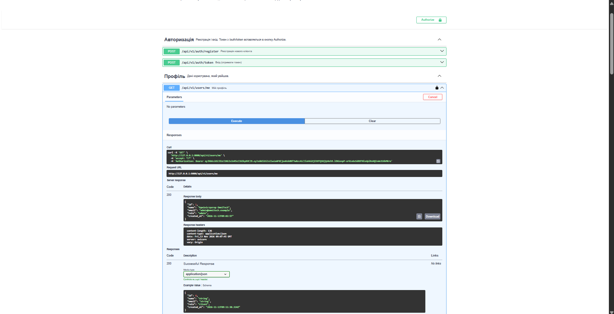

**Помилка перевірки даних:** реєстрація з неправильними полями → 422, усі помилки разом (Назар):

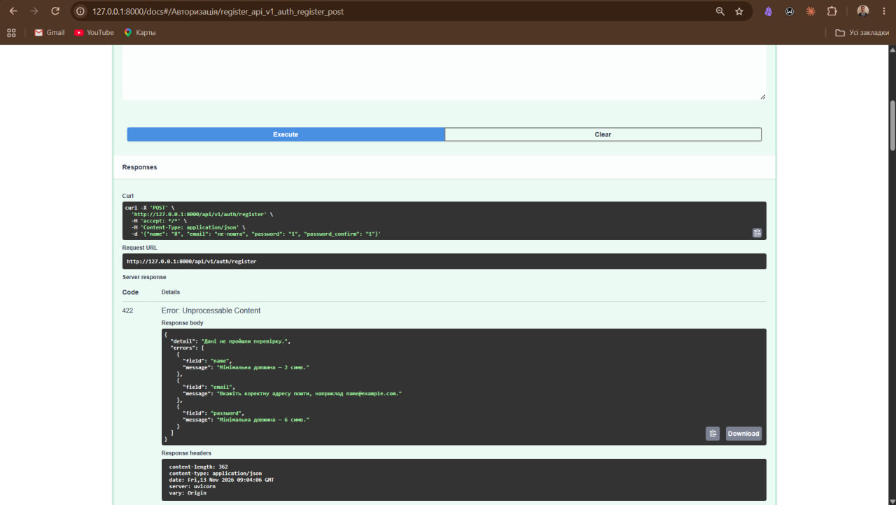

**Пошук у каталозі** в Postman: `?q=ноутбук&size=2` (Станіслав):

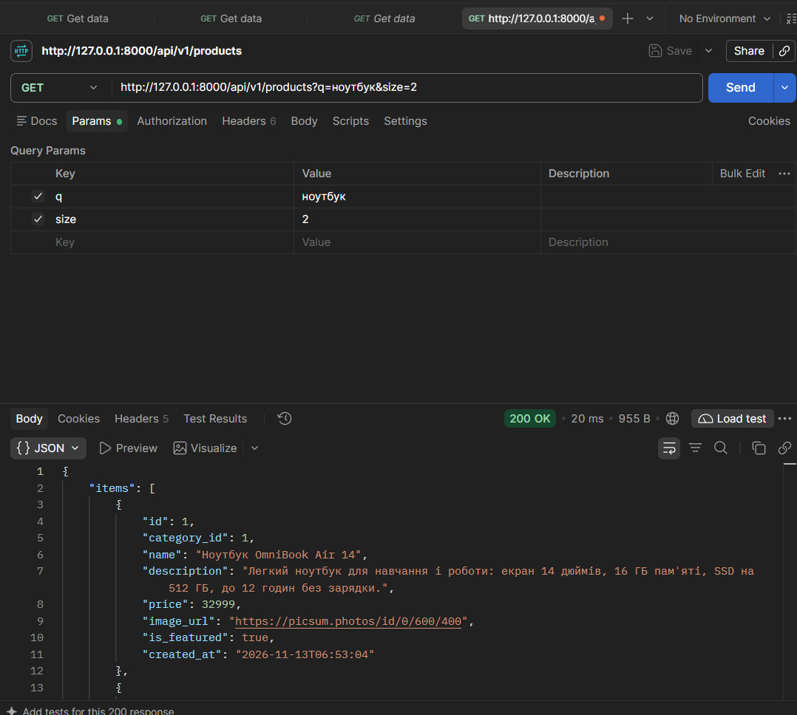

**API v2:** категорія й рейтинг усередині товару (Станіслав):

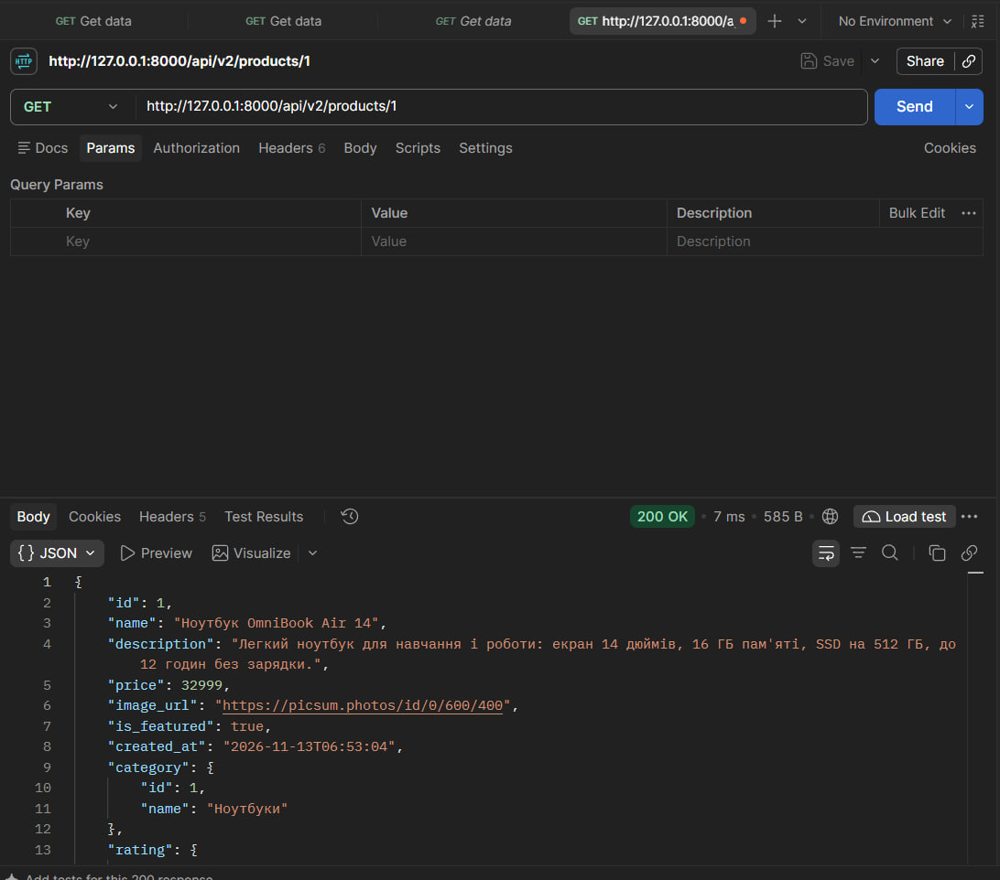

**Завантаження картинки** через `/docs` (Станіслав):

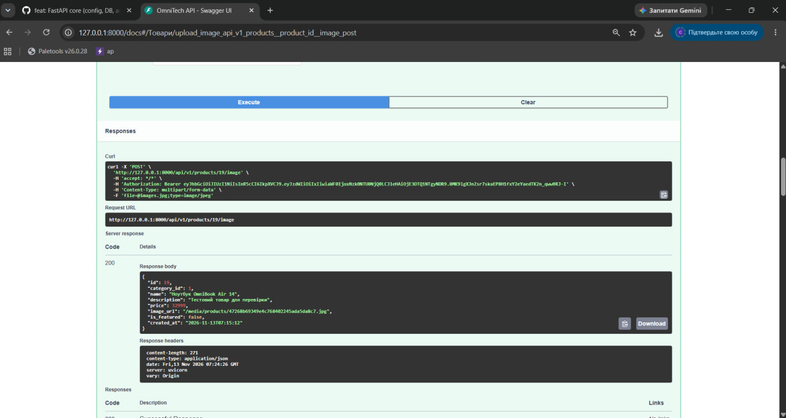

**Замовлення гостя** в Postman: 201 (Андрій):

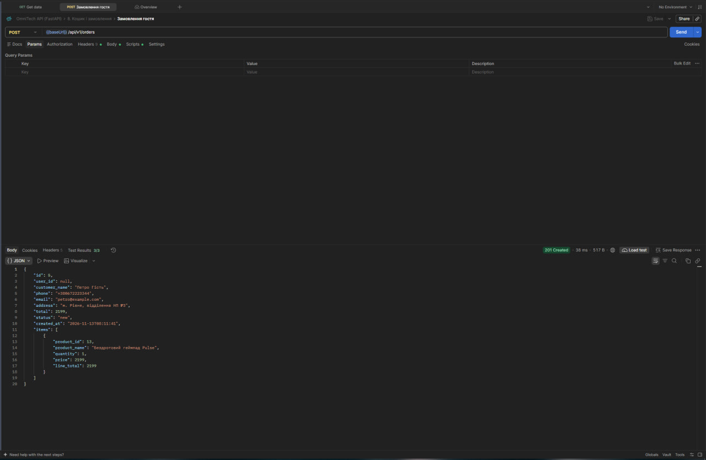

**Видалення товару із замовлення** → 409 (Андрій):

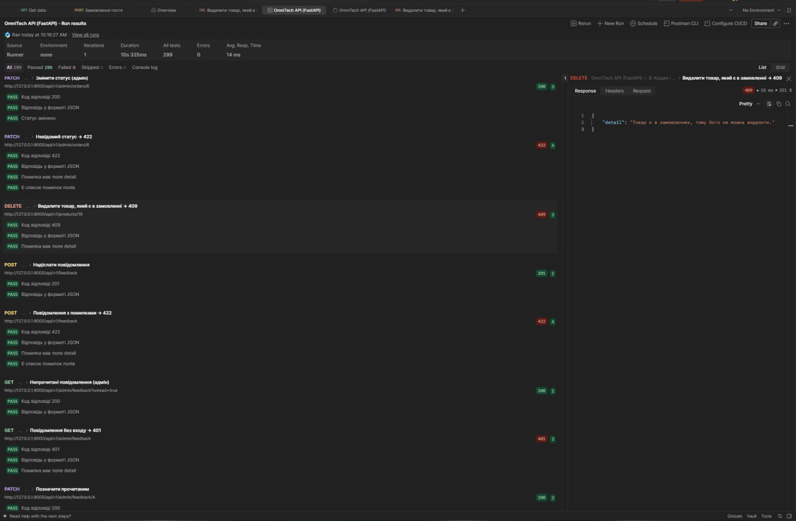

**Прогін усієї колекції** в Collection Runner (Андрій):

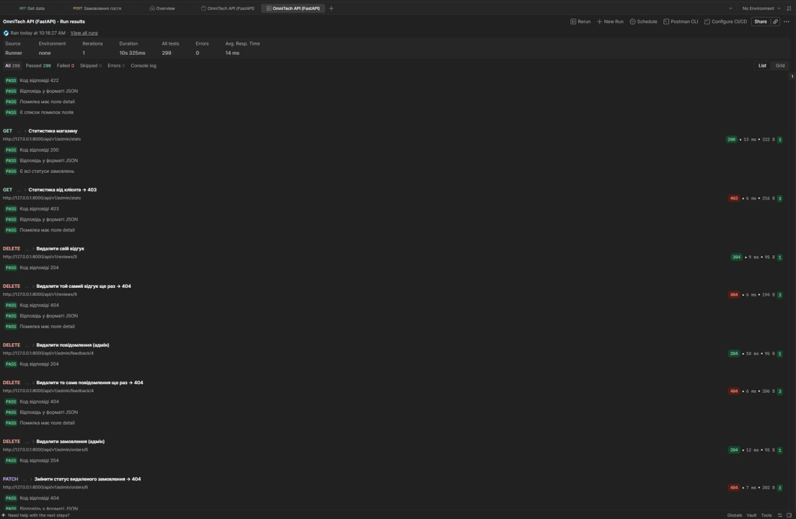

## Внесок учасників (лабораторна 05)

| Учасник | PR | Що зроблено | Звіт |
|---|---|---|---|
| Дмитрук Назар | [#15](https://github.com/Hyrysake/omnitech/pull/15) | перехід на FastAPI, налаштування, база, формат помилок, вхід (JWT), профіль, адмін-користувачі, демо-дані, README | [lab05-report-dmytruk.md](lab-reports/lab05-report-dmytruk.md) |
| Бардюк Станіслав | [#16](https://github.com/Hyrysake/omnitech/pull/16) | категорії, товари (пошук, фільтри, сторінки), картинки, відгуки й модерація, список бажань, API v2 | [lab05-report-bardiuk.md](lab-reports/lab05-report-bardiuk.md) |
| Махнюк Андрій | [#17](https://github.com/Hyrysake/omnitech/pull/17) | кошик, замовлення й історія, зворотний зв'язок, адмін-замовлення, статистика, колекція Postman | [lab05-report-makhniuk.md](lab-reports/lab05-report-makhniuk.md) |

## Висновки (лабораторна 05)

- Ми перевели OmniTech з сайту, який сам будує HTML, на REST API: дані тепер віддаються в JSON, і їх може використати будь-який клієнт. Першим таким клієнтом стане фронтенд у лабораторній 06.
- FastAPI і Pydantic перевіряють дані за схемами та будують документацію `/docs` прямо з коду, тож документація не відстає від API.
- Єдиний формат помилок, одна перевірка входу й одна пагінація для всіх частин зробили API передбачуваним: клієнт обробляє будь-яку відповідь одним кодом.
- Дві версії API показали, як змінювати формат відповіді, не ламаючи тих, хто вже користується старим.
- Колекція Postman з успішним запитом і запитом з помилкою для кожної операції стала нашою перевіркою кожного PR.

## Лабораторна 06: редизайн і розподіл роботи

### Дизайн, теми й доступність
- **Дві теми** — світла й темна. За замовчуванням береться тема системи, перемикач у шапці її змінює, вибір зберігається. Скрипт `boot.inline.js` у `<head>` ставить тему до першого малювання, тому сторінка не «блимає».
- **Той самий колір і шрифти**: тепле каміння й золото, Cormorant для заголовків, Montserrat для тексту.
- **Меню на весь екран** — елемент `<dialog>`: Esc закриває, фокус не виходить за межі меню, решта сторінки неактивна.
- **Ефекти** (докладніше в розділі «Ефекти і рух»): заставка з лічильником 0 → 100, золоті контурні лінії на тлі, права смужка прокручування, золоті лінії, що малюються прокруткою, поява тексту по словах, закріплена розповідь, золота шторка між сторінками, ілюстрації товарів із ліній. Ідеї взято з чотирьох сайтів (santalarch.com, landonorris.com, lusion.co, noomoagency.com), але без 3D-об'єктів, підпису від руки й тексту, що біжить. Усе вимикається перемикачем «Рух» і системним `prefers-reduced-motion`.
- **Швидкість**: жодних скриптів із чужих серверів, кожна сторінка вантажить лише свій код, GSAP і Lenis (близько 50 КБ у gzip) завантажуються окремим файлом після першого малювання. Вимог до швидкості в лабораторній немає, і ефекти її трохи знижують (див. результати тестування).
- **Доступність**: посилання «Перейти до вмісту», помітна рамка фокуса, підписи до кожного поля, `aria-live` для лічильників і помилок, контраст не нижчий за WCAG AA в обох темах, цілі натискання від 44 px; прикраси мають `aria-hidden`.

### Хто що зробив
Кожна людина змінює лише свої файли, тому злиття у `main` можливе в будь-якому порядку. Спільне (дизайн-система, шапка, підвал, ефекти, вхідний скрипт `boot.inline.js`, клієнт API, сховища, вхід, спільні компоненти) лежить у базовому стані `lab06-base`.

| Учасник | Файли |
|---|---|
| Дмитрук Назар | `index.html`, `catalog.html`, `product.html`, `wishlist.html`, `admin/reviews.html`, їхні модулі в `src/pages`, `src/ui/floating-filters.js`, `src/ui/review-form.js` |
| Бардюк Станіслав | `register.html`, `profile.html`, `admin/products.html`, `admin/product.html`, `admin/categories.html`, `admin/users.html`, їхні модулі |
| Махнюк Андрій | `about.html`, `faq.html`, `contacts.html`, `cart.html`, `checkout.html`, `order-done.html`, `orders.html`, `order.html`, `admin/orders.html`, `admin/order.html`, `admin/feedback.html`, їхні модулі |

Особисті звіти: `lab-reports/lab06-report-dmytruk.md`, `lab-reports/lab06-report-bardiuk.md`, `lab-reports/lab06-report-makhniuk.md`.
