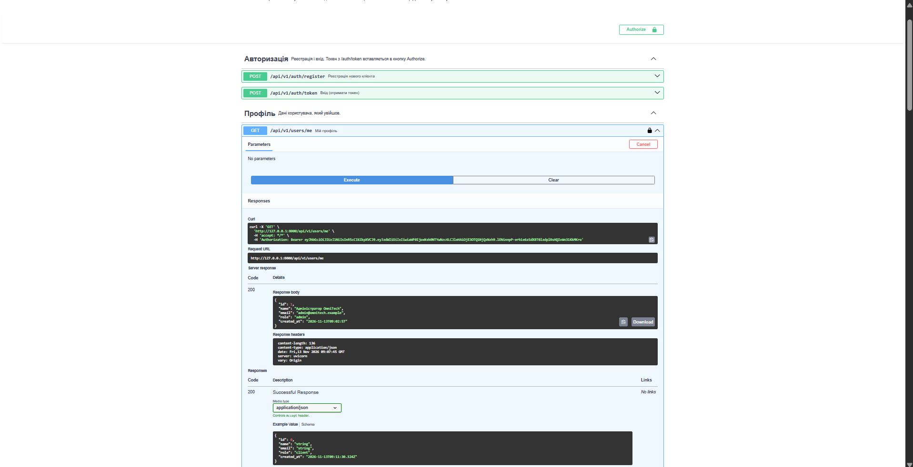

# OmniTech — інтернет-магазин техніки

Навчальний командний проєкт з дисципліни «Основи програмної інженерії».
Починаючи з лабораторної 05, OmniTech — це **REST API на FastAPI** (папка `backend/`). Клієнтську частину на Vite + JavaScript (папка `frontend/`) додає лабораторна 06.
Версії сайту на Flask з лабораторних 03 і 04 збережено в історії Git, позначки `lab03` і `lab04`.

## Команда

| Учасник | Роль | GitHub | Частина API (лабораторна 05) |
|---|---|---|---|
| Дмитрук Назар | Team Lead | [@Hyrysake](https://github.com/Hyrysake) | основа: налаштування, база, вхід (JWT), профіль |
| Бардюк Станіслав | QA | [@st009bar-dot](https://github.com/st009bar-dot) | каталог, відгуки, список бажань, картинки, API v2 |
| Махнюк Андрій | Developer | [@rotterdamsterdam](https://github.com/rotterdamsterdam) | кошик, замовлення, зворотний зв'язок, адмін-статистика, Postman |

## Технології

| Що | Чим | Навіщо |
|---|---|---|
| Вебфреймворк | FastAPI | маршрути, перевірка даних, автоматична документація `/docs` |
| Сервер | Uvicorn | запускає застосунок FastAPI (ASGI-сервер) |
| Перевірка даних | Pydantic v2 | схеми запитів і відповідей, усі помилки полів разом (422) |
| База даних | SQLite + SQLAlchemy 2.0 (ORM) | таблиці як класи Python; перейти на PostgreSQL — змінити одну адресу |
| Налаштування | pydantic-settings, файл `.env` | секретний ключ і адреси не пишуться в коді |
| Вхід | OAuth2 + JWT (PyJWT), паролі argon2 (pwdlib) | вхід без сесій на сервері: токен у заголовку `Authorization` |
| Картинки | python-multipart, Pillow | завантаження файлів і перевірка, що це справді картинка |
| Тестування API | Postman | колекція `backend/postman/postman_collection.json` |

## Як запустити

Потрібен Python 3.11 або новіший. Усі команди — у терміналі VS Code, з папки `backend`:

```powershell
cd backend
python -m venv .venv
.venv\Scripts\activate
pip install -r requirements.txt
```

Файл налаштувань `backend/.env` із власним секретним ключем (у Git не потрапляє; зразок усіх налаштувань — `.env.example`):

```powershell
python -c "import secrets; open('.env', 'w').write('SECRET_KEY=' + secrets.token_urlsafe(32) + chr(10))"
```

Демо-дані й запуск:

```powershell
python -m app.seed --reset
uvicorn app.main:app --reload
```

- API: <http://127.0.0.1:8000/api/v1/products>
- Документація (Swagger UI): <http://127.0.0.1:8000/docs>, альтернативний вигляд: <http://127.0.0.1:8000/redoc>

**Демо-акаунти** (створює `python -m app.seed`):

| Роль | Пошта | Пароль |
|---|---|---|
| Адміністратор | `admin@omnitech.example` | `admin123` |
| Клієнт | `client@omnitech.example` | `client123` |

**Як увійти в `/docs`:** кнопка **Authorize** → пошта в полі `username`, пароль у полі `password` → **Authorize**. Після цього кожен запит із `/docs` надсилає токен сам.

## Структура бекенду

```text
backend/
├── app/
│   ├── main.py            застосунок: CORS, обробники помилок, підключення маршрутів, /media
│   ├── api/
│   │   ├── router.py      усі адреси API в одному місці (/api/v1, /api/v2)
│   │   └── deps.py        залежності: сесія бази, поточний користувач, адмін, сторінки
│   ├── core/              налаштування, безпека (хеші, JWT), помилки, спільні перевірки
│   ├── db/                підключення до бази, базовий клас моделей, пагінація
│   ├── models/            таблиці бази (класи SQLAlchemy)
│   ├── schemas/           що API приймає і віддає (класи Pydantic)
│   ├── services/          логіка: що саме робити з даними (без HTTP)
│   ├── routers/           ендпоінти: v1/ і v2/
│   └── seed/              демонстраційні дані (python -m app.seed)
├── postman/               колекція Postman і картинка для тесту завантаження
├── data/                  файл бази omnitech.db (у Git не потрапляє)
├── media/                 завантажені картинки (у Git не потрапляють)
├── requirements.txt
└── .env.example           зразок налаштувань; справжній .env у Git не потрапляє
```

Запит проходить шари по черзі: **router** (адреса, коди відповіді) → **schema** (перевірка даних) → **service** (логіка) → **model** (база). Кожен шар знає лише про сусідній, тому код легко читати й перевіряти частинами.

## Ендпоінти

Усі адреси починаються з `/api`. 🔓 — доступно всім, 👤 — потрібен вхід, 🛡️ — лише адміністратор.

| Метод | Адреса | Доступ | Що робить | Коди |
|---|---|---|---|---|
| GET | `/api/health` | 🔓 | стан сервера й бази | 200, 503 |
| POST | `/api/v1/auth/register` | 🔓 | реєстрація клієнта | 201, 409, 422 |
| POST | `/api/v1/auth/token` | 🔓 | вхід (форма OAuth2), повертає токен | 200, 401, 422 |
| GET | `/api/v1/users/me` | 👤 | мій профіль | 200, 401 |
| PATCH | `/api/v1/users/me` | 👤 | змінити ім'я чи пошту | 200, 401, 409, 422 |
| POST | `/api/v1/users/me/password` | 👤 | змінити пароль | 204, 400, 401, 422 |
| DELETE | `/api/v1/users/me` | 👤 | видалити свій акаунт | 204, 401, 409 |
| GET | `/api/v1/admin/users` | 🛡️ | користувачі (сторінками, пошук `q`) | 200, 401, 403, 422 |
| GET | `/api/v1/categories` | 🔓 | категорії з кількістю товарів | 200 |
| POST | `/api/v1/categories` | 🛡️ | нова категорія | 201, 401, 403, 409, 422 |
| PATCH | `/api/v1/categories/{id}` | 🛡️ | перейменувати | 200, 401, 403, 404, 409, 422 |
| DELETE | `/api/v1/categories/{id}` | 🛡️ | видалити порожню категорію | 204, 401, 403, 404, 409 |
| GET | `/api/v1/products` | 🔓 | каталог: `q`, `category_id`, `min_price`, `max_price`, `featured`, `sort`, `page`, `size` | 200, 400, 422 |
| GET | `/api/v1/products/{id}` | 🔓 | один товар | 200, 404 |
| POST | `/api/v1/products` | 🛡️ | новий товар (+ заголовок `Location`) | 201, 401, 403, 422 |
| PUT | `/api/v1/products/{id}` | 🛡️ | замінити товар повністю | 200, 401, 403, 404, 422 |
| PATCH | `/api/v1/products/{id}` | 🛡️ | змінити частину полів | 200, 401, 403, 404, 422 |
| DELETE | `/api/v1/products/{id}` | 🛡️ | видалити товар | 204, 401, 403, 404, 409 |
| POST | `/api/v1/products/{id}/image` | 🛡️ | завантажити картинку (multipart, поле `file`) | 200, 401, 403, 404, 413, 415, 422 |
| DELETE | `/api/v1/products/{id}/image` | 🛡️ | прибрати картинку | 204, 401, 403, 404 |
| GET | `/api/v1/products/{id}/reviews` | 🔓 | відгуки про товар (сторінками) | 200, 404 |
| POST | `/api/v1/products/{id}/reviews` | 👤 | залишити відгук (один на товар) | 201, 401, 404, 409, 422 |
| PATCH | `/api/v1/reviews/{id}` | 👤 | змінити свій відгук | 200, 401, 403, 404, 422 |
| DELETE | `/api/v1/reviews/{id}` | 👤 | видалити відгук (автор або адмін) | 204, 401, 403, 404 |
| GET | `/api/v1/admin/reviews` | 🛡️ | усі відгуки для модерації | 200, 401, 403 |
| GET | `/api/v1/users/me/wishlist` | 👤 | мій список бажань | 200, 401 |
| PUT | `/api/v1/users/me/wishlist/{product_id}` | 👤 | додати товар до списку | 204, 401, 404 |
| DELETE | `/api/v1/users/me/wishlist/{product_id}` | 👤 | прибрати товар зі списку | 204, 401 |
| GET | `/api/v2/products` | 🔓 | каталог v2 (ті самі параметри) | 200, 400, 422 |
| GET | `/api/v2/products/{id}` | 🔓 | один товар v2 | 200, 404 |
| POST | `/api/v1/cart/preview` | 🔓 | порахувати кошик за актуальними цінами | 200, 422 |
| POST | `/api/v1/orders` | 🔓/👤 | оформити замовлення (гість або користувач) | 201, 401, 404, 422 |
| GET | `/api/v1/users/me/orders` | 👤 | мої замовлення | 200, 401 |
| GET | `/api/v1/users/me/orders/{id}` | 👤 | одне моє замовлення | 200, 401, 404 |
| POST | `/api/v1/feedback` | 🔓 | повідомлення з форми «Контакти» | 201, 422 |
| GET | `/api/v1/admin/orders` | 🛡️ | усі замовлення (фільтр `status`) | 200, 401, 403, 422 |
| GET | `/api/v1/admin/orders/{id}` | 🛡️ | одне замовлення | 200, 401, 403, 404 |
| PATCH | `/api/v1/admin/orders/{id}` | 🛡️ | змінити статус | 200, 401, 403, 404, 422 |
| DELETE | `/api/v1/admin/orders/{id}` | 🛡️ | видалити замовлення | 204, 401, 403, 404 |
| GET | `/api/v1/admin/feedback` | 🛡️ | повідомлення (фільтр `unread`) | 200, 401, 403 |
| PATCH | `/api/v1/admin/feedback/{id}` | 🛡️ | позначити прочитаним | 200, 401, 403, 404, 422 |
| DELETE | `/api/v1/admin/feedback/{id}` | 🛡️ | видалити повідомлення | 204, 401, 403, 404 |
| GET | `/api/v1/admin/stats` | 🛡️ | статистика магазину | 200, 401, 403 |

## Вхід і права

- `POST /api/v1/auth/token` приймає форму (`username` = пошта, `password`) і повертає **JWT** — підписаний рядок з номером користувача, роллю й терміном дії (60 хв).
- Клієнт надсилає токен з кожним запитом: `Authorization: Bearer <токен>`. Сервер нічого не зберігає між запитами (stateless): він лише перевіряє підпис і термін.
- Немає токена або він недійсний → **401**. Токен правильний, але роль не та → **403**.
- Виходу на сервері немає: щоб вийти, клієнт просто видаляє токен.
- Паролі зберігаються лише як хеш argon2. Для неправильної пошти й неправильного пароля відповідь однакова.

## Помилки

Будь-яка помилка має той самий формат:

```json
{
  "detail": "Дані не пройшли перевірку.",
  "errors": [
    {"field": "price", "message": "Має бути більше за 0."},
    {"field": "name", "message": "Мінімальна довжина — 3 симв."}
  ]
}
```

`errors` є лише тоді, коли помилка стосується конкретних полів. Усі помилки полів повертаються разом, тож клієнт виправляє все за один раз.

| Код | Коли |
|---|---|
| 200 / 201 / 204 | успіх / створено (з `Location`) / успіх без тіла |
| 400 | дію виконати не можна (неправильний поточний пароль, мінімальна ціна більша за максимальну) |
| 401 | потрібно увійти |
| 403 | недостатньо прав |
| 404 | запису немає (або чуже замовлення) |
| 405 | метод не підтримується для адреси |
| 409 | конфлікт з даними: пошта зайнята, другий відгук, товар у замовленнях, категорія з товарами |
| 413 / 415 | файл завеликий / не картинка |
| 422 | дані не пройшли перевірку |
| 500 | помилка сервера (подробиці лише в журналі сервера) |

## Валідація

- **Типи й формат** перевіряє Pydantic за схемами в `app/schemas/`. Ціни, оцінки, кількості й номери приймаються лише справжніми цілими числами JSON: `"100"`, `12.5` і `true` не пройдуть.
- **Правила з форм сайту** (лабораторна 04): ім'я від 2 символів, пароль від 6, телефон 10–13 цифр, адреса доставки від 5, назва товару від 3, опис до 1000, відгук від 5 до 1000 символів, повідомлення від 10 до 2000.
- Пробіли на початку й у кінці рядків відрізаються. **Невідоме поле — помилка**, тож одруківку (`prise` замість `price`) видно одразу.
- **Перевірки в базі:** існування категорії, унікальність пошти й назви категорії, один відгук на товар. Обмеження `CHECK`, `UNIQUE` і зовнішні ключі є й у самій базі, як останній рубіж.
- **Картинки:** лише JPEG, PNG або WebP до 5 МБ. Тип визначається за вмістом файлу (Pillow), а не за назвою. Ім'я файлу генерує сервер.

## Версії API

`/api/v1` і `/api/v2` працюють одночасно. v2 змінює формат товару, тому це окрема версія, а не правка v1:

| | v1 | v2 |
|---|---|---|
| категорія | `"category_id": 1` | `"category": {"id": 1, "name": "Ноутбуки"}` |
| рейтинг | окремим запитом до відгуків | `"rating": {"average": 4.5, "count": 2}` у кожному товарі |

Клієнти, написані під v1, працюють без змін.

## Тестування в Postman

Колекція: `backend/postman/postman_collection.json` (102 запити в 11 папках).
- **Імпорт:** Postman → Import → файл колекції.
- **Запуск:** запустіть сервер на свіжій базі (`python -m app.seed --reset`), потім Run collection.
- Для 41 з 43 операцій є і успішний запит, і запит з помилкою (400, 401, 403, 404, 409 або 422). Дві операції — `GET /api/health` і `GET /api/v1/categories` — не мають ні параметрів, ні тіла, тож клієнт не може в них помилитися; для їхніх адрес перевіряється 405 (непідтримуваний метод).
- Окремо перевіряються права: чужий відгук (403), чуже замовлення (404), токен видаленого акаунта (401).
- Токени після входу зберігаються в змінних колекції (`adminToken`, `clientToken`), запити з ними беруть їх самі.
- Остання папка прибирає створені записи, тож колекцію можна запускати повторно.
- Тест завантаження картинки бере файл `sample.png` з тієї самої папки.

## Результати тестування

| Що | Як | Результат |
|---|---|---|
| Колекція Postman | **Run collection** на свіжій базі | 102 запити, 299 перевірок, 0 помилок |
| Повторний прогін | ще раз на тій самій базі, без скидання | 0 помилок: папка «Прибирання» повертає базу до початкового стану |
| Документація | `/docs`, вхід через **Authorize**, **Try it out** | 43 операції в 12 розділах; вхід і запити з токеном працюють |
| Рев'ю | кожен PR перевіряв інший учасник за чеклістом | #15 — Станіслав, #16 — Андрій, #17 — Назар |

## Знімки екрана

**Документація `/docs`** після входу: `GET /users/me` повертає адміністратора (Назар):



**Помилка перевірки даних:** реєстрація з неправильними полями → 422, усі помилки разом (Назар):


**Пошук у каталозі** в Postman: `?q=ноутбук&size=2` (Станіслав):


**API v2:** категорія й рейтинг усередині товару (Станіслав):


**Завантаження картинки** через `/docs` (Станіслав):


**Замовлення гостя** в Postman: 201 (Андрій):


**Видалення товару із замовлення** → 409 (Андрій):


**Прогін усієї колекції** в Collection Runner (Андрій):


## Внесок учасників

| Учасник | PR | Що зроблено | Звіт |
|---|---|---|---|
| Дмитрук Назар | [#15](https://github.com/Hyrysake/omnitech/pull/15) | перехід на FastAPI, налаштування, база, формат помилок, вхід (JWT), профіль, адмін-користувачі, демо-дані, README | [lab05-report-dmytruk.md](lab-reports/lab05-report-dmytruk.md) |
| Бардюк Станіслав | [#16](https://github.com/Hyrysake/omnitech/pull/16) | категорії, товари (пошук, фільтри, сторінки), картинки, відгуки й модерація, список бажань, API v2 | [lab05-report-bardiuk.md](lab-reports/lab05-report-bardiuk.md) |
| Махнюк Андрій | [#17](https://github.com/Hyrysake/omnitech/pull/17) | кошик, замовлення й історія, зворотний зв'язок, адмін-замовлення, статистика, колекція Postman | [lab05-report-makhniuk.md](lab-reports/lab05-report-makhniuk.md) |

## Висновки

- Ми перевели OmniTech з сайту, який сам будує HTML, на REST API: дані тепер віддаються в JSON, і їх може використати будь-який клієнт. Першим таким клієнтом стане фронтенд у лабораторній 06.
- FastAPI і Pydantic перевіряють дані за схемами та будують документацію `/docs` прямо з коду, тож документація не відстає від API.
- Єдиний формат помилок, одна перевірка входу й одна пагінація для всіх частин зробили API передбачуваним: клієнт обробляє будь-яку відповідь одним кодом.
- Дві версії API показали, як змінювати формат відповіді, не ламаючи тих, хто вже користується старим.
- Колекція Postman з успішним запитом і запитом з помилкою для кожної операції стала нашою перевіркою кожного PR.
