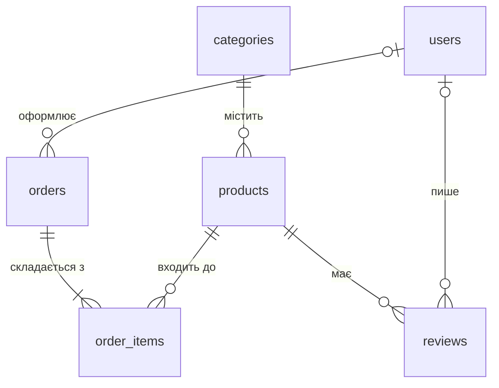

# OmniTech

> Вебсайт магазину електроніки на Flask із базою даних SQLite: каталог з пошуком і фільтрами, акаунти з ролями, адмін-панель, відгуки, кошик і замовлення, відгуки покупців про товари.

Навчальний командний проєкт з дисципліни «Основи програмної інженерії», група ІПЗ-22. Лабораторна робота 04 «Реалізація бази даних для вебпроєкту». Сторінки з лабораторної 03 (головна, «Про нас», «Контакти», «Часті питання») тепер працюють поверх бази даних: товари, категорії, користувачі й замовлення зберігаються в ній, а не в списках у коді.

## Технології

- **Python 3.12+** і **Flask** — сервер і маршрути сторінок;
- **SQLite** через вбудований модуль `sqlite3` — база даних одним файлом, без окремого сервера; запити пишемо мовою SQL вручну;
- **Jinja2** — шаблони сторінок із наслідуванням від спільного `base.html`;
- **Tailwind CSS 4** (через CDN) — оформлення та адаптивність без окремого CSS-файлу.

## Запуск

Команди для терміналу VS Code (Windows, PowerShell), у теці проєкту:

```
python -m venv .venv
.venv\Scripts\activate
pip install -r requirements.txt
python app.py
```

Сайт відкривається за адресою <http://127.0.0.1:5000>. Зупинити сервер — `Ctrl+C` у терміналі.

Базу створювати вручну не потрібно: під час першого запуску з'являється файл `db.sqlite`, у ньому створюються таблиці зі `schema.sql` і заповнюються початковими даними з `seed_data.py`. Файл `db.sqlite` не потрапляє в git (він описаний у `.gitignore`), у кожного учасника команди своя копія. Щоб почати з чистої бази, зупиніть сервер, видаліть `db.sqlite` і запустіть `python app.py` ще раз.

## Демонстраційні акаунти

Ці акаунти створюються разом з базою, щоб викладач і команда могли одразу перевірити ролі:

| Роль | Пошта | Пароль | Що доступно |
|---|---|---|---|
| Адміністратор | `admin@omnitech.example` | `admin123` | усе, включно з адмін-панеллю (`/admin`) |
| Клієнт | `client@omnitech.example` | `client123` | каталог, власний акаунт; адмін-панель закрита (помилка 403) |

> Паролі лежать у відкритому репозиторії, тому годяться лише для навчання. У справжньому магазині адміністратора створюють окремо, а пароль не потрапляє в код.

## Структура

```
omnitech/
  app.py                 застосунок Flask: підключення бази, blueprint-и, головна та статичні сторінки
  db.py                  з'єднання з SQLite, створення таблиць і початкових даних
  schema.sql             структура бази: таблиці, ключі, обмеження
  seed_data.py           початкові дані: категорії, товари, демо-акаунти, відгуки, замовлення й відгуки про товари
  validators.py          спільні перевірки введених даних
  security.py            хто зараз увійшов і хто має доступ до адмін-панелі
  requirements.txt       залежності (pip freeze)
  models/                SQL-запити, по одному файлу на частину бази
    catalog.py             товари й категорії: показ, пошук, фільтри
    users.py               реєстрація й перевірка паролів
    catalog_admin.py       зміна товарів і категорій (для адмін-панелі)
    feedback.py            відгуки з форми «Контакти»
    orders.py              замовлення та їхні рядки
    reviews.py             відгуки покупців про товари: оцінки, збереження, середня оцінка
  routes/                маршрути, згруповані в blueprint-и
    shop.py                каталог і сторінка товару
    auth.py                реєстрація, вхід, вихід
    admin.py               адмін-панель: огляд
    admin_catalog.py       адмін-панель: товари й категорії
    admin_feedback.py      адмін-панель: відгуки
    admin_orders.py        адмін-панель: замовлення
    cart.py                кошик і оформлення замовлення
    reviews.py             відгуки про товар: додати, змінити, видалити
    admin_reviews.py       адмін-панель: модерація відгуків про товари
  templates/             HTML-шаблони (спільний каркас base.html + сторінки)
    admin/                 шаблони адмін-панелі
  lab-reports/           звіти учасників команди
```

## База даних

| Таблиця | Що зберігає |
|---|---|
| `categories` | категорії товарів |
| `products` | товари; кожен належить до однієї категорії |
| `users` | користувачі: пошта, хеш пароля, роль (`admin` або `client`) |
| `feedback` | відгуки з форми на сторінці «Контакти» |
| `orders` | замовлення: контакти покупця, сума, статус |
| `order_items` | рядки замовлення: який товар, скільки штук, за якою ціною |
| `reviews` | відгуки покупців про товари: оцінка від 1 до 5, текст, автор |

Зв'язки між таблицями:



Гість без акаунта теж може оформити замовлення, тому `orders.user_id` може бути порожнім. Ціна в `order_items` — це ціна на момент покупки: пізніша зміна ціни товару не переписує старі замовлення.

Один користувач залишає про товар один відгук: повторна відправка форми змінює вже написаний (у таблиці це `UNIQUE (product_id, user_id)`). Видалення товару прибирає і його відгуки (`ON DELETE CASCADE`), а видалення акаунта лишає відгук, бо ім'я автора зберігається в самому відгуку (`ON DELETE SET NULL`).

## Сторінки

| Адреса | Сторінка | Що на ній |
|---|---|---|
| `/` | Головна | банер, переваги магазину, популярні товари з бази |
| `/about` | Про нас | історія магазину, цінності, команда проєкту |
| `/contacts` | Контакти | адреса, телефон, email, графік роботи, карта, форма відгуку |
| `/faq` | Часті питання | питання й відповіді, що розгортаються по кліку |
| `/shop` | Каталог | пошук за назвою, фільтр за категорією й ціною, сортування |
| `/product/<номер>` | Товар | фото, ціна, опис, середня оцінка, відгуки покупців із формою, схожі товари |
| `/register`, `/login` | Реєстрація і вхід | акаунт клієнта, вхід за поштою й паролем |
| `/admin` | Адмін-панель | лише для ролі `admin`: товари й категорії (створення, зміна, видалення) |
| `/admin/feedback` | Відгуки | перегляд, позначка «прочитано», видалення |
| `/cart`, `/checkout` | Кошик і замовлення | кошик у сесії, оформлення без обов'язкової реєстрації |
| `/admin/orders` | Замовлення | список зі статусами, зміна статусу, видалення |
| `/admin/reviews` | Відгуки про товари | перегляд усіх відгуків покупців, видалення |

## Команда

| Учасник | Роль | Внесок у лабораторну 04 |
|---|---|---|
| Дмитрук Назар ([@Hyrysake](https://github.com/Hyrysake)) | Team Lead | база даних (`db.py`, `schema.sql`, `seed_data.py`), товари й категорії, каталог із пошуком і фільтрами, сторінка товару, відгуки покупців про товари (оцінки, форма на сторінці товару, модерація в адмін-панелі) |
| Бардюк Станіслав ([@st009bar-dot](https://github.com/st009bar-dot)) | QA | користувачі й ролі, реєстрація та вхід, адмін-панель для товарів і категорій |
| Махнюк Андрій ([@rotterdamsterdam](https://github.com/rotterdamsterdam)) | Developer | форма відгуків і її модерація, кошик, оформлення замовлень, керування замовленнями в адмін-панелі |
