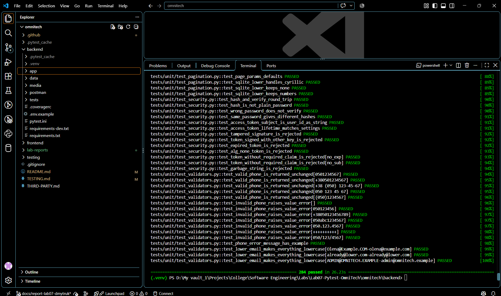
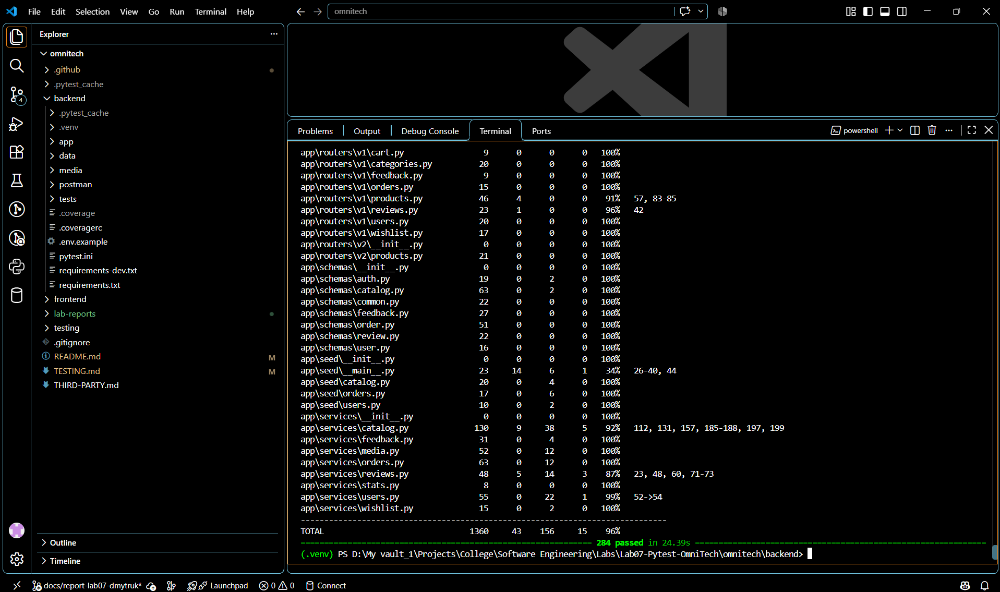

# Тестування OmniTech API

Автоматичні тести бекенду (FastAPI) на **pytest**: unit тести перевіряють окремі функції без бази й мережі, integration тести надсилають запити до API і перевіряють відповідь разом з базою даних.

## Як запустити

З папки `backend/`, з активованим віртуальним середовищем:

```
pip install -r requirements-dev.txt
pytest
```

| Команда | Що робить |
|---|---|
| `pytest` | усі тести |
| `pytest -v` | назва й результат кожного тесту |
| `pytest tests/unit` | лише unit тести (без бази, найшвидші) |
| `pytest tests/integration` | лише integration тести |
| `pytest -k wishlist` | лише тести, у назві яких є `wishlist` |
| `pytest --cov=app --cov-report=term-missing` | тести + покриття коду (які рядки не виконувались) |

Файл `.env` для тестів не потрібен: `tests/conftest.py` сам задає тестовий `SECRET_KEY` і тимчасову базу. Робоча база `backend/data/omnitech.db` під час тестів не змінюється.

Ті самі тести запускає **GitHub Actions** (`.github/workflows/tests.yml`) після кожного push у `main` і в кожному Pull Request.

## Як влаштовано

```
backend/
├── pytest.ini              # де шукати тести, корінь імпортів
├── .coveragerc             # що враховувати в покритті
├── requirements-dev.txt    # pytest, pytest-cov, httpx2
└── tests/
    ├── conftest.py         # спільні fixtures: тестова база, клієнт, користувачі, товари
    ├── unit/               # окремі функції, без бази й мережі
    └── integration/        # запити до API через TestClient + тестова база
```

- **Піраміда тестування.** За піраміди unit тестів має бути більше: вони швидкі й точно показують, яка функція зламалась. Integration тести повільніші, але перевіряють, що маршрут, перевірка даних, сервіс і база працюють разом. У нас integration тестів трохи більше, ніж unit; чому так, пояснено в розділі «Результат запуску».
- **Окрема тестова база.** `conftest.py` ще до імпорту застосунку направляє `DATABASE_URL` у тимчасову папку. Fixture `db` перед **кожним** тестом видаляє й створює таблиці заново, тож тести не залежать один від одного й від порядку запуску.
- **Тестовий клієнт.** `TestClient(app)` надсилає запити застосунку напряму, без запуску `uvicorn`.
- **Тестові дані.** Fixtures-фабрики (`make_user`, `make_category`, `make_product`) створюють лише те, що потрібно конкретному тесту. `user_headers` і `admin_headers` дають готовий заголовок `Authorization: Bearer …`.
- **Швидкі паролі.** Справжній argon2 навмисно повільний. У тестах він працює з найлегшими параметрами: логіка та сама, а всі тести проходять за секунди.
- **Схема AAA.** Тест має три частини: **Arrange** (підготувати дані), **Act** (викликати функцію чи надіслати запит), **Assert** (перевірити результат). У тестах з кількома кроками частини позначено коментарями.
- **Параметризовані тести.** `@pytest.mark.parametrize` запускає той самий тест для кожного значення: так перевіряються граничні випадки (0, 1, максимум, максимум + 1, порожній рядок).

### Чому здебільшого 422, а не 400

У FastAPI неправильні дані запиту (не те поле, не той тип, порожній рядок, число поза межами) перевіряє Pydantic і повертає **422 Unprocessable Entity**: так влаштоване наше API з лабораторної 05. Код **400 Bad Request** лишився для запитів, які правильні за формою, але неможливі за змістом: мінімальна ціна більша за максимальну, неправильний поточний пароль. Тести перевіряють обидва випадки.

## Тести учасників

Таблиці всіх тестів — у файлах учасників: що саме перевіряє кожен тест і який результат очікується.

| Учасник | Що перевіряє | Файл |
|---|---|---|
| Дмитрук Назар | паролі й токени, перевірка полів, помилки, сторінки; вхід, профіль, користувачі в адмін-панелі, демо-дані | [TESTING-dmytruk.md](testing/TESTING-dmytruk.md) |
| Бардюк Станіслав | правила каталогу, картинки; категорії, товари, API v2, відгуки, список бажань | [TESTING-bardiuk.md](testing/TESTING-bardiuk.md) |
| Махнюк Андрій | сума й схеми замовлення; кошик, замовлення, адмін-замовлення, зворотний зв'язок, статистика | [TESTING-makhniuk.md](testing/TESTING-makhniuk.md) |

## Результат запуску

`pytest -v`:



| | Тестів | Автор |
|---|---|---|
| Unit | 138 | Назар 58, Станіслав 41, Андрій 39 |
| Integration | 146 | Назар 45, Станіслав 57, Андрій 44 |
| **Разом** | **284**, усі пройдено, близько 25 с | |

Кількість — разом з усіма значеннями параметризованих тестів (pytest рахує кожне окремо). У Назара 45 integration тестів: 43 у `test_auth`, `test_users`, `test_admin_users`, `test_seed` і 2 у `test_health` (вони є вже в базовій позначці `lab07-base`).

**Чому integration тестів трохи більше, ніж unit.** Більша частина логіки бекенду — це API: маршрут, перевірка даних, сервіс і база разом. Перевірити, що `DELETE` товару із замовлення дає 409, можна лише через базу. Окремі функції (паролі, токени, перевірки полів, правила каталогу, картинки, сторінки, підрахунок суми замовлення) покрито unit тестами повністю. Піраміду ми порушуємо свідомо й небагато: integration тести на тимчасовій SQLite швидкі, усі 146 проходять приблизно за 25 секунд.

## Покриття коду

`pytest --cov=app --cov-report=term-missing`:



| Частина | Покриття |
|---|---|
| `app/core` (налаштування, паролі, токени, помилки, перевірки) | 92–100 % |
| `app/db` (сесія, сторінки) | 93–100 % |
| `app/schemas` | 100 % |
| `app/services` (вхід, користувачі, каталог, картинки, відгуки, список бажань, замовлення, зворотний зв'язок, статистика) | 87–100 % |
| `app/routers` (усі маршрути) | 85–100 % |
| **Усього `app/`** | **96 %** (з урахуванням гілок `if`) |

Що лишилось неперевіреним і чому:
- `app/seed/__main__.py` (34 %) — команда `python -m app.seed` для запуску вручну. Самі функції заповнення перевіряє `test_seed.py`.
- `routers/health.py`, рядки 18–19 — відповідь 503, коли база недоступна. Щоб її отримати, треба зламати з'єднання з базою посеред тесту.
- `core/errors.py`, рядки 159–167 — відповідь 500 на непередбачену помилку. Її поява означала б помилку в нашому коді, а не сценарій для тесту.
- кілька рядків `services/catalog.py` (92 %) і `services/reviews.py` (87 %) — рідкісні гілки пошуку й модерації.

GitHub Actions перевіряє покриття в кожному PR: якщо воно впаде нижче 80 %, перевірка стане червоною.

100 % покриття не означало б, що помилок немає: покриття показує лише, що рядок виконався, а не що результат перевірили правильно. Тому в кожному тесті є `assert` з конкретним очікуваним значенням.

## Висновки

- 284 автоматичні тести перевіряють бекенд за 25 секунд однією командою `pytest`. Після кожної зміни видно, чи нічого не зламалось, ще до того, як зміна потрапить у `main`.
- Unit тести показали, що функції, які отримують дані й повертають результат (паролі, токени, перевірка полів, кількість сторінок, сума замовлення), найлегше тестувати. Тому підрахунок кількості сторінок (`page_count`) ми винесли з `paginate`, а суму замовлення (`order_total`) — з `services/orders.py` в окремі функції.
- Окрема тимчасова база для кожного тесту зробила тести незалежними: їх можна запускати в будь-якому порядку й скільки завгодно разів, а робоча база не змінюється.
- Негативні сценарії (401, 403, 404, 409, 413, 415, 422 і 400) перевірено так само ретельно, як успішні: саме в них найчастіше ховаються помилки безпеки.
- GitHub Actions запускає тести в кожному Pull Request, тож рев'юер бачить результат ще до того, як відкриє код.
