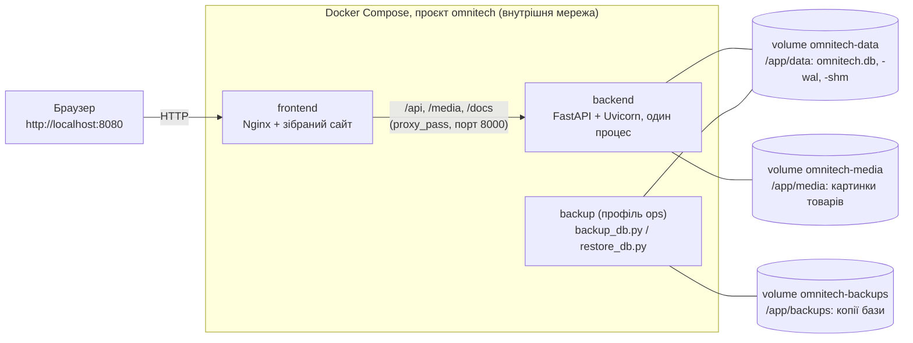

# Архітектура

## Схема

Назовні відкритий лише один порт: `HTTP_PORT` (за замовчуванням 8080) на сервісі `frontend`. Бекенд доступний тільки
з внутрішньої мережі Docker, тому до API і до бази не можна дістатися в обхід Nginx.

## Сервіси

| Сервіс | Образ | Що робить | Файл |
|---|---|---|---|
| `backend` | `omnitech-backend` (збирається з `backend/Dockerfile`) | API на FastAPI, база SQLite у volume | `compose/backend.yaml` |
| `frontend` | `omnitech-frontend` (збирається з `frontend/Dockerfile`) | Nginx: віддає сайт, пересилає `/api`, `/media`, `/docs` на `backend` | `compose/frontend.yaml` |
| `backup` | `omnitech-backup` (збирається прямо в `compose/ops.yaml`) | резервні копії й відновлення бази; запускається лише з профілем `ops` | `compose/ops.yaml` |

`compose.yaml` у корені лише збирає їх разом (`include:`) і оголошує три volume. Кожен сервіс має свій файл, тож
кожен учасник команди править свою частину й не заважає іншим.

## Образ бекенду (`backend/Dockerfile`)

- **Багатоетапна збірка.** Етап `builder` створює віртуальне середовище `/opt/venv` і ставить бібліотеки. У фінальний
  образ копіюється лише `/opt/venv` та код, без кешу pip. Обидва етапи на `python:3.13-slim` (Debian), щоб скомпільовані
  пакунки (argon2, pillow) були сумісні.
- **Кешування шарів.** Спершу копіюється тільки `requirements.txt` і ставляться бібліотеки, код (`COPY app ./app`) іде
  останнім. Після зміни коду Docker бере шар з бібліотеками з кешу (`CACHED`), тож перезбирання займає секунди.
- **Розмір.** Близько 248 МБ без стиснення (з них приблизно 176 МБ — сам `python:3.13-slim`). Зменшили так: `pip install --no-compile`
  (без `.pyc`, мінус ~27 МБ) і видалення `pip` з віртуального середовища (мінус ~13 МБ).
- **Користувач.** Процес працює не від root, а від `app` з uid 10001.
- **Запуск.** `ENTRYPOINT ["python", "-m", "app.entrypoint"]`: створює таблиці, за потреби заповнює порожню базу
  демо-даними і замінює себе на `uvicorn` (`os.execvp`). Uvicorn стає процесом з PID 1 і отримує сигнал зупинки від Docker.
  Порт береться зі змінної `PORT`.
- **Перевірка стану.** `HEALTHCHECK` звертається до `/api/health` самим Python (у slim-образі немає `curl`). Адреса
  повертає 503, якщо база недоступна, і тоді контейнер стає `unhealthy`.

## Образ сайту (`frontend/Dockerfile`)

Етапи: `deps` (`npm ci`) → `build` (`npm run build`) → фінальний `nginx:alpine`. У фінальному образі лише готовий
`dist/` і конфіг Nginx, без Node.js (~99 МБ). Змінна `VITE_API_URL` під час збирання порожня: сайт звертається до `/api/...`
на тій самій адресі, звідки його завантажили, тому CORS не потрібен. Є ще етап `dev` для `compose.dev.yaml`.

Конфіг Nginx (`frontend/nginx/default.conf`):

- сайт багатосторінковий (кожна сторінка — окремий `.html`), тому «запасної» головної сторінки немає: невідома адреса
  дає сторінку `404.html` зі статусом 404;
- `/api/`, `/media/`, `/docs`, `/openapi.json` пересилаються на `backend:8000`;
- адреса бекенду в `proxy_pass` задана змінною і є `resolver 127.0.0.11`: Nginx шукає адресу під час запиту, тож проксі
  не ламається, коли контейнер `backend` перестворено з новою IP-адресою;
- файли з `/assets/` кешуються на рік (в іменах є хеш), `client_max_body_size 6m` відповідає ліміту картинок бекенду.

## SQLite у контейнері

- **Named volume на ПАПЦІ `/app/data`, а не на файлі.** У режимі WAL SQLite створює поруч файли `omnitech.db-wal` і
  `omnitech.db-shm`; їм потрібна папка, у яку можна писати.
- **Права.** У Dockerfile папки `/app/data` і `/app/media` належать користувачу 10001. Коли Docker створює порожній volume
  на такій папці, він копіює власника з образу, тому застосунок може писати без `chmod 777`.
- **Без bind mount для бази.** На Windows, Mac і в WSL2 блокування файлів через спільні папки працюють ненадійно,
  а SQLite на них спирається. Bind mount використовується лише для коду в режимі розробки.
- **Один процес Uvicorn.** SQLite дозволяє одного писача за раз. Один процес не створює змагання за блокування.
- **Копії лише через `Connection.backup()`**, не копіюванням файлу (докладно: [backup.md](backup.md)).

## Запуск і порядок сервісів

`frontend` має `depends_on: backend: condition: service_healthy`: Nginx стартує, коли API вже відповідає. Команда
`docker compose up --wait` повертає керування, лише коли всі сервіси `healthy`. `restart: unless-stopped` піднімає контейнер
після збою (перевірено командою `docker compose exec backend sh -c "kill 1"`: лічильник перезапусків зростає, сервіс знову healthy),
але не піднімає, якщо його зупинили вручну.

## Режими prod і dev

| | Prod (`compose.yaml`) | Dev (`compose.dev.yaml`) |
|---|---|---|
| Сайт | Nginx зі зібраним `dist/` | сервер Vite, код з вашої папки, порт 5173 |
| API | код вбудований в образ, коренева система `read_only` | код з папки `backend/app` підключений bind mount, `uvicorn --reload` |
| Логи | `APP_ENV=production`: JSON | `APP_ENV=development`: читабельні, рівень DEBUG |
| Порти назовні | лише 8080 | 5173 (сайт) і 8000 (API) |
| Перезапуск | `unless-stopped` | вимкнено |

Dev-файли (`compose/backend.dev.yaml`, `compose/frontend.dev.yaml`) лише доповнюють робочі: `compose.dev.yaml`
підключає кожну пару через `include: - path: [основний, доповнення]`.

## Безпека контейнерів

Не від root; коренева файлова система лише для читання (`read_only: true`, для запису є томи й `tmpfs`); усі Linux-можливості
вимкнено (`cap_drop: [ALL]`), Nginx отримує лише потрібні чотири; `no-new-privileges`; секретний ключ береться з `.env`,
який не потрапляє в Git; порти бекенду не публікуються.

## Чому саме так

| Рішення | Причина |
|---|---|
| `python:3.13-slim`, а не alpine | у Alpine інша бібліотека C (musl), для pillow і argon2 немає готових пакунків, збірка довша й крихкіша |
| Nginx як reverse proxy | один порт і одна адреса для сайту й API, немає CORS, статику віддає Nginx швидко, а не Python |
| `include:` у `compose.yaml` | кожен сервіс у своєму файлі: менше конфліктів у Git, як у команді з трьох людей |
| Профіль `ops` для копій | копія потрібна за розкладом або перед ризикованою дією, а не при кожному `up` |
| JSON-логи у production | рядок легко шукати й обробляти (`docker compose logs backend`), а в dev зручніше читати очима |
| Один Uvicorn-процес | SQLite = один писач; для більшого навантаження потрібна клієнт-серверна база (PostgreSQL) |
