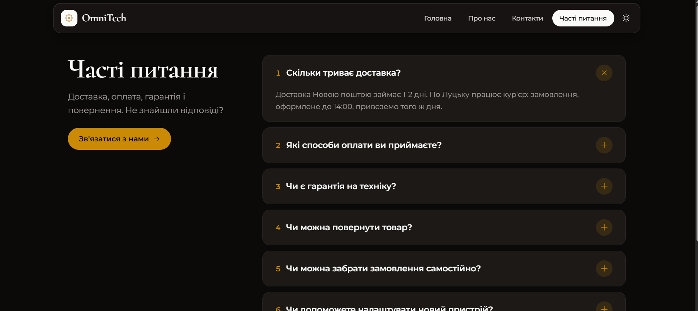
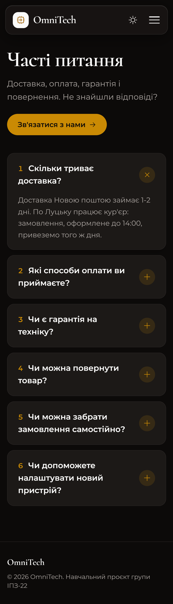
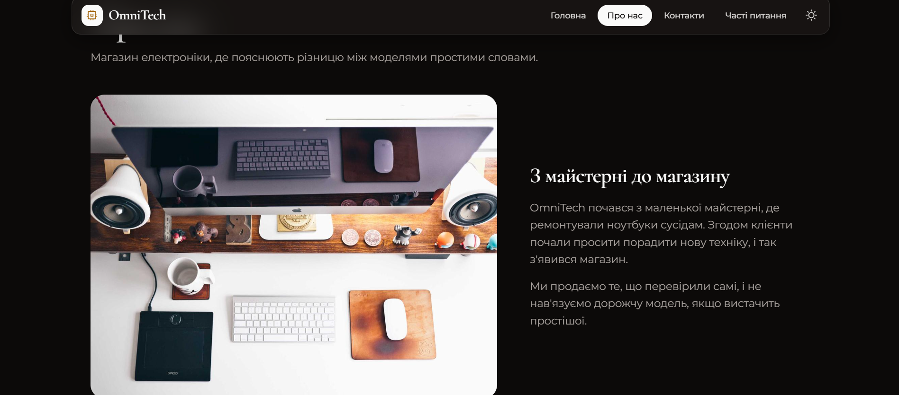

# Звіт з лабораторної роботи 03 «Розробка базового вебпроєкту»

## Загальні відомості

| | |
|---|---|
| **ПІБ** | Бардюк Станіслав Олександрович |
| **Група** | ІПЗ-22 |
| **Роль у команді** | QA |
| **Склад команди** | Дмитрук Назар (Team Lead), Махнюк Андрій (Developer), Бардюк Станіслав (QA) |
| **Тема проєкту** | OmniTech — вебсайт магазину електроніки |
| **Репозиторій** | <https://github.com/Hyrysake/omnitech> |

## Особистий внесок

Я розробив сторінку «Часті питання» і темну тему, а також перевіряв роботу сайту перед злиттям.

1. **Сторінка «Часті питання» (`templates/faq.html`, маршрут `/faq`):**
   - питання й відповіді зберігаються в `app.py` як список словників `FAQ` і передаються в шаблон;
   - цикл `` будує блок для кожного питання, а `loop.index` нумерує їх;
   - кожне питання — це HTML-елементи `
` і `
`: відповідь розгортається по кліку без JavaScript, а «+» повертається на 45° і стає хрестиком (`group-open:rotate-45`).
2. **Темна тема (`templates/base.html`):**
   - кнопка з іконкою місяця або сонця в меню; яку іконку показати, вирішує CSS (`dark:hidden`, `hidden dark:inline-block`); іконки з бібліотеки Phosphor;
   - правило `@custom-variant dark` перемикає Tailwind з теми операційної системи на клас `.dark`;
   - вибір користувача зберігається в `localStorage`, тому лишається на інших сторінках і після перезапуску браузера.
3. **Тестування (роль QA):** перевірив PR Назара (каркас і головна сторінка) перед схваленням. Запускав застосунок локально, проходив усі пункти меню, перевіряв мобільне меню й вигляд сторінок на ширині телефона в режимі пристроїв DevTools.

**Посилання:**
- мої коміти: <https://github.com/Hyrysake/omnitech/commits?author=st009bar-dot>
- мій Pull Request: <https://github.com/Hyrysake/omnitech/pull/3>

**Інструменти:** VS Code, Git, GitHub. Дизайн інтерфейсу і частину коду зроблено з допомогою AI (Claude), розібрано й перевірено мною.

## Скріншоти

Сторінка «Часті питання», звичайний і мобільний вигляд (одна відповідь розгорнута):

Темна тема:

## Труднощі та їх вирішення

- **Темна тема вмикалася сама.** Класи `dark:` були в шаблонах від початку, але в Tailwind 4 вони за замовчуванням реагують на тему Windows або телефона. Користувач не міг її перемкнути. Рядок `@custom-variant dark (&:where(.dark, .dark *));` змушує Tailwind реагувати на клас `.dark` на тегу `<html>`, а цим класом уже керує моя кнопка.
- **«Спалах» світлої теми.** Якщо перевіряти збережену тему скриптом у кінці сторінки, браузер спочатку малює світлу сторінку і лише потім перемикає її на темну, тож при кожному переході екран блимає. Тому перевірка `localStorage` стоїть у `<head>` і виконується ще до відмалювання сторінки. А обробник кнопки лишився в кінці `<body>`, бо кнопки на момент виконання `<head>` ще не існує.
- **Посилання на сторінку іншого учасника.** На сторінці FAQ є кнопка «Зв'язатися з нами» на сторінку «Контакти» (`url_for('contacts')`). Воно працює лише після злиття PR Андрія, тому свою гілку я створив тільки після цього злиття.

## Висновки

Я навчився виводити списки даних у Jinja2 через цикл `for` і змінну `loop`, а також використовувати вбудовані можливості HTML (`
`) замість зайвого JavaScript. Під час роботи над темною темою я розібрався, як Tailwind формує варіанти класів і як `localStorage` зберігає налаштування користувача в браузері. Як QA я перевіряв кожну зміну до злиття, і тому в `main` не потрапило жодної непрацюючої версії.
