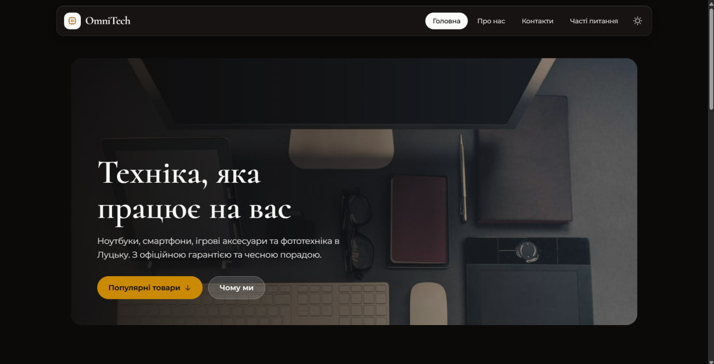
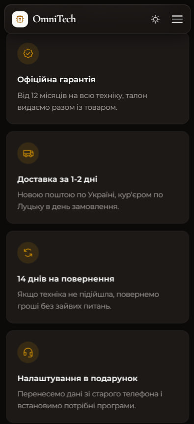

# Звіт з лабораторної роботи 03 «Розробка базового вебпроєкту»

## Загальні відомості

| | |
|---|---|
| **ПІБ** | Дмитрук Назар Сергійович |
| **Група** | ІПЗ-22 |
| **Роль у команді** | Team Lead |
| **Склад команди** | Дмитрук Назар (Team Lead), Махнюк Андрій (Developer), Бардюк Станіслав (QA) |
| **Тема проєкту** | OmniTech — вебсайт магазину електроніки |
| **Репозиторій** | <https://github.com/Hyrysake/omnitech> |

## Особистий внесок

Я створив репозиторій і каркас застосунку, на який спираються сторінки інших учасників.

1. **Налаштування проєкту:** репозиторій на GitHub, `README.md`, `.gitignore` (віртуальне середовище й кеш Python не потрапляють у репозиторій), віртуальне середовище `.venv`, `requirements.txt`. Додав Андрія та Станіслава як співавторів і увімкнув захист гілки `main`: злиття лише через Pull Request з одним схваленням.
2. **`app.py`:** створення застосунку Flask, маршрут `/` для головної сторінки, запуск у режимі налагодження.
3. **`templates/base.html`:** базовий шаблон, від якого наслідуються всі сторінки: підключення Tailwind CSS, шрифтів Cormorant і Montserrat та іконок Phosphor; кольори сайту, записані один раз у `@theme`; липке «скляне» меню і мобільне меню-«бургер»; макрос `nav_link`, який малює пункт меню і виділяє поточну сторінку; футер; плавна поява блоків, яка вимикається, якщо користувач увімкнув у системі «Зменшити рух»; блоки `title` і `content`.
4. **`templates/home.html`:** головна сторінка з банером на всю ширину (фото під темним градієнтом, поверх нього заголовок і дві кнопки), чотирма картками переваг, блоком «Популярні товари» і відгуками покупців. Ціни виводяться з пробілом між тисячами (`32 999 грн`).
5. **Дані з Python:** список `FEATURED_PRODUCTS` в `app.py` передається в шаблон через `render_template('home.html', products=...)`, а цикл `` будує картку для кожного товару.
6. **Рев'ю:** перевірив і схвалив Pull Request Андрія зі сторінками «Про нас» і «Контакти».

**Посилання:**
- мої коміти: <https://github.com/Hyrysake/omnitech/commits?author=Hyrysake>
- мій Pull Request: <https://github.com/Hyrysake/omnitech/pull/1>

**Інструменти:** VS Code, Git, GitHub. Дизайн інтерфейсу і частину коду зроблено з допомогою AI (Claude), розібрано й перевірено мною.

## Скріншоти

Головна сторінка, звичайний вигляд:

Головна сторінка, мобільний вигляд (меню згорнуте в «бургер»):

## Труднощі та їх вирішення

- **Меню й сторінки, яких ще немає.** У меню посилання будуються функцією `url_for('назва_функції')`. Якби я одразу додав у `base.html` пункти «Про нас» чи «Контакти», Flask упав би з помилкою `BuildError`, бо таких маршрутів ще не існувало. Тому кожен учасник додавав пункт меню **в тому самому коміті**, що й маршрут своєї сторінки.
- **Порядок роботи в команді.** Сторінки Андрія та Станіслава наслідуються від мого `base.html`, тож вони не могли почати, поки мій PR не злито. Ми працювали строго по черзі, і кожен створював свою гілку від оновленого `main`. Тому конфліктів злиття не було.
- **Кодування `requirements.txt`.** У Windows PowerShell 5.1 команда `pip freeze > requirements.txt` записує файл у кодуванні UTF-16, і GitHub показує його як нечитабельний. Я зберіг список залежностей командою `pip freeze | Out-File -Encoding ascii requirements.txt`.

## Висновки

Я навчився створювати вебзастосунок на Flask: маршрути зв'язують адресу сторінки з функцією Python, а Jinja2 збирає HTML із базового шаблону та сторінок, що від нього наслідуються. Базовий шаблон дав команді спільне меню й оформлення, тому кожна нова сторінка займає лише кілька десятків рядків. Адаптивність забезпечує Tailwind CSS: префікси `sm:`, `md:` і `lg:` змінюють сітку залежно від ширини екрана.
