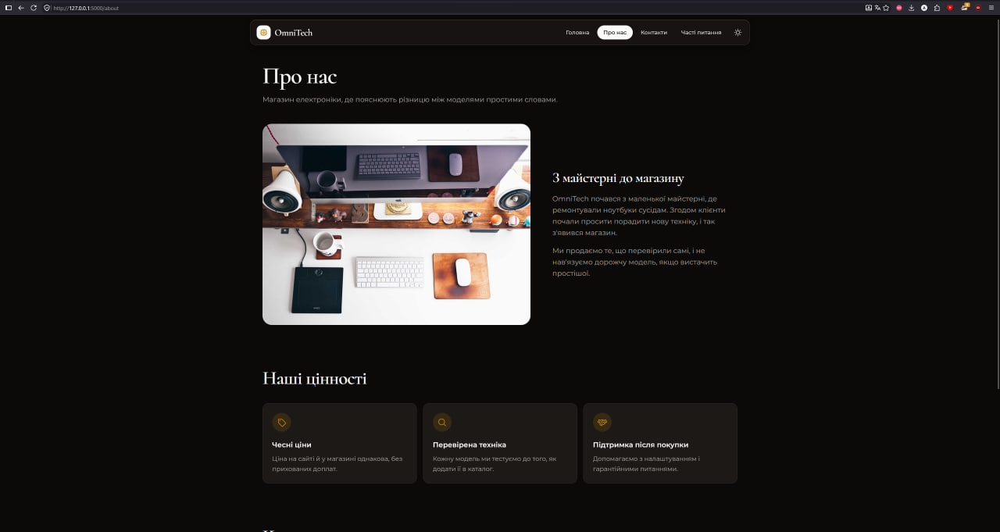
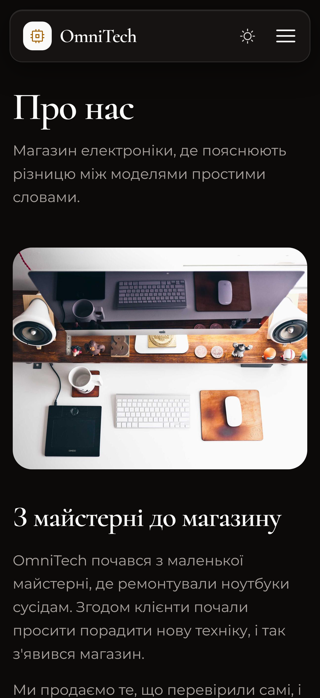
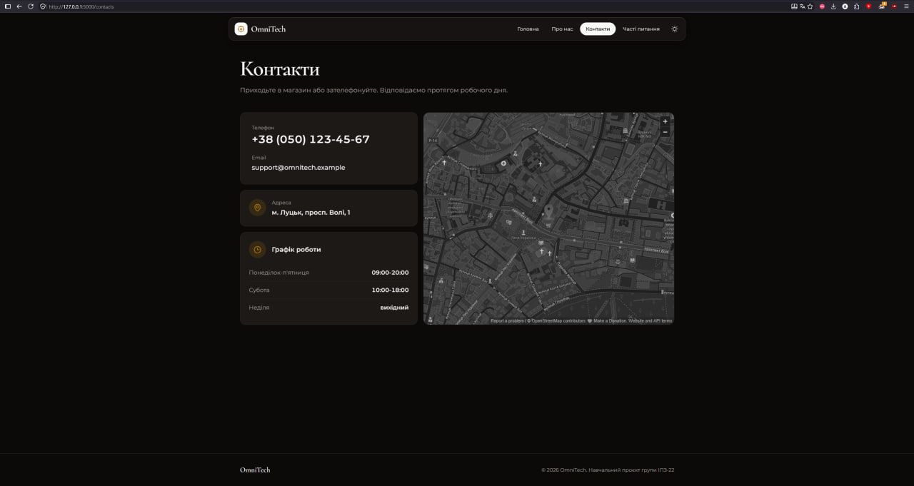
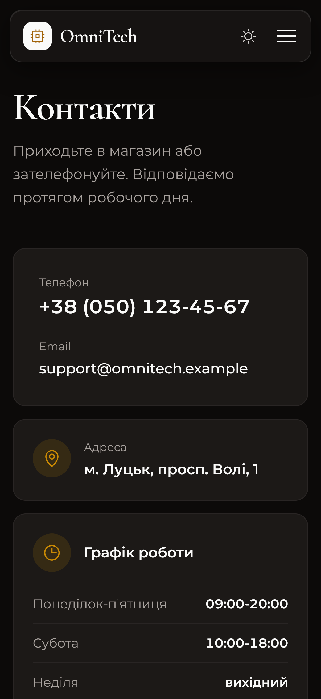

# Звіт з лабораторної роботи 03 «Розробка базового вебпроєкту»

## Загальні відомості

| | |
|---|---|
| **ПІБ** | Махнюк Андрій Сергійович |
| **Група** | ІПЗ-22 |
| **Роль у команді** | Developer |
| **Склад команди** | Дмитрук Назар (Team Lead), Махнюк Андрій (Developer), Бардюк Станіслав (QA) |
| **Тема проєкту** | OmniTech — вебсайт магазину електроніки |
| **Репозиторій** | <https://github.com/Hyrysake/omnitech> |

## Особистий внесок

Я розробив дві сторінки сайту, «Про нас» і «Контакти».

1. **Сторінка «Про нас» (`templates/about.html`, маршрут `/about`):** історія магазину з фото, три картки цінностей з іконками, блок «Команда проєкту» з ініціалами й роллю кожного учасника. На телефоні все в один стовпець, від ширини `lg` (1024 px) фото й текст стоять поруч.
2. **Сторінка «Контакти» (`templates/contacts.html`, маршрут `/contacts`):**
   - контактні дані зберігаються у словнику `CONTACTS` в `app.py` і передаються в шаблон через `render_template('contacts.html', contacts=CONTACTS)`;
   - телефон і email — це посилання `tel:` і `mailto:`. На телефоні натискання на номер одразу відкриває набір;
   - графік роботи — це список у словнику, з якого цикл `` будує рядки списку `<dl>` (пари «день: години»);
   - карта OpenStreetMap вбудована через `<iframe>`. CSS-фільтри роблять її сірою, а в темній темі темною, щоб вона не вибивалася з дизайну сайту.
3. **Меню:** додав пункти «Про нас» і «Контакти» в `base.html`, як у широке, так і в мобільне меню. Кожен пункт — це один виклик макросу Назара: `{{ nav_link('about', 'Про нас') }}`, а для мобільного меню `nav_link('about', 'Про нас', mobile=True)`.
4. **Заклик на головній:** унизу `home.html` додав блок «Приходьте подивитися наживо» з кнопкою, що веде на «Контакти».
5. **Рев'ю:** перевірив і схвалив Pull Request Станіслава зі сторінкою «Часті питання» та темною темою.

**Посилання:**
- мої коміти: <https://github.com/Hyrysake/omnitech/commits?author=azureflarez>
- мій Pull Request: <https://github.com/Hyrysake/omnitech/pull/2>

**Інструменти:** VS Code, Git, GitHub. Дизайн інтерфейсу і частину коду зроблено з допомогою AI (Claude), розібрано й перевірено мною.

## Скріншоти

Сторінка «Про нас», звичайний і мобільний вигляд:

Сторінка «Контакти», звичайний і мобільний вигляд:

## Труднощі та їх вирішення

- **Висота карти.** Без явно заданої висоти `<iframe>` з картою має висоту приблизно 150 px і виглядає як смужка. На телефоні карта стоїть під контактами, і їй потрібна мінімальна висота (`min-h-[24rem]`). На широкому екрані вона стоїть поруч із контактами й тягнеться на всю висоту лівої колонки (`h-full`).
- **Рамка карти в темній темі.** Фільтр `invert` змінює кольори всього елемента разом із рамкою, тож темна рамка ставала світлою. Тому рамку й заокруглення я переніс на обгортку `
`, а фільтри лишилися на самому `<iframe>`.
- **Де зберігати дані.** Контакти можна було вписати прямо в HTML, але тоді, щоб змінити телефон чи графік, довелося б шукати їх серед розмітки. Я виніс їх у словник `CONTACTS` в `app.py`: дані змінюються в одному місці, а в лабораторній 04 їх можна буде брати з бази даних, не переписуючи шаблон.
- **Кнопка на сторінку, якої ще немає.** Блок «Приходьте подивитися наживо» належить головній сторінці Назара, але його кнопка веде на «Контакти» (`url_for('contacts')`). Якби Назар додав блок раніше, головна падала б з помилкою `BuildError`, бо маршруту `contacts` ще не було. Тому блок додано в моєму коміті, разом із самим маршрутом.
- **Номер телефону для посилання.** Посилання `tel:` має містити номер без пробілів і дужок, а на сторінці номер має бути читабельним. Тому у словнику два поля: `phone` для показу і `phone_link` для посилання.

## Висновки

Я навчився передавати дані з Python у шаблон через `render_template` і виводити їх у Jinja2 через `{{ }}` та цикл ``. Наслідування від `base.html` дозволило мені написати лише вміст своїх сторінок: меню, стилі й футер вони отримують автоматично. Адаптивну верстку я перевіряв у режимі пристроїв DevTools (`Ctrl+Shift+M`).
