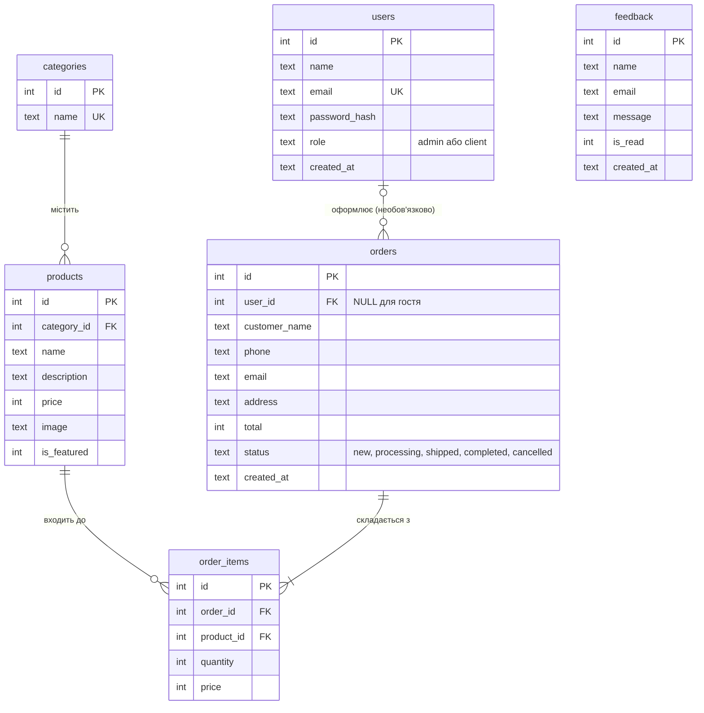
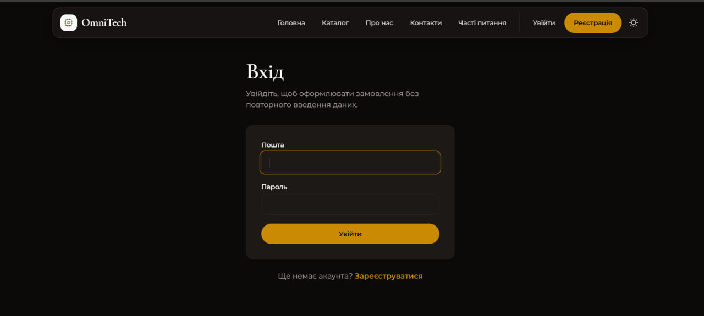
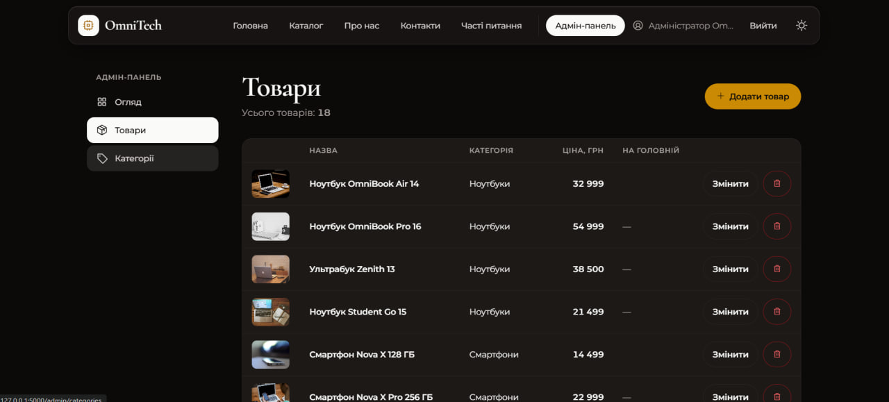
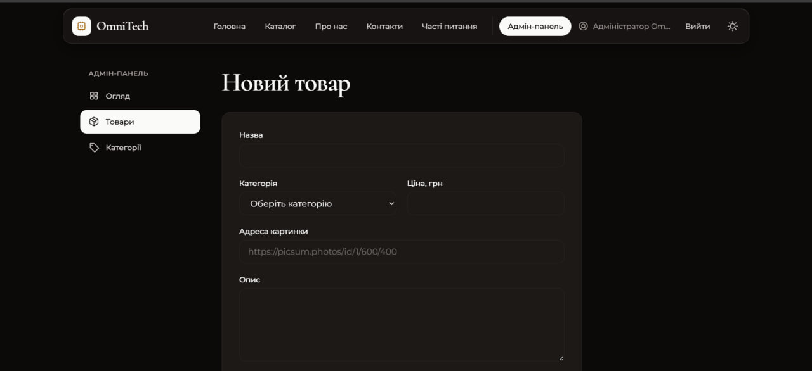
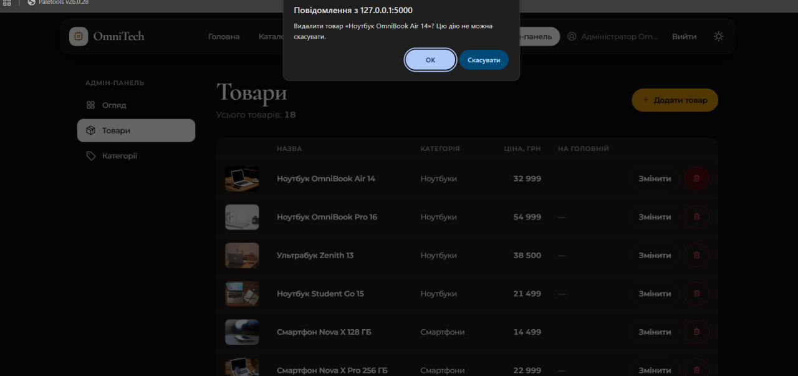

# Звіт з лабораторної роботи 04 «Реалізація бази даних для вебпроєкту»

## Загальні відомості

| | |
|---|---|
| **ПІБ** | Бардюк Станіслав Олександрович |
| **Група** | ІПЗ-22 |
| **Роль у команді** | QA |
| **Склад команди** | Дмитрук Назар (Team Lead), Махнюк Андрій (Developer), Бардюк Станіслав (QA) |
| **Тема проєкту** | OmniTech — вебсайт магазину електроніки (продовження лабораторної 03) |
| **Репозиторій** | <https://github.com/Hyrysake/omnitech> |

## Особистий внесок

Я зробив користувачів із ролями та адмін-панель для товарів і категорій.

1. **Таблиця `users` і паролі (`models/users.py`).** Користувач має ім'я, унікальну пошту, роль `admin` або `client` (обмеження `CHECK`) та **хеш** пароля. Пароль ніколи не зберігається відкритим текстом: `generate_password_hash` робить хеш із випадковою «сіллю», а `check_password_hash` перевіряє введений пароль. Обидві функції входять у Werkzeug, який уже є разом із Flask.
2. **Вхід у систему (`routes/auth.py`).** Реєстрація, вхід і вихід. Після входу в сесії (підписаному cookie) зберігається лише номер користувача. Помилки показуються повідомленнями `flash`; повідомлення про неправильний вхід однакове для «немає такої пошти» і «неправильний пароль», щоб не підказувати, які адреси зареєстровані. Повторну пошту ловить обмеження `UNIQUE`: Python отримує `sqlite3.IntegrityError`, а користувач бачить зрозуміле повідомлення. Вихід можливий лише через POST.
3. **Хто зараз на сайті (`security.py`).** Перед кожним запитом `load_logged_in_user` читає з бази користувача за номером із сесії й кладе в `g.user`. Тому зміна ролі чи видалення акаунта діє одразу. Функція `safe_next_url` пропускає лише адреси всередині нашого сайту, інакше параметр `next` дозволив би перенаправити людину на чужий сайт.
4. **Захист адмінки (`require_admin`).** Одна функція на весь blueprint через `before_request`: гість потрапляє на сторінку входу й після входу повертається назад, клієнт отримує помилку 403. Забути захистити окремий маршрут неможливо.
5. **Адмін-панель (`routes/admin.py`, `routes/admin_catalog.py`, `templates/admin/`).** «Огляд» з кількістю товарів, категорій і користувачів. Товари: таблиця, додавання, зміна, видалення (повний CRUD) з перевіркою полів на сервері. Категорії: додавання, перейменування, видалення. Видалення працює лише методом POST і питає підтвердження.
6. **Друге обмеження бази на ділі.** Категорію з товарами база видалити не дозволяє (`ON DELETE RESTRICT`), а панель перетворює `IntegrityError` на повідомлення «У категорії є товари». Так само з дублікатом назви категорії.
7. **Рев'ю:** перевірив і схвалив Pull Request Назара з базою, каталогом і сторінкою товару, пройшовши чекліст QA (регістр у пошуку, ін'єкція `' OR 1=1 --`, некоректні числа у фільтрах, сторінка 404, мобільний вигляд).

**Посилання:**
- мої коміти: <https://github.com/Hyrysake/omnitech/commits?author=st009bar-dot>
- мій Pull Request: <https://github.com/Hyrysake/omnitech/pull/9>

**Інструменти:** VS Code, Git, GitHub, SQLite. Частину коду зроблено з допомогою AI (Claude), розібрано й перевірено мною.

## Схема бази даних

Зв'язки:

| Зв'язок | Тип | Як реалізований |
|---|---|---|
| `categories` — `products` | один до багатьох | `products.category_id` → `categories.id`, `ON DELETE RESTRICT`: категорію з товарами видалити не можна |
| `orders` — `products` | **багато до багатьох** | проміжна таблиця `order_items` з двома зовнішніми ключами; у ній ще `quantity` і `price` (ціна на момент покупки) |
| `orders` — `order_items` | один до багатьох | `order_items.order_id` → `orders.id`, `ON DELETE CASCADE`: рядки замовлення видаляються разом із ним |
| `users` — `orders` | один до багатьох, необов'язковий | `orders.user_id` → `users.id`, `ON DELETE SET NULL`; у гостя без акаунта `user_id` порожній |

Таблиця `feedback` ні з чим не пов'язана: це окремі повідомлення з форми на сторінці «Контакти».

## Скріншоти

Сторінка входу:

Адмін-панель, таблиця товарів:

Форма зміни товару (категорії підтягуються з таблиці `categories`):

Спроба видалити категорію, у якій є товари: база не дозволяє, панель показує повідомлення:

## Труднощі та їх вирішення

- **Захист кожного маршруту адмінки.** Перевіряти роль у кожній функції окремо легко забути, а непомічена діра гірша за відсутність захисту. Я підключив перевірку до всього blueprint-а одним рядком `before_request(require_admin)`, і вона діє також на POST-запити (видалення, збереження).
- **Куди повертати після входу.** Гість, який відкрив `/admin`, має потрапити туди після входу, але довіряти адресі з параметра `next` не можна. Адреса приймається лише тоді, коли починається з одного `/` (але не з `//`) і не містить `\`.
- **Пункт меню «Адмін-панель» між комітами.** Якби він з'явився в першому коміті (вхід), а маршрут адмінки лише в другому, адміністратор на проміжному стані отримав би помилку `BuildError` на кожній сторінці. Тому пункт меню додається в тому самому коміті, що й маршрут.
- **Помилки бази як повідомлення.** `sqlite3.IntegrityError` від `UNIQUE` і `RESTRICT` не можна показувати користувачеві як є. Кожен виклик, який може порушити обмеження, обгорнуто в `try/except` із зрозумілим текстом.

## Висновки

Я навчився відрізняти автентифікацію (хто ти: пошта й пароль, номер у сесії) від авторизації (що тобі можна: роль `admin` чи `client`). Паролі зберігаються лише як хеш, а захист розділу краще робити в одному місці для всього blueprint-а. Обмеження бази (`UNIQUE`, `CHECK`, `RESTRICT`) працюють як останній рубіж: навіть якщо код пропустить помилку, дані залишаться цілими.
