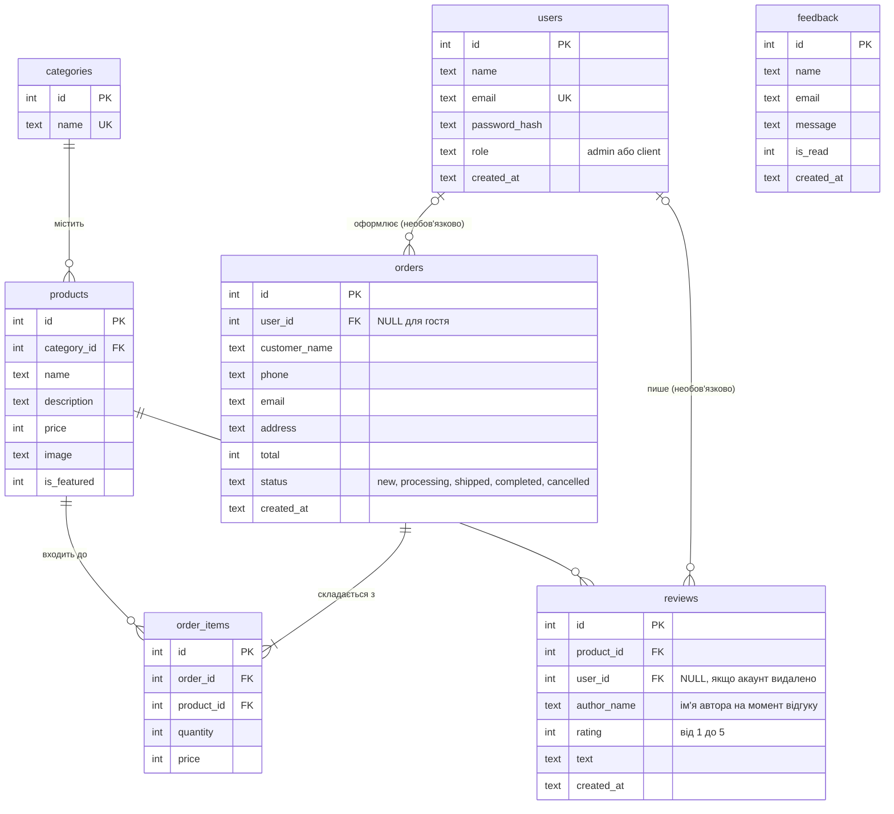
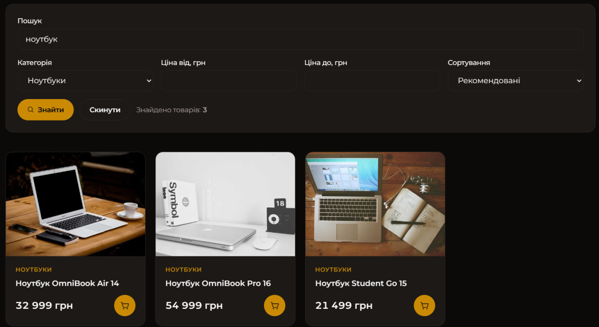
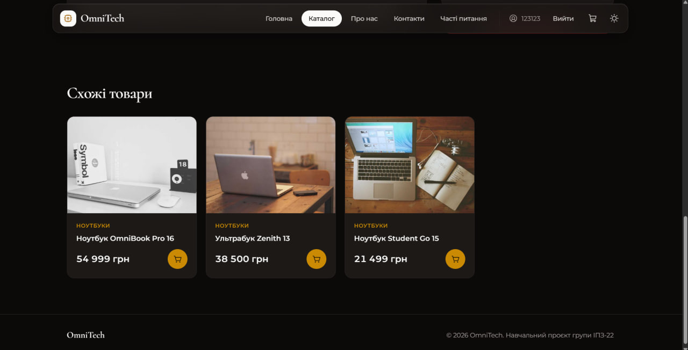
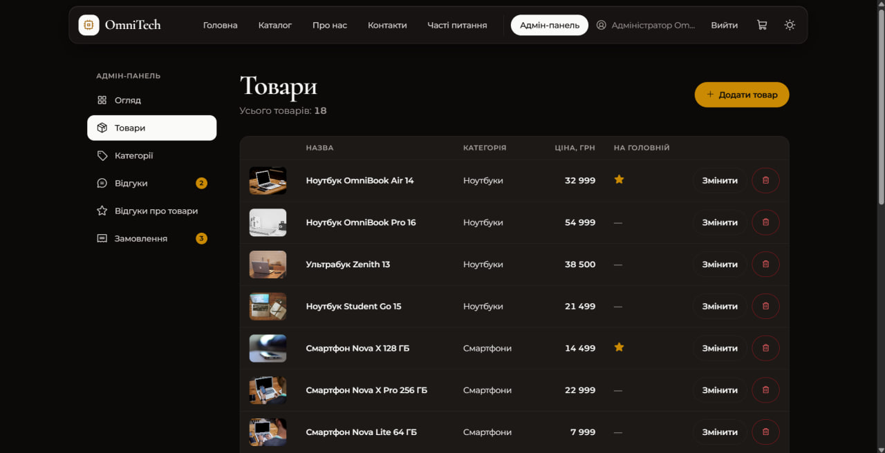
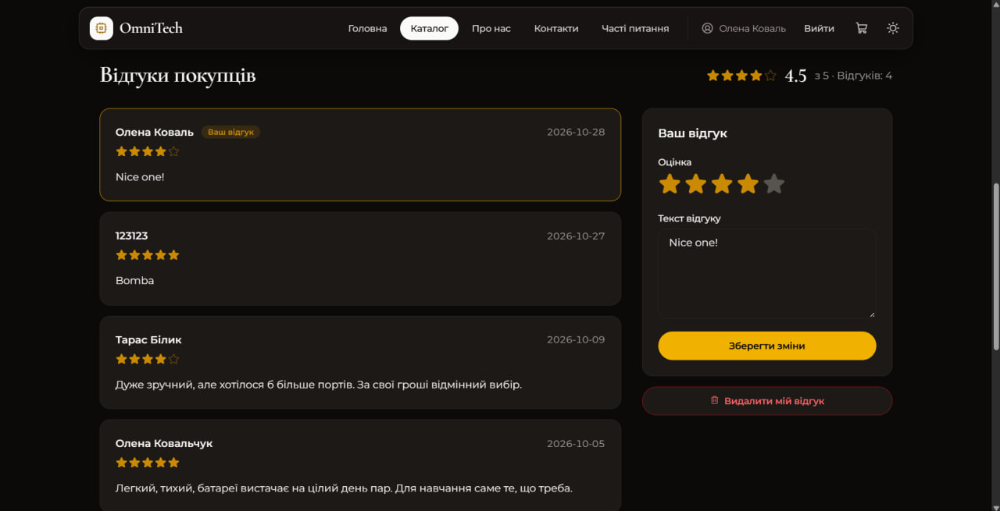
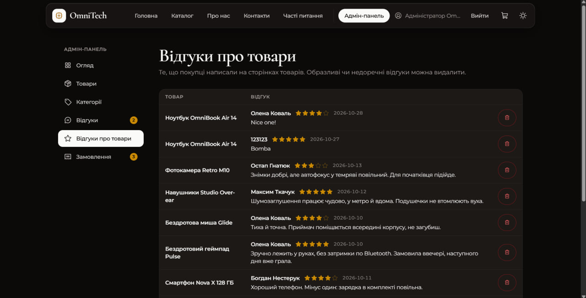

# Звіт з лабораторної роботи 04 «Реалізація бази даних для вебпроєкту»

## Загальні відомості

| | |
|---|---|
| **ПІБ** | Дмитрук Назар Сергійович |
| **Група** | ІПЗ-22 |
| **Роль у команді** | Team Lead |
| **Склад команди** | Дмитрук Назар (Team Lead), Махнюк Андрій (Developer), Бардюк Станіслав (QA) |
| **Тема проєкту** | OmniTech — вебсайт магазину електроніки (продовження лабораторної 03) |
| **Репозиторій** | <https://github.com/Hyrysake/omnitech> |

## Особистий внесок

Я зробив основу, на яку спираються частини Станіслава й Андрія: шар роботи з базою, таблиці товарів і категорій та вітрину магазину.

1. **Шар роботи з базою (`db.py`).** Функція `get_db()` відкриває одне з'єднання на запит і кладе його в `g`; `close_db()` закриває його через `@app.teardown_appcontext`. Одразу після підключення виконується `PRAGMA foreign_keys = ON`, інакше SQLite не перевіряв би зовнішні ключі. `row_factory = sqlite3.Row` дозволяє читати рядки як `row['name']`. Шлях до файлу бази лежить у `app.config['DATABASE']` і будується від теки застосунку, тож сайт працює з будь-якої теки запуску.
2. **Структура бази (`schema.sql`).** Таблиці `categories` і `products` з первинними ключами, `UNIQUE` на назві категорії, `CHECK (price > 0)`, зовнішнім ключем `products.category_id` з `ON DELETE RESTRICT` та індексом за категорією. Запис `CREATE TABLE IF NOT EXISTS` дозволяє виконувати файл при кожному запуску: нові таблиці, які додають інші учасники, з'являються самі.
3. **Початкові дані (`seed_data.py`).** 7 категорій і 18 товарів, які додаються лише в порожні таблиці, тому дані, додані через адмін-панель, ніколи не перезаписуються. Сайт після клонування й `python app.py` одразу виглядає «живим».
4. **Запити до товарів (`models/catalog.py`).** Популярні товари для головної (`JOIN` з категоріями), список категорій, один товар за номером і функція `search_products()`: умова `WHERE` складається лише з тих фільтрів, які користувач справді заповнив, а значення завжди передаються окремо через `?`. Сортування вибирається зі словника допустимих варіантів, бо назву стовпця в параметр передати не можна.
5. **Каталог і сторінка товару (`routes/shop.py`, `shop.html`, `product.html`).** Пошук за назвою й описом, фільтр за категорією та ціною «від — до», чотири варіанти сортування. Форма надсилається методом GET, тому вибрані фільтри лежать в адресі, і її можна зберегти в закладки. Сторінка товару показує схожі товари з тієї ж категорії; для неіснуючого номера віддається власна сторінка 404.
6. **Решта.** Спільна картка товару `_product_card.html`, фільтр Jinja `money` для цін, `README.md` із розділом про базу, `.gitignore` із записом `db.sqlite`.
7. **Рев'ю:** перевірив і схвалив Pull Request Андрія з відгуками, кошиком і замовленнями.
8. **Відгуки покупців про товари (окремий Pull Request, поза початковим розподілом).** Після того, як сайт був готовий, ми вирішили, що покупець має змогу написати відгук про товар, і я зробив це сам двома комітами.
   - **Таблиця `reviews`** (`schema.sql`): оцінка з `CHECK (rating BETWEEN 1 AND 5)`, текст, `product_id` з `ON DELETE CASCADE` (відгуки зникають разом із товаром), `user_id` з `ON DELETE SET NULL` (відгук переживає видалення акаунта, бо ім'я автора збережено в `author_name`) і `UNIQUE (product_id, user_id)`: один користувач залишає про товар один відгук.
   - **Запити (`models/reviews.py`).** Збереження виконує один запис `INSERT … ON CONFLICT (product_id, user_id) DO UPDATE` («upsert»): якщо відгук цього користувача про цей товар уже є, база змінює його, а не додає дубль, тож `UNIQUE` не потрібно обходити перевіркою в Python. Середня оцінка й кількість відгуків рахуються агрегатами `AVG(rating)` і `COUNT(*)`; перевірка введеного (оцінка 1–5, довжина тексту 5–1000 символів) виконується на сервері, бо HTML-атрибути обходяться.
   - **Сторінка товару.** Під назвою — середня оцінка зірками, нижче розділ «Відгуки покупців» зі списком і формою. Оцінка вибирається клікабельними зірками, зробленими з радіокнопок (працює й клавіатура). Свій відгук можна змінити чи видалити; гостю замість форми пропонується увійти. Якщо форма містить помилки, сторінка відкривається знову з тим, що ввів користувач, а помилки стоять над формою.
   - **Модерація (`routes/admin_reviews.py`).** В адмін-панелі нова сторінка «Відгуки про товари»: список усіх відгуків із посиланням на товар і видаленням (з підтвердженням), картка кількості на «Огляді».
   - Попутно виправлено помилку з Lab 03: у таблиці товарів адмінки колонка «На головній» показувала порожнє місце замість зірки, бо заповнені іконки лежать в окремому наборі стилів, який там не було підключено.

**Посилання:**
- мої коміти: <https://github.com/Hyrysake/omnitech/commits?author=Hyrysake>
- мої Pull Request-и: <https://github.com/Hyrysake/omnitech/pull/8> (база й каталог) і <https://github.com/Hyrysake/omnitech/pull/11> (відгуки про товари)

**Інструменти:** VS Code, Git, GitHub, SQLite. Частину коду зроблено з допомогою AI (Claude), розібрано й перевірено мною.

## Схема бази даних

Зв'язки:

| Зв'язок | Тип | Як реалізований |
|---|---|---|
| `categories` — `products` | один до багатьох | `products.category_id` → `categories.id`, `ON DELETE RESTRICT`: категорію з товарами видалити не можна |
| `orders` — `products` | **багато до багатьох** | проміжна таблиця `order_items` з двома зовнішніми ключами; у ній ще `quantity` і `price` (ціна на момент покупки) |
| `orders` — `order_items` | один до багатьох | `order_items.order_id` → `orders.id`, `ON DELETE CASCADE`: рядки замовлення видаляються разом із ним |
| `users` — `orders` | один до багатьох, необов'язковий | `orders.user_id` → `users.id`, `ON DELETE SET NULL`; у гостя без акаунта `user_id` порожній |
| `products` — `reviews` | один до багатьох | `reviews.product_id` → `products.id`, `ON DELETE CASCADE`: відгуки видаляються разом із товаром |
| `users` — `reviews` | один до багатьох, необов'язковий | `reviews.user_id` → `users.id`, `ON DELETE SET NULL`: відгук лишається, ім'я автора зберігається в `author_name`; пара `UNIQUE (product_id, user_id)` дозволяє одному користувачеві один відгук про товар |

Таблиця `feedback` ні з чим не пов'язана: це окремі повідомлення з форми на сторінці «Контакти».

## Скріншоти

Каталог із пошуком «ноутбук» (результат із бази, регістр літер не має значення):

Сторінка товару зі схожими товарами:

Каталог на телефоні (меню згорнуте в «бургер»):

Адмін-панель, таблиця товарів: ті самі 18 рядків таблиці `products`, які видно в каталозі:

Відгуки покупців на сторінці товару: середня оцінка, список і форма з вибором зірок (відгук залогіненого користувача виділено рамкою):

Адмін-панель, модерація відгуків про товари:

## Труднощі та їх вирішення

- **Кирилиця в пошуку.** Вбудована функція `LOWER()` і оператор `LIKE` у SQLite нечутливі до регістру лише для англійських літер, тому пошук `ноутбук` не знаходив «Ноутбук OmniBook». Я зареєстрував у з'єднанні власну SQL-функцію `lower_uk` на основі Python-методу `casefold()` (`create_function`) і шукаю по ній. Окремо екранував символи `%` та `_` у запиті користувача, щоб пошук `%` не знаходив усе підряд.
- **Безпечний динамічний запит.** Фільтрів багато й кожен необов'язковий, тож запит складається з частин. Значення йдуть тільки через `?`, а ключ сортування береться зі словника: з адреси ніколи не потрапляє в SQL жоден текст. Я перевірив пошук `' OR 1=1 --`: він просто нічого не знаходить.
- **Порядок категорій.** Сортування за назвою розкладає кирилицю за кодами символів, і «Фототехніка» стояла б не там, де її очікує людина. Тому категорії виводяться за номером у порядку додавання.
- **Один відгук від користувача.** Спершу я думав перевіряти в Python, чи є вже відгук, і лише тоді вибирати між `INSERT` і `UPDATE`. Між перевіркою й записом можна відправити форму двічі, тому надійніше доручити це базі: обмеження `UNIQUE (product_id, user_id)` забороняє дубль, а `INSERT … ON CONFLICT DO UPDATE` перетворює повторне збереження на зміну наявного відгуку. Для демонстраційних відгуків без акаунта `user_id` порожній, а порожні значення `UNIQUE` між собою не порівнює, тож вони не заважають одне одному.
- **Зірки без JavaScript.** Вибір оцінки зроблено з п'яти справжніх радіокнопок, які виводяться у зворотному порядку з `flex-row-reverse`: тоді стиль `peer-checked`, який працює через селектор `~` (усі наступні сусіди в коді), фарбує обрану зірку й усі зірки ліворуч від неї. Завдяки цьому форма працює з клавіатури (стрілки) і для екранної читалки, а скрипт не потрібен. Заповнені іконки зірок лежать в окремому наборі стилів Phosphor, тому цей набір підключається лише на сторінках, де він потрібен.
- **Порядок роботи в команді.** Мої файли — основа для двох інших частин, тому мій PR злито першим, а Станіслав і Андрій створювали гілки від оновленого `main`. Конфліктів злиття не було.

## Висновки

Я навчився проєктувати реляційну базу для вебпроєкту: таблиці зв'язані ключами, а правила `ON DELETE` і `CHECK` захищають дані від помилок навіть тоді, коли помиляється код застосунку. Параметризовані запити одночасно роблять пошук безпечним і дозволяють складати запит із необов'язкових фільтрів. Розділення на `db.py`, `models/` і `routes/` допомогло команді працювати паралельно: кожен змінює свої файли. Відгуки про товари показали, як нову таблицю підключити до готового сайту, нічого не ламаючи: це одна нова таблиця зі зв'язками, один модуль запитів і один маршрут. Для сайту, який уже працює, не довелося видаляти базу: `CREATE TABLE IF NOT EXISTS` просто додає нову таблицю.
