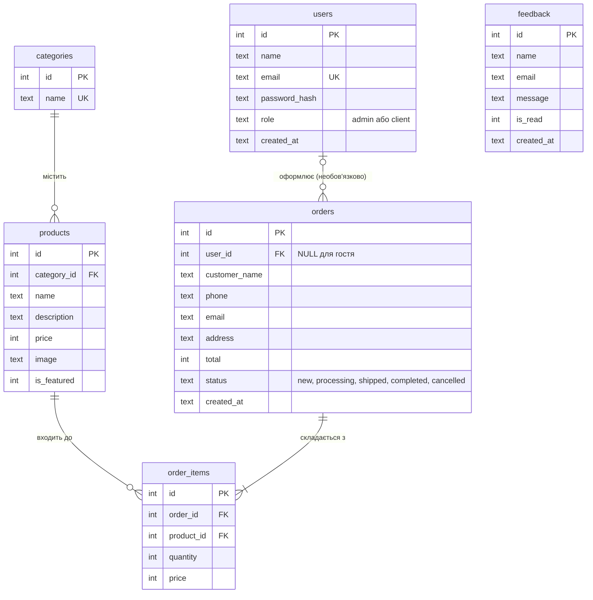
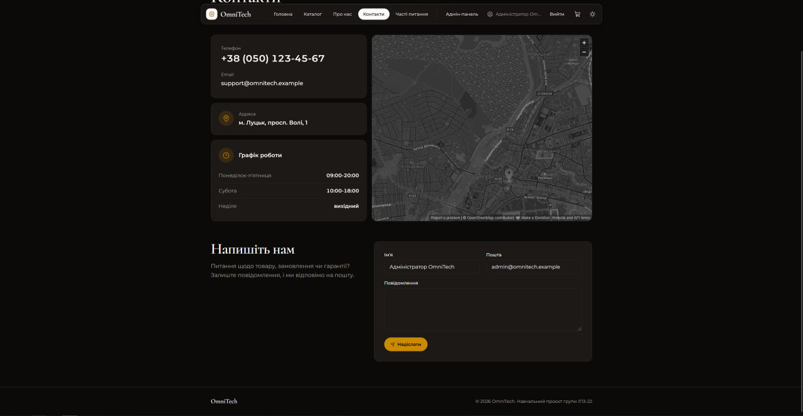
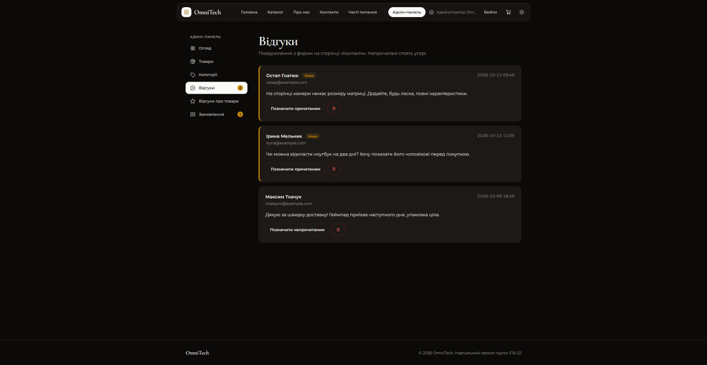
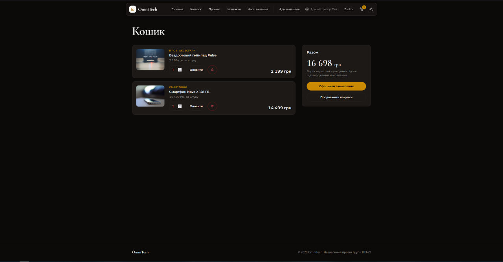
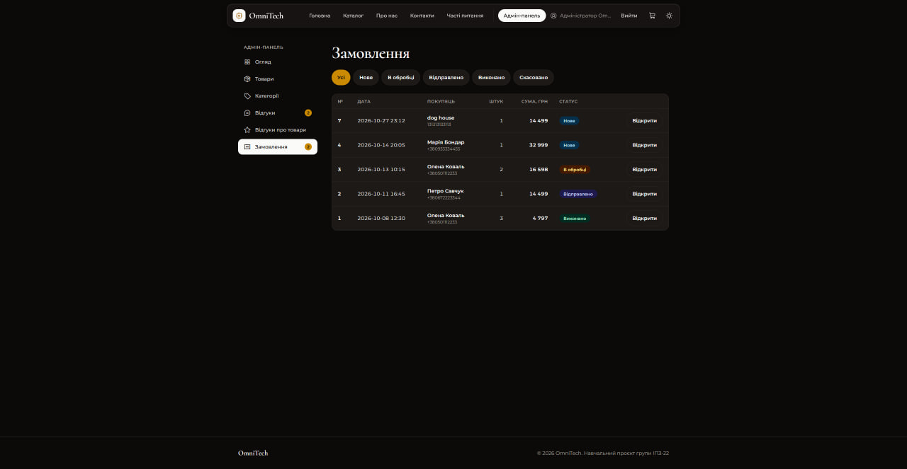
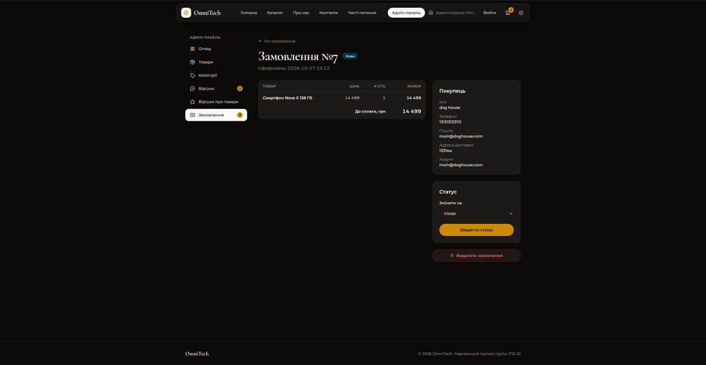

# Звіт з лабораторної роботи 04 «Реалізація бази даних для вебпроєкту»

## Загальні відомості

| | |
|---|---|
| **ПІБ** | Махнюк Андрій Сергійович |
| **Група** | ІПЗ-22 |
| **Роль у команді** | Developer |
| **Склад команди** | Дмитрук Назар (Team Lead), Махнюк Андрій (Developer), Бардюк Станіслав (QA) |
| **Тема проєкту** | OmniTech — вебсайт магазину електроніки (продовження лабораторної 03) |
| **Репозиторій** | <https://github.com/Hyrysake/omnitech> |

## Особистий внесок

Я зробив відгуки з модерацією, кошик, оформлення замовлень і керування ними.

1. **Відгуки (`models/feedback.py`, `routes/admin_feedback.py`).** Таблиця `feedback`. На сторінці «Контакти» з'явилася форма: поля перевіряються на сервері (довжина імені, пошта, довжина повідомлення), помилки показуються над формою, а після успіху відбувається `redirect` із повідомленням (патерн POST → Redirect → GET: оновлення сторінки не відправляє форму вдруге). В адмін-панелі повний CRUD: перегляд (непрочитані зверху), позначка «прочитано / непрочитано» (`UPDATE`) і видалення (`DELETE`), число нових відгуків у бічному меню.
2. **Кошик (`routes/cart.py`).** Кошик лежить у сесії як словник «номер товару → кількість». **Ціни в сесію не записуються**: при показі кошика й під час оформлення вони щоразу беруться з бази, тому підмінити ціну через cookie неможливо. Додавання, зміна кількості й видалення рядка — POST-форми.
3. **Оформлення замовлення.** Форма з іменем, телефоном, поштою й адресою, перевірка кожного поля. Гість може купити без акаунта, залогінений клієнт отримує форму вже заповненою. Сторінку «Дякуємо» показано за номером, який лежить у сесії: чужий номер у адресі нічого не відкриє.
4. **Таблиці `orders` і `order_items` (`models/orders.py`).** `order_items` — проміжна таблиця зв'язку «багато до багатьох» між замовленнями й товарами: у ній `order_id`, `product_id`, кількість і ціна **на момент покупки**. Замовлення і його рядки записуються **однією транзакцією**: `INSERT` у `orders`, номер через `lastrowid`, `executemany` для рядків, один `commit()`; у разі помилки — `rollback()`.
5. **Керування замовленнями (`routes/admin_orders.py`).** Список із фільтром за статусом (`LEFT JOIN` і `GROUP BY` рахують кількість штук), сторінка замовлення (`JOIN` рядків із товарами), зміна статусу (список допустимих значень перевіряється і на сервері, і обмеженням `CHECK` у базі) і видалення (рядки видаляються каскадно, `ON DELETE CASCADE`).
6. **Рев'ю:** перевірив і схвалив Pull Request Станіслава з користувачами, ролями й адмін-панеллю: гість, клієнт і адмін на `/admin`, додавання й видалення товарів, повідомлення про категорію з товарами.

**Посилання:**
- мої коміти: <https://github.com/Hyrysake/omnitech/commits?author=rotterdamsterdam>
- мій Pull Request: <https://github.com/Hyrysake/omnitech/pull/10>

**Інструменти:** VS Code, Git, GitHub, SQLite. Частину коду зроблено з допомогою AI (Claude), розібрано й перевірено мною.

## Схема бази даних

Зв'язки:

| Зв'язок | Тип | Як реалізований |
|---|---|---|
| `categories` — `products` | один до багатьох | `products.category_id` → `categories.id`, `ON DELETE RESTRICT`: категорію з товарами видалити не можна |
| `orders` — `products` | **багато до багатьох** | проміжна таблиця `order_items` з двома зовнішніми ключами; у ній ще `quantity` і `price` (ціна на момент покупки) |
| `orders` — `order_items` | один до багатьох | `order_items.order_id` → `orders.id`, `ON DELETE CASCADE`: рядки замовлення видаляються разом із ним |
| `users` — `orders` | один до багатьох, необов'язковий | `orders.user_id` → `users.id`, `ON DELETE SET NULL`; у гостя без акаунта `user_id` порожній |

Таблиця `feedback` ні з чим не пов'язана: це окремі повідомлення з форми на сторінці «Контакти».

## Скріншоти

Форма відгуку на сторінці «Контакти»:

Адмін-панель, відгуки (непрочитані з позначкою «Нове»):

Кошик:

Адмін-панель, список замовлень зі статусами та фільтром:

Одне замовлення: склад, дані покупця, зміна статусу:

## Труднощі та їх вирішення

- **Замовлення з кількох рядків.** Якщо після вставки замовлення зламається вставка його рядків, у базі лишилося б замовлення без товарів. Я записую все однією транзакцією: `commit()` лише після останньої вставки, а в `except` — `rollback()`.
- **Чия ціна.** Якби ціна приходила з форми чи сесії, її можна було б підмінити. Тому форма й кошик містять лише номер товару й кількість, а ціну сервер бере з бази й записує в `order_items.price`. Завдяки цьому зміна ціни товару пізніше не переписує стару історію замовлень.
- **Чужі замовлення.** Сторінка «Дякуємо за замовлення» не бере номер з адреси: його запам'ятовує сесія. Інакше, перебираючи `/order/1`, `/order/2`, будь-хто побачив би адреси й телефони інших покупців.
- **Видалений товар у кошику.** Адмін міг видалити товар, поки він лежить у чийомусь кошику. Такі рядки при показі кошика просто пропускаються, а база не дозволяє видалити товар, який уже є в замовленні (`ON DELETE RESTRICT`).
- **Куди показувати помилки форми.** Форма відгуку стоїть унизу довгої сторінки «Контакти», і повідомлення вгорі сторінки не було б видно. Тому помилки цієї форми виводяться безпосередньо над нею.

## Висновки

Я навчився працювати із зв'язком «багато до багатьох» через проміжну таблицю та з транзакціями: замовлення з рядками записується або повністю, або не записується взагалі. Запити з `JOIN` дають адмінові склад замовлення в одному виклику, а правила `CASCADE` і `RESTRICT` самі підтримують цілісність даних. Усе, що приходить від користувача (кількість, статус, номер замовлення), перевіряється на сервері.
