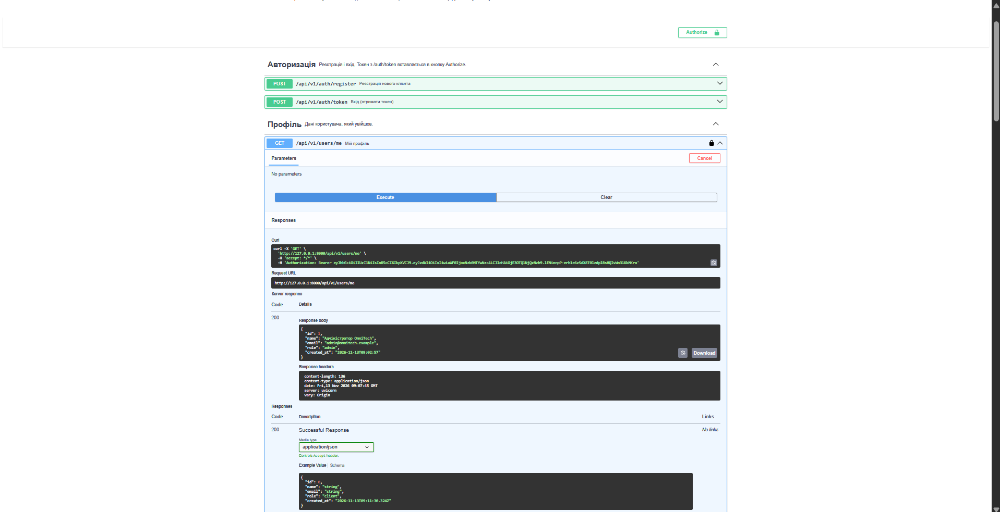
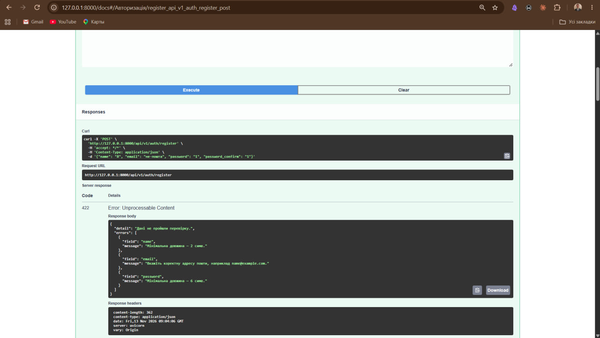

# Звіт з лабораторної роботи 05 «Розробка RESTful API з документацією»

## Загальні відомості

| | |
|---|---|
| **ПІБ** | Дмитрук Назар Сергійович |
| **Група** | ІПЗ-22 |
| **Роль у команді** | Team Lead |
| **Склад команди** | Дмитрук Назар (Team Lead), Махнюк Андрій (Developer), Бардюк Станіслав (QA) |
| **Тема проєкту** | OmniTech — REST API інтернет-магазину на FastAPI (продовження лабораторних 03–04) |
| **Репозиторій** | <https://github.com/Hyrysake/omnitech> |

## Особистий внесок

Я зробив основу бекенду, на якій стоять частини Станіслава й Андрія, і перевів проєкт з Flask на FastAPI.

1. **Перехід на FastAPI.** Flask-сайт з лабораторних 03–04 прибрано з `main`: він лишається під міткою `lab04`, яку я поставив перед початком. Новий бекенд лежить у теці `backend/`, кожна частина API — в окремому файлі.
2. **Налаштування (`app/core/config.py`).** Секретний ключ, адреса бази, дозволені джерела CORS і обмеження на розмір файлів читаються з файлу `.env` через pydantic-settings, а не пишуться в коді. Сервер не запуститься ні без ключа, ні з ключем-зразком з `.env.example`. Файл `.env` у Git не потрапляє.
3. **База (`app/db/`).** SQLAlchemy 2.0: з'єднання, сесія на кожен запит (залежність `get_db`), базовий клас моделей. Для SQLite:
   - увімкнено перевірку зовнішніх ключів (`PRAGMA foreign_keys`);
   - замінено функцію `lower()`, щоб пошук без урахування регістру працював і з кирилицею;
   - номери записів ніколи не повторюються (`AUTOINCREMENT`): інакше токен видаленого користувача відкрив би акаунт наступного зареєстрованого.

   Пагінація теж тут: сторінка рахується в SQL (`LIMIT`/`OFFSET`), а лічильник `total` будується з того самого запиту.
4. **Єдиний формат помилок (`app/core/errors.py`).**
   - Будь-яка помилка повертається як `{"detail": "…", "errors": [{"field", "message"}]}`.
   - Помилки перевірки Pydantic (422) перекладено українською, і всі вони повертаються разом.
   - 404 і 405 теж віддаються в JSON. 500 повертає загальний текст, подробиці йдуть лише в журнал сервера.
   - Завеликий запит відхиляється ще до читання (413).
   - Сервіси кидають власні винятки (`NotFoundError`, `ConflictError`…), а обробники перетворюють їх на потрібний код.
5. **Вхід (`app/core/security.py`, `app/api/deps.py`).**
   - Паролі зберігаються хешем argon2.
   - Вхід працює за стандартом OAuth2: `POST /api/v1/auth/token` повертає JWT із номером користувача й терміном дії 60 хв. Токен без терміну дії не приймається.
   - Залежності `CurrentUser` і `AdminUser` дають 401 без токена й 403 без прав. Роль береться з бази на кожен запит.
   - Для неправильної пошти й неправильного пароля відповідь однакова й займає однаковий час.
6. **Користувачі:** реєстрація, профіль (`GET`, `PATCH`, `DELETE /users/me`), зміна пароля, список користувачів для адміністратора зі сторінками й пошуком.
7. **Номери в адресах.** Спільний тип `Id` (від 1 до 2 147 483 647) для всіх `{…_id}`: завеликий номер дає 422, а не падіння сервера.
8. **Документація.** `/docs` будується сам із коду: розділи українською, опис і приклади в кожному ендпоінті, формат помилок у кожній відповіді, кнопка **Authorize** для входу.
9. **Демо-дані:** команда `python -m app.seed --reset`. До неї кожна частина додає свою функцію.
10. **README** (звіт команди): структура, запуск, таблиця ендпоінтів, коди помилок, валідація, результати тестування, знімки екрана всіх трьох.
11. **Рев'ю:** перевірив і схвалив PR Андрія (колекція Postman двічі поспіль, 0 помилок).

**Посилання:**
- мої коміти: <https://github.com/Hyrysake/omnitech/commits?author=Hyrysake>
- мій Pull Request: <https://github.com/Hyrysake/omnitech/pull/15>

**Інструменти:** VS Code, Git, GitHub, Postman. Частину коду зроблено з допомогою AI (Claude), розібрано й перевірено мною.

## Ендпоінти моєї частини

| Метод | Адреса | Доступ | Коди |
|---|---|---|---|
| GET | `/api/health` | усі | 200, 503 |
| POST | `/api/v1/auth/register` | усі | 201, 409, 422 |
| POST | `/api/v1/auth/token` | усі | 200, 401, 422 |
| GET, PATCH, DELETE | `/api/v1/users/me` | вхід | 200 / 204, 401, 409, 422 |
| POST | `/api/v1/users/me/password` | вхід | 204, 400, 401, 422 |
| GET | `/api/v1/admin/users` | адмін | 200, 401, 403, 422 |

## Скріншоти

Документація `/docs` після входу через **Authorize**: `GET /users/me` повертає адміністратора:

Реєстрація з неправильними даними: 422, усі помилки полів разом:

## Технічні рішення

- **Токен, а не сесія.** Lab 06 буде окремим фронтендом на Vite (інша адреса), а cookie-сесія з Flask ускладнила б CORS. Токен у заголовку `Authorization` однаково працює з браузера, Postman і `/docs`, а сервер нічого не зберігає між запитами.
- **Роль з бази, а не з токена.** Якби роль лежала в токені, адміністратор, якого позбавили прав, лишався б адміном до кінця терміну дії токена.
- **Шари `routers → services → models`.** Ендпоінт відповідає лише за HTTP, логіка лежить у сервісі. Тому один сервіс каталогу обслуговує і v1, і v2, а в лабораторній 07 сервіси можна буде тестувати окремо.
- **Без Alembic.** Таблиці створює `create_all()`, а `--reset` починає з чистої бази. Справжніх даних, які треба переносити між версіями схеми, у проєкті поки немає.

## Висновки

FastAPI бере на себе багато того, що у Flask ми писали вручну: перевірку даних за типами, помилки 422, документацію. Тому код більше говорить про те, *що* перевіряється, ніж *як*. Найважливішим у цій частині виявилася не кількість ендпоінтів, а спільні правила для всіх: один формат помилок, одна залежність для входу, одна функція для сторінок. Завдяки цьому частини Станіслава й Андрія виглядають і поводяться так само, як моя.
