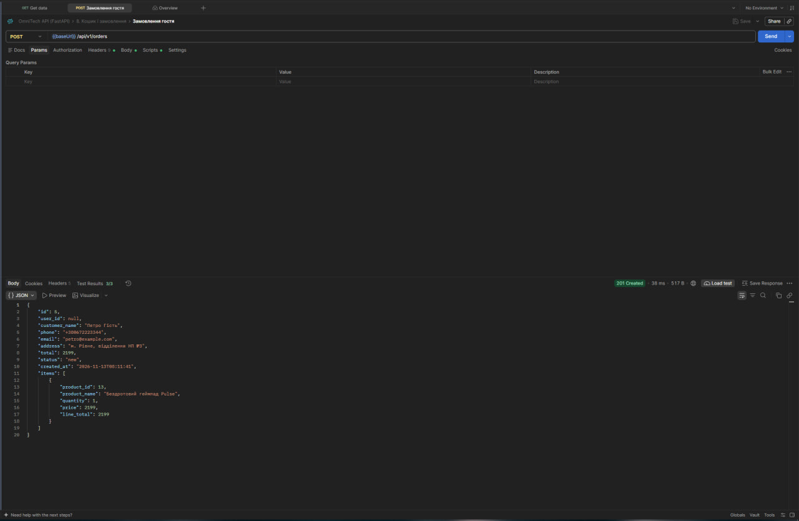
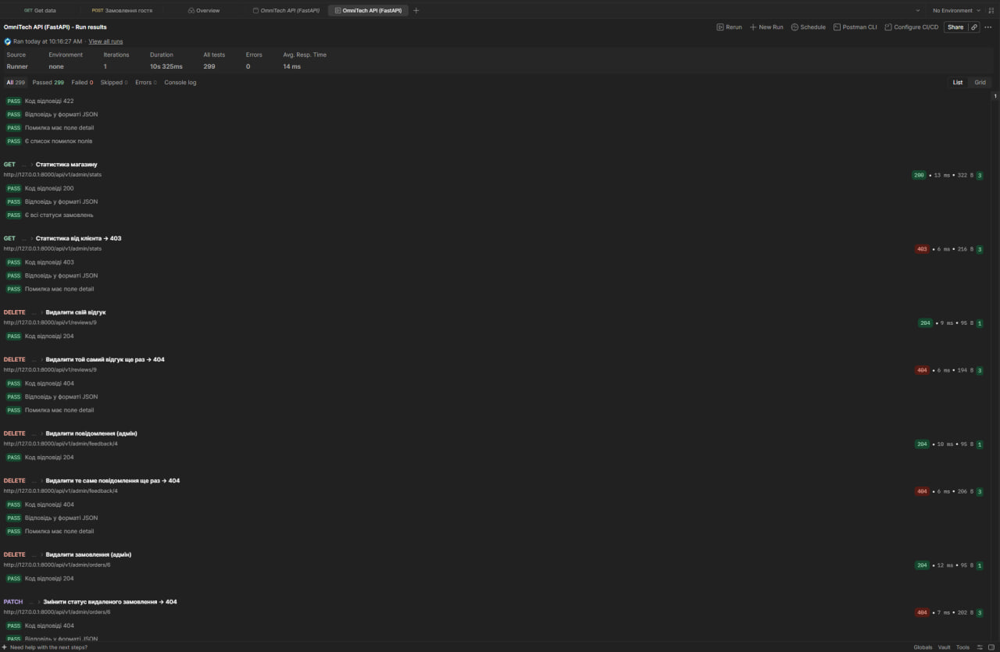
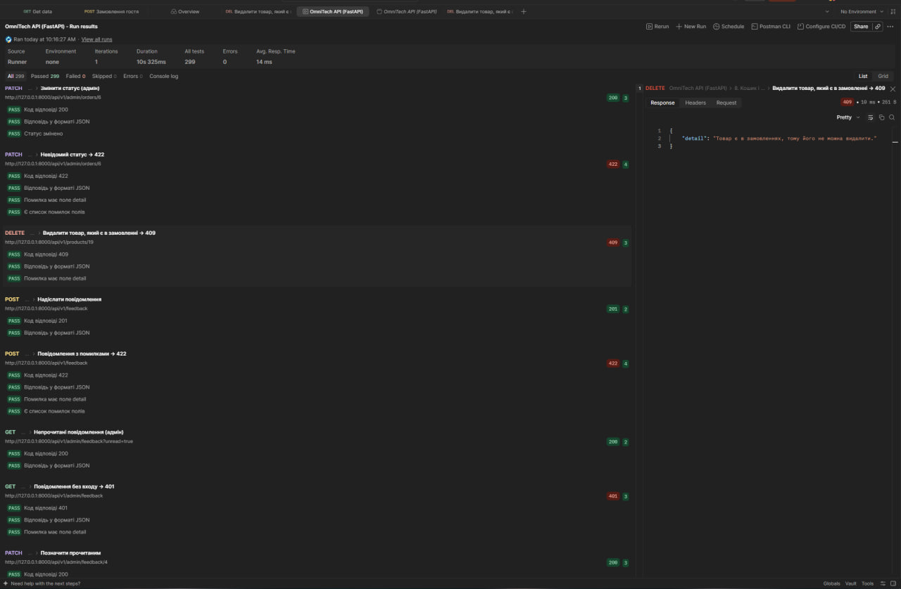

# Звіт з лабораторної роботи 05 «Розробка RESTful API з документацією»

## Загальні відомості

| | |
|---|---|
| **ПІБ** | Махнюк Андрій Сергійович |
| **Група** | ІПЗ-22 |
| **Роль у команді** | Developer |
| **Склад команди** | Дмитрук Назар (Team Lead), Махнюк Андрій (Developer), Бардюк Станіслав (QA) |
| **Тема проєкту** | OmniTech — REST API інтернет-магазину на FastAPI (продовження лабораторних 03–04) |
| **Репозиторій** | <https://github.com/Hyrysake/omnitech> |

## Особистий внесок

Я зробив кошик, замовлення, зворотний зв'язок, адміністрування замовлень, статистику й колекцію Postman для всього API.

1. **Кошик (`POST /api/v1/cart/preview`).** Сам кошик зберігає клієнт (у Lab 06 це буде браузер), а сервер лише перераховує його за актуальними цінами з бази. Однакові товари в кількох рядках об'єднуються. Товари, яких уже немає, повертаються списком `missing`, а не помилкою, щоб клієнт міг прибрати їх з кошика.
2. **Замовлення (`POST /api/v1/orders`).**
   - Оформити може і гість, і користувач після входу; тоді замовлення прив'язується до акаунта.
   - Ціни клієнт не надсилає. Якщо додати поле `price`, буде 422, бо схема забороняє невідомі поля. Сума рахується лише за цінами з бази.
   - Замовлення з усіма рядками записується одним `commit`: або все, або нічого.
   - Перевіряються: ім'я, телефон (10–13 цифр), пошта, адреса доставки, від 1 до 99 штук одного товару.
3. **Історія замовлень:** `GET /users/me/orders` (сторінками, нові спершу) і одне замовлення. На чуже замовлення відповідь **404**, а не 403: так не видно, що замовлення з таким номером існує.
4. **Адміністрування замовлень:** список з фільтром за статусом, одне замовлення, зміна статусу (лише з п'яти дозволених), видалення.
5. **Зворотний зв'язок:** форма «Контакти» (`POST /feedback`). Для адміністратора — список з фільтром «непрочитані», позначка «прочитано», видалення.
6. **Статистика (`GET /admin/stats`).** Показує кількість:
   - товарів, категорій, користувачів і відгуків;
   - замовлень за кожним статусом;
   - непрочитаних повідомлень;

   і суму виконаних замовлень.
7. **Колекція Postman (`backend/postman/postman_collection.json`).**
   - 102 запити в 11 папках, 299 автоматичних перевірок (`pm.test`).
   - Для кожної операції, в якій клієнт може помилитися, є успішний запит і запит з помилкою. Окремо перевіряються чужі дані: відгук (403), замовлення (404), токен видаленого акаунта (401).
   - Токени адміністратора й двох клієнтів після входу зберігаються в змінних колекції, і запити беруть їх самі.
   - Остання папка прибирає все створене, тож колекцію можна запускати кілька разів поспіль.
8. **Рев'ю:** перевірив і схвалив PR Станіслава:
   - відгуки (201, 409);
   - права (401, 403);
   - список бажань;
   - фільтри (400, 422);
   - видалення категорії з товарами (409).

**Посилання:**
- мої коміти: <https://github.com/Hyrysake/omnitech/commits?author=rotterdamsterdam>
- мій Pull Request: <https://github.com/Hyrysake/omnitech/pull/17>

**Інструменти:** VS Code, Git, GitHub, Postman (Collection Runner). Частину коду зроблено з допомогою AI (Claude), розібрано й перевірено мною.

## Ендпоінти моєї частини

| Метод | Адреса | Доступ |
|---|---|---|
| POST | `/api/v1/cart/preview` | усі |
| POST | `/api/v1/orders` | гість або вхід |
| GET | `/api/v1/users/me/orders`, `…/{id}` | вхід |
| POST | `/api/v1/feedback` | усі |
| GET / PATCH / DELETE | `/api/v1/admin/orders`, `…/{id}` | адмін |
| GET / PATCH / DELETE | `/api/v1/admin/feedback`, `…/{id}` | адмін |
| GET | `/api/v1/admin/stats` | адмін |

## Скріншоти

Замовлення гостя в Postman: 201, ціни з бази, статус `new`:

Прогін усієї колекції: 102 запити, усі перевірки пройдено:

Спроба видалити товар, який є в замовленні: 409 з поясненням:

## Технічні рішення

- **Кошик у клієнта, ціни на сервері.** Сервер нічого не пам'ятає між запитами (принцип REST stateless), тому кошик тримає клієнт. Але довіряти його цінам не можна: клієнт міг їх змінити. Тому і перегляд кошика, і замовлення беруть ціни з бази.
- **Ціна в рядку замовлення.** У рядку зберігається ціна на момент покупки. Якщо адміністратор пізніше змінить ціну товару, старі замовлення не зміняться.
- **Колекція без ручних кроків.** Номери створених записів (товар, відгук, замовлення) зберігаються в змінних колекції й підставляються в наступні запити. Тому колекцію можна запустити кнопкою **Run** від початку до кінця.

## Висновки

Замовлення — найбільш «грошова» частина API, і тут видно, навіщо правило «не довіряй клієнту»: ціни, наявність і права перевіряє лише сервер. Колекція Postman із 299 перевірками стала нашим «тестом на все»: кожен PR перевіряли прогоном колекції. Повторний прогін на тій самій базі показав, що API не лишає за собою сміття.
