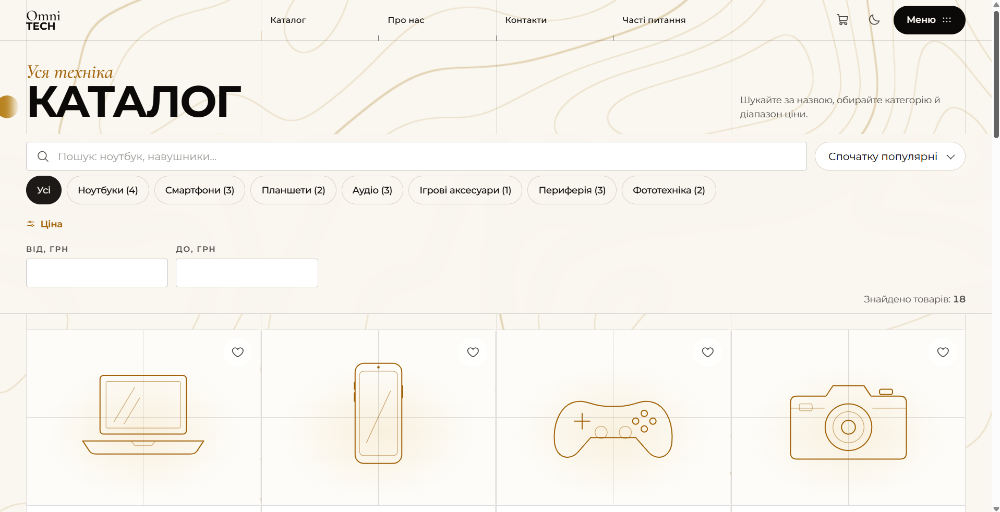
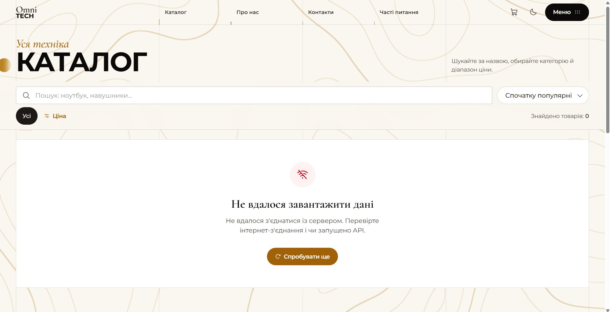
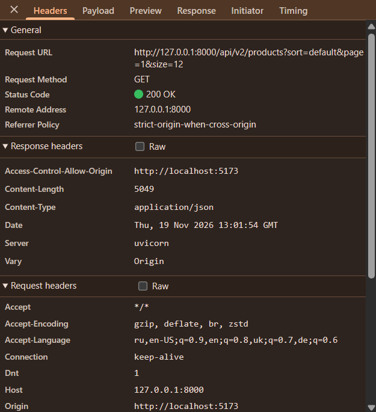
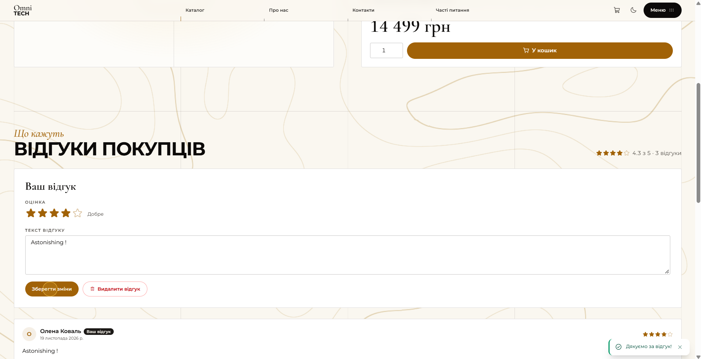

# Звіт з лабораторної роботи 06 «Інтеграція клієнтської частини з API та обробка помилок»

## Загальні відомості

| | |
|---|---|
| **ПІБ** | Дмитрук Назар Сергійович |
| **Група** | ІПЗ-22 |
| **Роль у команді** | Team Lead |
| **Склад команди** | Дмитрук Назар (Team Lead), Махнюк Андрій (Developer), Бардюк Станіслав (QA) |
| **Тема проєкту** | OmniTech — сайт інтернет-магазину на Vite + JavaScript, що працює через REST API з лабораторної 05 |
| **Репозиторій** | <https://github.com/Hyrysake/omnitech> |

## Особистий внесок

Я зробив основу фронтенду (спільний код і новий дизайн, на яких стоять частини всіх трьох учасників), а також головну, каталог, сторінку товару, відгуки, список бажань і модерацію відгуків. Основа пішла окремим PR, моя частина — трьома PR; частини Станіслава й Андрія не залежать від моїх: кожен змінює лише свої файли.

1. **Проєкт Vite (`frontend/`).** Багатосторінковий сайт: кожна сторінка — окремий HTML-файл зі своїм скриптом, усі вони перелічені у `vite.config.js`. Tailwind CSS підключено через npm. Адреса API береться з `.env` (`VITE_API_URL`), а не пишеться в коді. Версії пакетів зафіксовано в `package-lock.json`, тому на кожному комп'ютері `npm ci` ставить однакове.
2. **Клієнт API (`src/api/client.js`).** Одна функція `apiRequest` для всіх запитів сайту:
   - перевіряє `response.ok`, бо `fetch` не вважає 404 чи 500 помилкою;
   - перетворює будь-яку невдачу на `ApiError` з кодом, видом (`network`, `timeout`, `http`) і зрозумілим українським текстом; помилки полів (`errors`) з відповіді сервера зберігаються для форм;
   - обриває запит через 10 секунд (`AbortSignal.timeout`), щоб сторінка не «висіла» вічно;
   - для 204 повертає `null`, бо тіла там немає.
3. **Спільні частини (`src/ui/`, `src/layout/`, `src/auth/`, `src/store/`).** Повідомлення (toast), стани списку (скелетони під час завантаження, «нічого не знайдено», помилка з кнопкою «Спробувати ще»), перевірка форм, картка товару, пагінація, сторінка входу, сеанс входу (токен у `localStorage`, перехід на вхід і повернення назад із перевіркою адреси `?next=`), сховища кошика й списку бажань, каркас адмін-панелі та сторінка її огляду. Увесь HTML будується через `el()`: текст потрапляє на сторінку як текст, а не як розмітка, тому `<script>` у назві товару чи відгуку не виконається.
4. **Дизайн.** Той самий колір і шрифти, але інше відчуття сайту:
   - **шапка й меню на весь екран** — елемент `<dialog>`, `showModal()`: Esc закриває, фокус не виходить за межі меню, решта сторінки неактивна, усе без власного коду для цього;
   - **світла й темна теми**: система підказує тему, перемикач її змінює, вибір зберігається, а скрипт у `<head>` ставить її до малювання, тому «білого спалаху» немає; цей скрипт один на всі сторінки (`src/boot.inline.js`), у кожному HTML лише маркер `<!--boot-->`, який Vite замінює на його вміст;
   - **ефекти** (ідеї з lusion.co, landonorris.com і santalarch.com, без 3D): заставка з лічильником 0 → 100 один раз за сесію, фонові золоті контурні лінії (WebGL-шейдер, а без WebGL — SVG `public/contours.svg`), права смужка прокручування, золоті лінії, що малюються прокруткою (`stroke-dashoffset`), поява тексту по словах, закріплена розповідь на головній, золота шторка між сторінками (View Transitions). У шейдері є чужий код шуму simplex (MIT), закріплена розповідь і плавна прокрутка зроблені на GSAP і Lenis; ліцензії записано в `THIRD-PARTY.md`. Усе вимикається перемикачем «Рух» і системним `prefers-reduced-motion`; режим сторінки (`data-mode`: `full`, `calm`, `admin`) вирішує, скільки ефектів увімкнено;
   - **швидкість**: на головній немає ресурсів із чужих сайтів, бібліотеку іконок скорочено з 1500 значків до потрібних семи десятків, GSAP і Lenis завантажуються окремим файлом після першого малювання. Ефекти трохи знижують швидкість у Lighthouse (головна близько 88–92, сторінки з даними нижчі); вимог до швидкості в лабораторній немає;
   - **доступність**: посилання «Перейти до вмісту», видимий фокус, підписи до всіх полів, контраст не нижчий за WCAG AA в обох темах (Lighthouse Accessibility 100 на всіх перевірених сторінках).
5. **Головна сторінка.** Велике слово-вивіска, закріплена розповідь у чотири кроки, список категорій (`GET /api/v1/categories`), розділ «Популярні товари» (`GET /api/v2/products?featured=true`).
6. **Каталог.** Живий пошук (запит іде, коли людина на мить перестала друкувати), кнопки-категорії, ціна від–до, сортування (власний випадний список замість звичайного `<select>`), сторінки. Коли прогорнути вниз і почати гортати вгору, фільтри з'являються панеллю під шапкою (`src/ui/floating-filters.js`). Фільтри записуються в адресу (`?q=…&category=…&page=…`): посиланням можна поділитися, а кнопка «Назад» повертає попередній фільтр. Якщо фільтр змінили, поки попередній запит ще йде, старий запит скасовується (`AbortController`), щоб його відповідь не перекрила нову.
7. **Сторінка товару.** Дані з `GET /api/v2/products/{id}` (категорія й рейтинг уже всередині), неіснуючий товар — «Товар не знайдено» (404).
8. **Відгуки.** Список зі сторінками; форма з вибором зірок (`POST`), а якщо відгук уже є — редагування (`PATCH`) і видалення. Після змін рейтинг товару перезавантажується з сервера.
9. **Список бажань.** Сердечко на картках і на сторінці товару (`PUT`/`DELETE /users/me/wishlist/{id}`), сторінка «Список бажань». Сердечко змінюється одразу, а якщо сервер відмовив — повертається назад з повідомленням.
10. **Модерація відгуків.** Сторінка адмін-панелі з усіма відгуками і видаленням.
11. **README** (звіт команди): запуск сайту, структура, сторінки, як сайт працює з API, дизайн, результати тестування, знімки екрана трьох учасників.
12. **Рев'ю:** перевірив і схвалив PR Станіслава (реєстрація, профіль, адмін-панель каталогу) і Андрія (сторінки, кошик, замовлення) за чеклістом.

**Посилання:**
- мої коміти: <https://github.com/Hyrysake/omnitech/commits?author=Hyrysake>
- мої Pull Request: <https://github.com/Hyrysake/omnitech/pulls?q=is%3Apr+author%3AHyrysake> (#22 основа, #24 головна й каталог, #28 товар і відгуки, #30 список бажань і модерація, #31 і #32 виправлення)

**Інструменти:** VS Code, Git, GitHub, Node.js, Vite, браузер (DevTools). Частину коду зроблено з допомогою AI (Claude), розібрано й перевірено мною.

## Сторінки моєї частини та запити до API

| Сторінка | Файли | Запити |
|---|---|---|
| Головна | `index.html`, `src/pages/home.js` | `GET /api/v1/categories`, `GET /api/v2/products?featured=true` |
| Каталог | `catalog.html`, `src/pages/catalog.js`, `src/ui/floating-filters.js` | `GET /api/v1/categories`, `GET /api/v2/products` |
| Товар | `product.html`, `src/pages/product.js` | `GET /api/v2/products/{id}`, `GET /api/v1/products/{id}/reviews` |
| Відгук (форма на сторінці товару) | `src/ui/review-form.js` | `POST /api/v1/products/{id}/reviews`, `PATCH`, `DELETE /api/v1/reviews/{id}` |
| Список бажань | `wishlist.html`, `src/pages/wishlist.js`, `src/store/wishlist.js` | `GET /api/v1/users/me/wishlist`, `PUT`, `DELETE /api/v1/users/me/wishlist/{id}` |
| Відгуки (адмін) | `admin/reviews.html`, `src/pages/admin/reviews.js` | `GET /api/v1/admin/reviews`, `DELETE /api/v1/reviews/{id}` |
| Вхід (основа) | `login.html`, `src/pages/login.js`, `src/auth/` | `POST /api/v1/auth/token` |
| Огляд адмінки (основа) | `admin/index.html`, `src/pages/admin/dashboard.js`, `src/layout/admin.js` | `GET /api/v1/admin/stats` |
| Сторінка 404 | `404.html` | — |

## Тестування

| Що перевіряв | Результат |
|---|---|
| Каталог: категорія «Ноутбуки», потім пошук «ноутбук» | 4 товари, потім 3 (Zenith 13 — «ультрабук», слова «ноутбук» у ньому немає); фільтри в адресі; «Назад» повертає попередній стан |
| Сервер API вимкнено (Ctrl+C у терміналі сервера) | «Не вдалося з'єднатися із сервером…» і кнопка «Спробувати ще»; після запуску сервера кнопка завантажує товари |
| Network → **Offline** | те саме повідомлення, сторінка не ламається |
| Network → **Slow 4G** | скелетони замість товарів, поки йде запит |
| `product.html?id=999999` | «Товар не знайдено» (404) |
| Відгук з однією зіркою й порожнім текстом | помилка під полем, запит не надсилається |
| Другий відгук на той самий товар з іншої вкладки (у першій форма вже в режимі редагування) | сервер відповідає 409, форма переходить у режим редагування |
| Назва товару `` | показується як текст, нічого не виконується |
| Console на всіх сторінках | без червоних помилок |

## Скріншоти

Каталог з пошуком і фільтром за категорією; фільтри видно в адресі:

Сервер API вимкнено: повідомлення й кнопка «Спробувати ще»:

Вкладка Network: запит до `/api/v2/products` і його відповідь у JSON:

Відгук додано, рейтинг товару оновився:

## Технічні рішення

- **Один клієнт API замість `fetch` на кожній сторінці.** Таймаут, перевірку `response.ok`, текст помилки й токен написано один раз, тому кожна сторінка обробляє і 404, і вимкнений сервер однаково.
- **`try/catch` — це ще не обробка помилок.** `fetch` кидає виняток лише тоді, коли відповіді немає зовсім. Відповідь 404 чи 500 приходить «успішно», тому `apiRequest` сам перевіряє `response.ok`, а сторінка показує людині, що сталося і що робити далі.
- **Фільтри в адресі, а не в змінних.** Сторінку каталогу можна оновити, надіслати посиланням чи повернутися до неї кнопкою «Назад», і фільтр збережеться. Значення з адреси перевіряються, бо змінити адресу може будь-хто.
- **Сердечко змінюється одразу.** Сайт не чекає на відповідь сервера, щоб натиск відчувався миттєвим, а якщо сервер відмовив — повертає попередній стан.
- **CORS.** Сайт (`localhost:5173`) і API (`127.0.0.1:8000`) — різні джерела, тому браузер дозволяє запити лише тому, що сервер з лабораторної 05 перелічує адресу сайту в `CORS_ORIGINS`.

## Висновки

Лабораторна показала, що головна робота клієнта — не сам запит, а все навколо нього: що бачить людина, поки дані йдуть, коли сервер вимкнено, коли відповідь прийшла з помилкою або запізнилась. Спільний клієнт API і спільні стани списку дали один спосіб робити це на кожній сторінці сайту. Найкорисніше на практиці — вкладка Network: у ній видно кожен запит, заголовок з токеном і відповідь сервера, тому більшість помилок знаходилась саме там.
