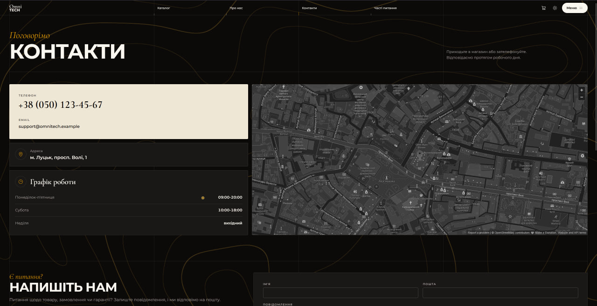
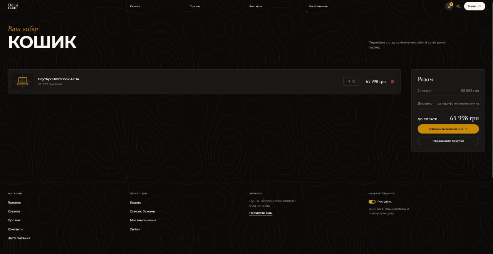
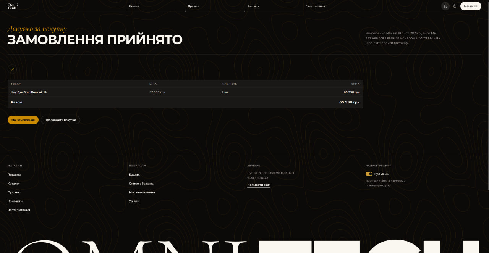
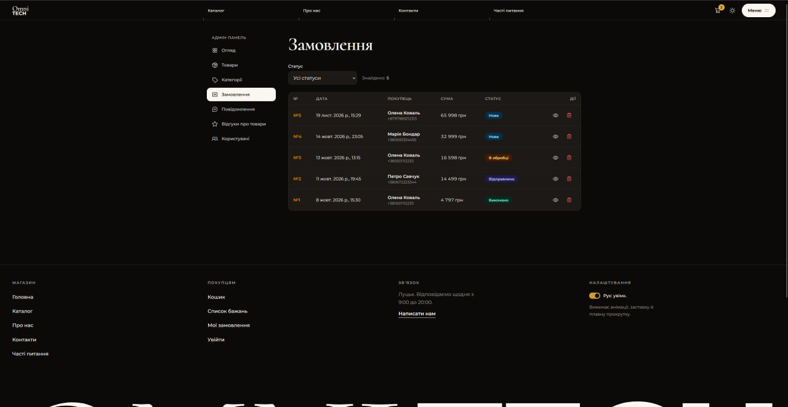

# Звіт з лабораторної роботи 06 «Інтеграція клієнтської частини з API та обробка помилок»

## Загальні відомості

| | |
|---|---|
| **ПІБ** | Махнюк Андрій Сергійович |
| **Група** | ІПЗ-22 |
| **Роль у команді** | Developer |
| **Склад команди** | Дмитрук Назар (Team Lead), Махнюк Андрій (Developer), Бардюк Станіслав (QA) |
| **Тема проєкту** | OmniTech — сайт інтернет-магазину на Vite + JavaScript, що працює через REST API з лабораторної 05 |
| **Репозиторій** | <https://github.com/Hyrysake/omnitech> |

## Особистий внесок

Я зробив інформаційні сторінки, кошик, оформлення й історію замовлень, а також замовлення й повідомлення в адмін-панелі трьома PR. Спільний код (клієнт API, сховище кошика, шапка, сеанс входу) лежить в основі сайту, мої сторінки працюють на ньому.

1. **«Про нас», «Часті питання», «Контакти».** Тексти й оформлення — з лабораторної 04. Форма «Напишіть нам» надсилає `POST /api/v1/feedback`: перевірка полів у браузері (ім'я, пошта, повідомлення від 10 до 2000 символів, лічильник символів), повідомлення про успіх. Користувачу, який увійшов, ім'я й пошта підставляються самі.
2. **Кошик (сторінка `src/pages/cart.js`, сховище `src/store/cart.js` — з основи).**
   - Зберігається в `localStorage` лише як номери товарів і кількість: `[{product_id, quantity}]`. Кількість обмежена 1–99, як на сервері.
   - Ціни й суми рахує сервер (`POST /api/v1/cart/preview`), тож підробити ціну в браузері неможливо, а зміна ціни в каталозі одразу видна в кошику.
   - Якщо товар видалили з каталогу, сервер повертає його номер у `missing`, а кошик прибирає його й пояснює чому.
   - Число біля іконки кошика (шапка з основи) оновлюється на всіх сторінках за подією `cart:changed`, а також в інших вкладках за подією `storage`; моя сторінка кошика змінює вміст і сповіщає шапку.
3. **Оформлення замовлення.** Форма з перевіркою (ім'я, телефон 10–13 цифр, пошта, адреса від 5 символів), `POST /api/v1/orders`. Гість замовляє без входу; якщо користувач увійшов, токен надсилається і замовлення потрапляє в його історію. Кнопка неактивна, поки йде запит, тож подвійний клік не створить два замовлення. Після успіху — сторінка «Дякуємо» з номером і складом замовлення, кошик очищується.
4. **«Мої замовлення».** Список (сторінками) і деталі одного замовлення з цінами на момент покупки. Чуже замовлення сервер «не знаходить» (404).
5. **Адмін-панель.** Замовлення: список з фільтром за статусом, сторінка замовлення зі зміною статусу (`PATCH`) і видаленням. Повідомлення: список з фільтром «лише непрочитані», позначка прочитаного (`PATCH`), видалення.

**Посилання:**
- мої коміти: <https://github.com/Hyrysake/omnitech/commits?author=rotterdamsterdam>
- мої Pull Request: <https://github.com/Hyrysake/omnitech/pulls?q=is%3Apr+author%3Arotterdamsterdam> (#25 сторінки й контакти, #27 кошик і замовлення, #29 адмін: замовлення й повідомлення)

**Інструменти:** VS Code, Git, GitHub, Node.js, Vite, браузер (DevTools). Частину коду зроблено з допомогою AI (Claude), розібрано й перевірено мною.

## Сторінки моєї частини та запити до API

| Сторінка | Файли | Запити |
|---|---|---|
| Про нас, Часті питання | `about.html`, `faq.html`, `src/pages/static.js` | — |
| Контакти | `contacts.html`, `src/pages/contacts.js` | `POST /api/v1/feedback` |
| Кошик | `cart.html`, `src/pages/cart.js` | `POST /api/v1/cart/preview` |
| Оформлення | `checkout.html`, `src/pages/checkout.js` | `POST /api/v1/cart/preview`, `POST /api/v1/orders` |
| Замовлення оформлено | `order-done.html`, `src/pages/order-done.js` | `GET /api/v1/users/me/orders/{id}` (якщо немає збережених даних) |
| Мої замовлення | `orders.html`, `order.html`, `src/pages/orders.js`, `src/pages/order.js` | `GET /api/v1/users/me/orders`, `GET /api/v1/users/me/orders/{id}` |
| Замовлення (адмін) | `admin/orders.html`, `admin/order.html` | `GET /api/v1/admin/orders`, `GET`, `PATCH`, `DELETE /api/v1/admin/orders/{id}` |
| Повідомлення (адмін) | `admin/feedback.html` | `GET /api/v1/admin/feedback`, `PATCH`, `DELETE /api/v1/admin/feedback/{id}` |

## Тестування

| Що перевіряв | Результат |
|---|---|
| Форма «Контакти» порожня / коротке повідомлення | 3 повідомлення під полями / «Мінімальна довжина — 10 симв.» |
| 2 різні товари, у одного кількість 3 | суми перераховано сервером, число біля кошика — 4 |
| Оформлення з телефоном `123` | помилка під полем, запит не надсилається |
| Оформлення гостем | 201, сторінка з номером замовлення, кошик порожній |
| Оформлення користувачем | замовлення з'явилось у «Мої замовлення» |
| Чуже замовлення за адресою `order.html?id=…` | «Замовлення не знайдено» (сервер повертає 404) |
| Network під час оформлення | `POST /api/v1/orders` → 201, у тілі лише номери й кількість товарів, цін немає |
| Адмін змінив статус | покупець бачить новий статус у своїй історії |

## Скріншоти

Форма «Контакти» з помилками під полями:

Кошик: ціни й суми порахував сервер:

Замовлення оформлено: номер і склад замовлення:

Замовлення в адмін-панелі з фільтром за статусом:

## Технічні рішення

- **Кошик без цін.** У браузері лежать лише номери й кількість. Ціну знає тільки сервер, тому навіть якщо хтось змінить `localStorage`, заплатить він за цінами з бази.
- **Сторінка «Дякуємо» для гостя.** Гість не має доступу до історії замовлень (`/users/me/orders` потребує входу), тому сторінка оформлення зберігає відповідь сервера в `sessionStorage`, а сторінка «Дякуємо» показує її.
- **Порожній кошик серверу не надсилаємо.** Схема `CartIn` вимагає хоча б один товар (інакше 422), тому порожній кошик одразу показує «Кошик порожній» без запиту.
- **Захист від подвійного замовлення.** Поки запит не завершився, кнопка «Підтвердити замовлення» неактивна і показує «Оформлюємо…».

## Висновки

Кошик показав, як розділити відповідальність між браузером і сервером: браузер пам'ятає вибір людини, а все, що стосується грошей, рахує сервер. Оформлення замовлення навчило думати про ситуації, коли щось змінюється між діями: товар видалили, поки він лежав у кошику, або користувач натиснув кнопку двічі. Адмін-сторінки замовлень і повідомлень використали ті самі компоненти (таблиця, пагінація, вікно підтвердження), що й решта адмінки, тому писати їх було швидко.
