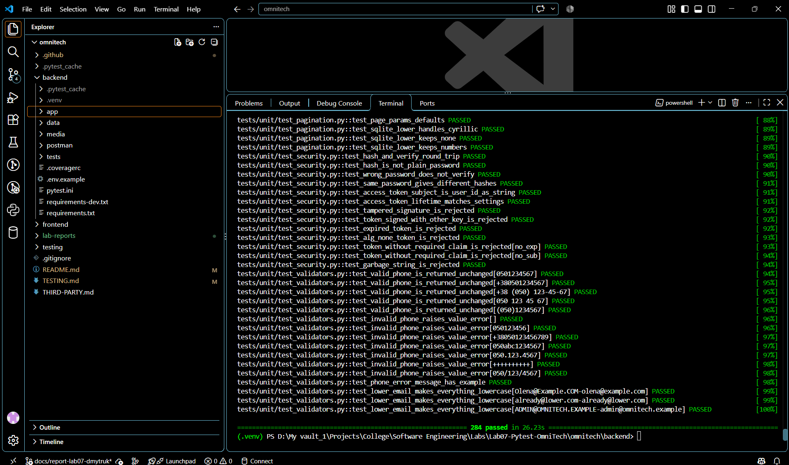
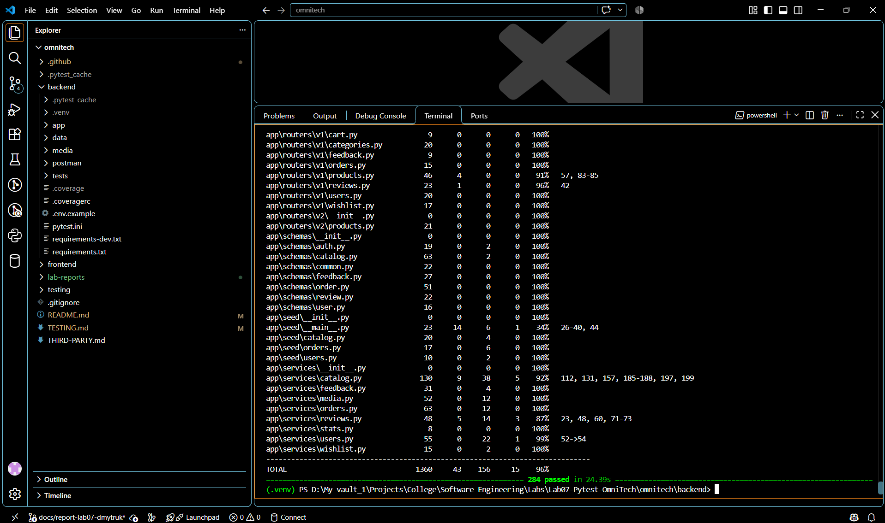
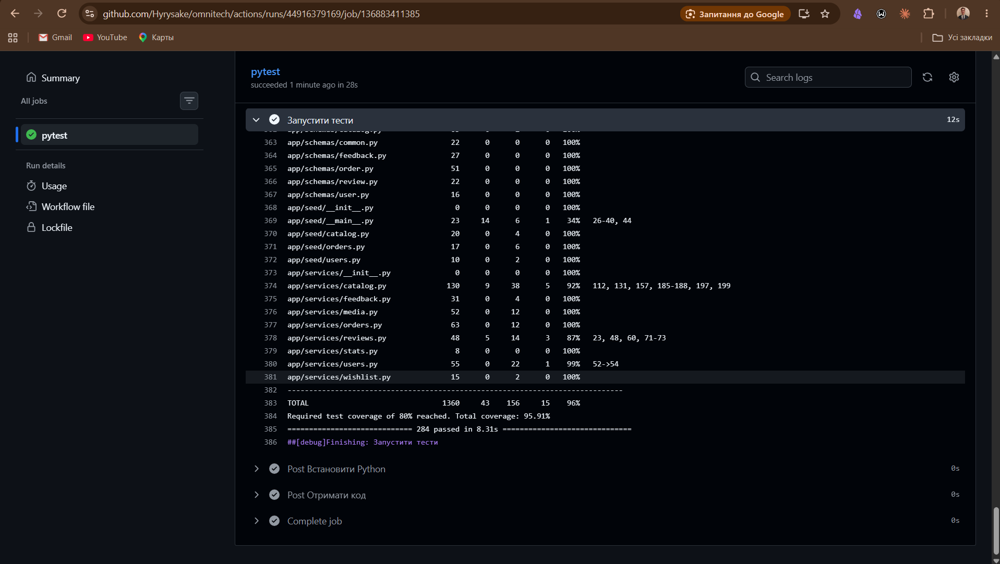

# Звіт з лабораторної роботи 07 «Написання unit та integration тестів»

## Загальні відомості

| | |
|---|---|
| **ПІБ** | Дмитрук Назар Сергійович |
| **Група** | ІПЗ-22 |
| **Роль у команді** | Team Lead |
| **Склад команди** | Дмитрук Назар (Team Lead), Махнюк Андрій (Developer), Бардюк Станіслав (QA) |
| **Тема проєкту** | OmniTech — автоматичні тести REST API інтернет-магазину (FastAPI, pytest) |
| **Репозиторій** | <https://github.com/Hyrysake/omnitech> |

## Особистий внесок

Я налаштував тестування для всієї команди й написав тести для основи бекенду, яку робив у лабораторній 05: налаштувань, паролів і токенів, формату помилок, входу й профілю. Робота йшла чотирма Pull Request: спільна основа, unit тести, integration тести і останній PR зі звітом та порогом покриття. Кожен учасник працював зі своїми файлами, тому ми зливали PR у будь-якому порядку. Тільки мій останній PR треба було злити після всіх інших.

1. **Спільна основа (PR `feature/tests-base`, мітка `lab07-base`).**
   - `pytest.ini`, `.coveragerc` і `requirements-dev.txt`. Тести шукаються в `tests/`, корінь імпортів — `backend/`. Бібліотеки для тестів (pytest, pytest-cov, httpx2) лежать окремо від бібліотек застосунку: серверу вони не потрібні.
   - `tests/conftest.py`. Ще до імпорту застосунку тести направляють базу й папку файлів у тимчасову теку і задають тестовий `SECRET_KEY`. Тому робоча база `omnitech.db` не змінюється, а файл `.env` для тестів не потрібен. Запобіжник `assert` зупинить тести, якщо база раптом не тимчасова. Fixture `db` перед кожним тестом створює таблиці заново, `client` — це `TestClient`, який шле запити застосунку без запуску сервера. Фабрики `make_user`, `make_category`, `make_product` і готові заголовки входу `user_headers`, `admin_headers` потрібні тестам усіх трьох учасників. argon2 у тестах працює з найлегшими параметрами, тож тести не чекають на повільне хешування паролів.
   - `tests/integration/test_health.py` (2 тести): перевіряє, що сервер відповідає, і що неіснуюча адреса дає 404 у нашому форматі. Він потрібен, щоб одразу після основи `pytest` мав що запускати.
   - `.github/workflows/tests.yml` без порогу покриття, скелет `TESTING.md` і розділ «Тести (backend)» у README.
   - Після злиття основи я поставив мітку `lab07-base`, від неї пішли перші гілки всіх трьох учасників.
2. **Unit тести (PR `feature/tests-core-unit`, 58 тестів).**
   - Рефакторинг для тестів: підрахунок кількості сторінок винесено з `paginate` в окрему функцію `page_count(total, size)` у `app/db/pagination.py`, щоб перевірити її без бази.
   - `test_security.py` (13): хеш і перевірка пароля, сіль, вміст токена й термін дії, відмова для підробленого підпису, простроченого токена, алгоритму `none`, токена без `exp` чи `sub`.
   - `test_validators.py` (16): телефон (межі 10–13 цифр, літери, дужки й пробіли), пошта в нижньому регістрі.
   - `test_errors.py` (15): назви полів у помилках (`items.0.quantity`), переклад помилок Pydantic українською, формат тіла помилки.
   - `test_pagination.py` (14): `page_count` на межах (0, 12, 13, 24, 25 записів), зсув сторінки, `lower()` для кирилиці.
3. **Integration тести (PR `feature/tests-core-integration`, 43 тести і файл `testing/TESTING-dmytruk.md`).**
   - `test_auth.py` (13): реєстрація (201, пароля у відповіді немає), зайнята пошта 409, неправильні поля 422, вхід, однакова відповідь 401 для неправильного пароля й неіснуючої пошти.
   - `test_users.py` (12): профіль без токена, з підробленим, простроченим і токеном видаленого акаунта (усі 401), зміна імені, пароля (неправильний поточний — 400), видалення акаунта, адміністратор не видаляє себе (409).
   - `test_admin_users.py` (14): список користувачів лише для адміністратора (401, 403), пошук кирилицею, межі розміру сторінки.
   - `test_seed.py` (4): демо-дані заповнюються, повторний запуск не створює дублікатів.
   - `testing/TESTING-dmytruk.md`: таблиці моїх тестів (що перевіряє, очікуваний результат).
4. **Останній PR (`docs/report-lab07-dmytruk`).** У workflow додано поріг `--cov-fail-under=80`: покриття нижче 80 % робить перевірку червоною. `TESTING.md` доповнено результатами, покриттям і висновками, у README додано значок «Тести» й розділ про тестування, тут же цей звіт. Поріг стоїть у цьому PR, а не в основі, бо тести однієї людини не покривають весь бекенд: лише мої 103 тести дають 72 %, мої й Андрія — 79 %, мої й Станіслава — 91 %, усі разом — 96 %. Тому цей PR я зливаю останнім.
5. **Рев'ю:** перевірив і схвалив PR Станіслава (тести каталогу) та Андрія (тести кошика, замовлень, зворотного зв'язку й статистики): для кожного перевіряв, що змінено лише файли з його пакета, і запускав `pytest`.

Разом у мене 103 тести: 58 unit і 45 integration (разом з двома тестами стану сервера з основи).

**Посилання:**
- мої коміти: <https://github.com/Hyrysake/omnitech/commits?author=Hyrysake>
- мої Pull Request: <https://github.com/Hyrysake/omnitech/pulls?q=is%3Apr+author%3AHyrysake> (#37 основа, #39 unit тести основи, #42 integration тести основи)

**Інструменти:** VS Code, Git, GitHub, GitHub Actions, Python, pytest, pytest-cov. Частину коду зроблено з допомогою AI (Claude), розібрано й перевірено мною.

## Тестування

| Що перевіряв | Результат |
|---|---|
| `pytest` у папці `backend/`, усі частини злито | 284 passed, близько 25 с |
| `pytest tests/unit` | 138 passed менше ніж за секунду: unit тести без бази найшвидші |
| мої чотири unit файли (`tests/unit/test_security.py`, `test_validators.py`, `test_errors.py`, `test_pagination.py`) | 58 passed |
| `pytest --cov=app --cov-report=term-missing`, усі частини | 96 % покриття `app/` |
| те саме, але лише мої тести (103) | 72 % |
| Навмисна помилка: у `page_count` замінив `ceil(total / size)` на `total // size` | на моїй гілці 3 тести червоні: випадки `test_page_count` з 1, 13 і 25 записами (наприклад, `assert 0 == 1` — pytest показав отримане й очікуване). Коли злито всі частини, червоних 6: ще два тести адмін-користувачів і тест списку товарів, які рахують сторінки через API. Повернув рядок — усі зелені |
| Тести працюють з тимчасовою базою | `backend/data/omnitech.db` не змінюється: `conftest.py` задає тимчасову базу до імпорту, а `assert` зупиняє тести, якщо вона не тимчасова |
| PR на GitHub | вкладка **Checks**: «Тести» — зелена галочка |

## Скріншоти

Результат `pytest -v`: усі тести пройдено:

Звіт про покриття:

GitHub Actions: тести пройшли в Pull Request з порогом покриття:

## Технічні рішення

- **Схема AAA і граничні значення.** Тести з кількома кроками поділено коментарями `# Arrange / # Act / # Assert`. Межі (телефон 9/10/13/14 цифр, сторінки 0/12/13/25, розмір сторінки 0/50/51) перевіряє `@pytest.mark.parametrize`: кожне значення — окремий рядок у `pytest -v`.
- **Налаштування до імпорту.** Застосунок читає налаштування один раз, коли його імпортують. Якби тести задали базу пізніше, вони вже працювали б із робочою базою. Тому змінні оточення стоять на самому початку `conftest.py`.
- **Справжня база SQLite у тимчасовому файлі, а не в пам'яті.** Працюють ті самі перевірки зовнішніх ключів і `lower()` для кирилиці, що й на сервері, а різні з'єднання тестового клієнта бачать ті самі дані.
- **Токен без входу через API.** Фабрика створює токен функцією `create_access_token`, тож кожен тест не мусить спершу входити. Сам вхід перевіряють окремі тести в `test_auth.py`.
- **Окремі `unit/` і `integration/`.** `pytest tests/unit` дає швидку перевірку менше ніж за секунду.
- **Спільна основа й окремі файли.** Усе, що потрібне всім (налаштування, `conftest.py`, workflow), лежить в основі. Після неї кожен змінює лише свої файли, тому конфліктів при злитті немає.
- **Поріг покриття в останньому PR.** Він працює лише тоді, коли злито тести всіх трьох. Якби поріг стояв в основі, перші PR були б червоними.

## Висновки

Лабораторна показала, що тести — це не окрема робота після коду, а спосіб переконатися, що код робить те, що ми про нього кажемо. Найважче було не написати `assert`, а підготувати умови: тимчасову базу, налаштування до імпорту, швидкі паролі. Після цього тест на будь-який ендпоінт займає кілька рядків. GitHub Actions перетворив тести на правило команди: PR з червоною перевіркою видно одразу, ще до рев'ю.
