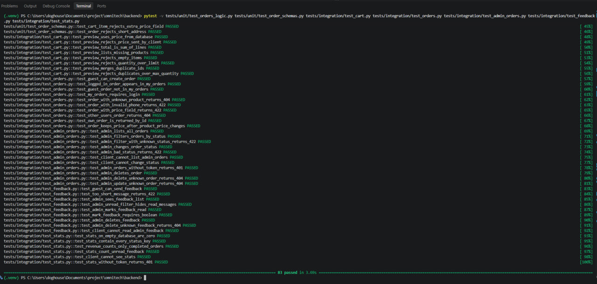
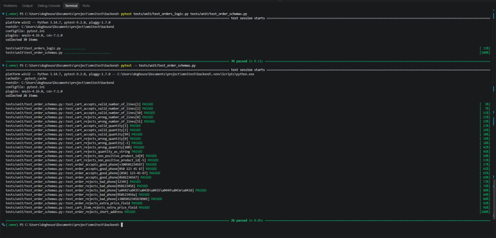
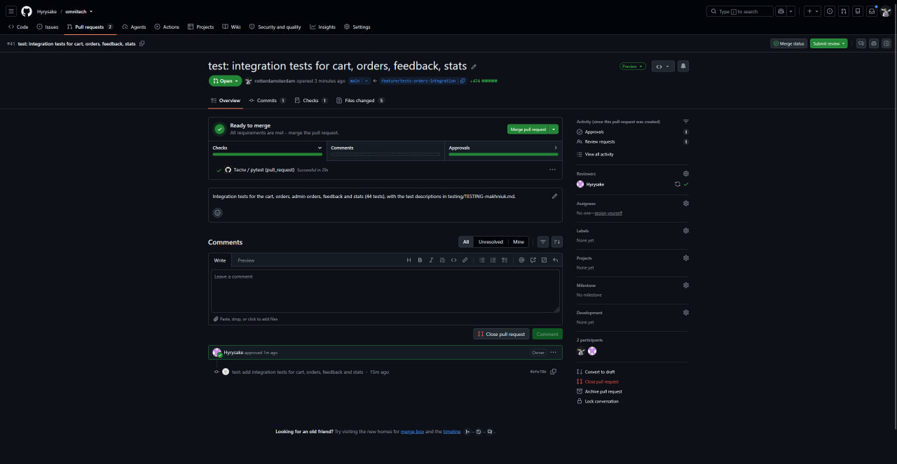

# Звіт з лабораторної роботи 07 «Написання unit та integration тестів»

## Загальні відомості

| | |
|---|---|
| **ПІБ** | Махнюк Андрій Сергійович |
| **Група** | ІПЗ-22 |
| **Роль у команді** | Developer |
| **Склад команди** | Дмитрук Назар (Team Lead), Махнюк Андрій (Developer), Бардюк Станіслав (QA) |
| **Тема проєкту** | OmniTech — автоматичні тести REST API інтернет-магазину (FastAPI, pytest) |
| **Репозиторій** | <https://github.com/Hyrysake/omnitech> |

## Особистий внесок

Я написав тести для своєї частини з лабораторної 05: кошика, замовлень, зворотного зв'язку, адмін-замовлень і статистики. Робота йшла трьома Pull Request: unit тести (разом з рефакторингом), integration тести і PR зі звітом. Першу гілку я створив від мітки `lab07-base`, яку Назар поставив після злиття спільної основи. Мої файли не збігаються з файлами Назара й Станіслава, тому наші PR зливалися в будь-якому порядку.

1. **Unit тести (PR `feature/tests-orders-unit`, 39 тестів).**
   - Рефакторинг: суму замовлення рахували двічі, у попередньому перегляді кошика й під час створення замовлення (`sum(...)` у двох місцях `services/orders.py`). Я виніс її в одну функцію `order_total(prices_and_quantities)`. Тепер обидва місця рахують однаково, а саму суму можна перевірити unit тестом без бази. Поведінка API не змінилась.
   - `test_orders_logic.py` (13): `order_total` (порожнє замовлення, один рядок, кілька рядків, максимальна кількість, генератор пар); об'єднання однакових товарів у кошику; перевищення найбільшої кількості (90 + 10) — помилка з полем `items`; сума рядка замовлення.
   - `test_order_schemas.py` (26): межі схем кошика й замовлення через `ValidationError`: 0, 1, 50 і 51 рядок; кількість 0, 1, 99 і 100; правильні й неправильні телефони; поле `price` від клієнта заборонене.
2. **Integration тести (PR `feature/tests-orders-integration`, 44 тести і файл `testing/TESTING-makhniuk.md`).**
   - `test_cart.py` (8): ціни беруться з бази, ціна від клієнта — 422; сума; неіснуючі товари в `missing`; порожній кошик 422; однакові товари об'єднуються.
   - `test_orders.py` (10): замовлення гостя 201; замовлення користувача з'являється в його історії; неіснуючий товар 404; неправильний телефон 422; чуже замовлення 404; замовлення зберігає ціну, навіть коли ціна товару змінилась.
   - `test_admin_orders.py` (11): список з фільтром за статусом, зміна статусу, неправильний статус 422, покупець 403, видалення, неіснуюче 404.
   - `test_feedback.py` (9): повідомлення від гостя 201, закоротке 422, фільтр «непрочитані», позначка прочитаного, видалення, покупець 403.
   - `test_stats.py` (6): на порожній базі всі лічильники нульові, виручка рахує лише виконані замовлення, покупець 403.
   - `testing/TESTING-makhniuk.md`: таблиці моїх тестів (що перевіряє, очікуваний результат).
3. **Звіт (PR `docs/report-lab07-makhniuk`):** цей файл і мої знімки екрана.

Разом у мене 83 тести: 39 unit і 44 integration.

**Посилання:**
- мої коміти: <https://github.com/Hyrysake/omnitech/commits?author=rotterdamsterdam>
- мої Pull Request: <https://github.com/Hyrysake/omnitech/pulls?q=is%3Apr+author%3Arotterdamsterdam> (#38 unit тести замовлень, #41 integration тести кошика й замовлень)

**Інструменти:** VS Code, Git, GitHub, GitHub Actions, Python, pytest, pytest-cov. Частину коду зроблено з допомогою AI (Claude), розібрано й перевірено мною.

## Тестування

| Що перевіряв | Результат |
|---|---|
| `pytest -v` з моїми 7 файлами (`tests/unit/test_orders_logic.py`, `test_order_schemas.py` і п'ять файлів у `tests/integration/`) | 83 passed |
| `pytest -v tests/unit/test_order_schemas.py` | кожне граничне значення — окремий рядок звіту, наприклад `test_cart_rejects_wrong_quantity[100]` |
| `pytest` у папці `backend/`, усі частини злито | 284 passed, близько 25 с |
| `pytest --cov=app --cov-report=term-missing` з моїми тестами | мої модулі повністю покриті: `services/orders.py`, `feedback.py`, `stats.py` і маршрути кошика, замовлень, адмін-замовлень, зворотного зв'язку та статистики — по 100 %. По всьому `app/` з усіма частинами — 96 % |
| Навмисна помилка: в `order_total` замінив `price * quantity` на `price + quantity` | 10 червоних тестів: 4 unit і 6 integration (кошик, замовлення, статистика); повернув — усі зелені |
| GitHub Actions у моїх PR | зелена перевірка «Тести» |

## Скріншоти

Мої тести замовлень у `pytest -v`:

Параметризований тест: кожне граничне значення окремо:

GitHub Actions: зелена перевірка в PR з integration тестами:

## Технічні рішення

- **Одна функція для суми.** Якби суму рахували у двох місцях по-різному, кошик міг би показати одну суму, а замовлення записати іншу. Тепер помилка в сумі одразу ламає тести і кошика, і замовлень.
- **Схема AAA.** У тестах кошика й замовлень спочатку готую дані (товар, користувача, кошик), потім роблю один запит, потім перевіряю відповідь і базу; у коротких unit тестах `order_total` ці три кроки вміщаються в кілька рядків без коментарів.
- **Ціна на момент покупки.** Тест змінює ціну товару після замовлення й перевіряє, що в замовленні лишилась стара. Так ми переконались, що історія замовлень не «переписується».
- **Чуже замовлення — 404, а не 403.** Тест перевіряє, що сервер навіть не підтверджує, що замовлення з таким номером існує.

## Висновки

Тести показали, навіщо виносити логіку в окремі функції: `order_total` раніше була схована всередині двох сервісів, і перевірити її можна було лише через базу. Після рефакторингу її перевіряє один швидкий unit тест, а навмисна помилка в ній одразу видна в десяти місцях. Також зрозумів, що для замовлень найважливіші негативні сценарії: чуже замовлення, неіснуючий товар, ціна від клієнта, бо саме там можлива втрата грошей чи даних.
