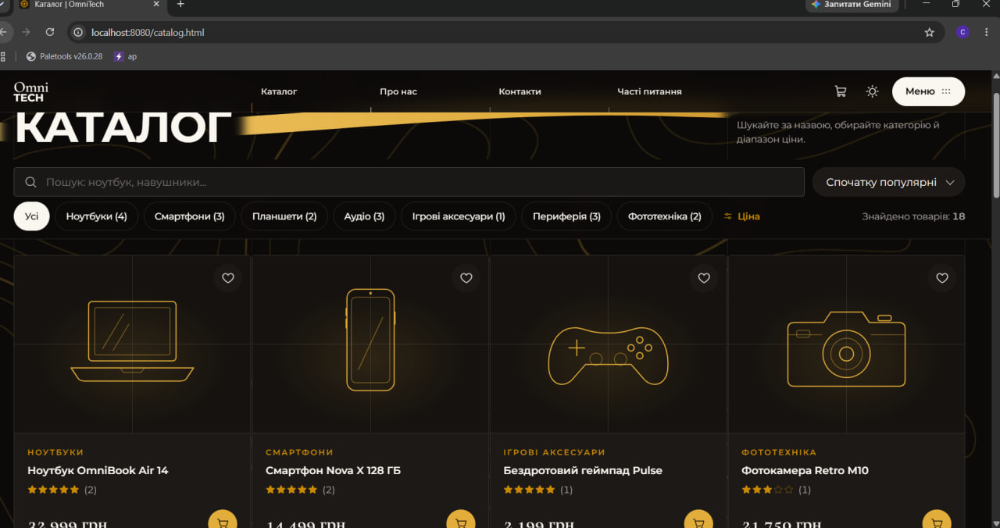
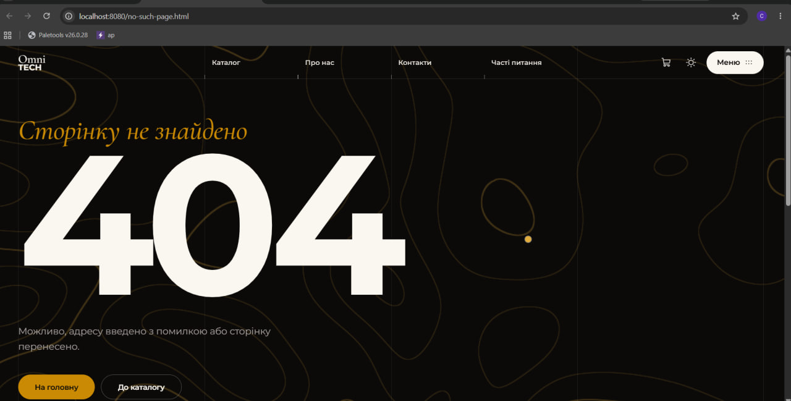
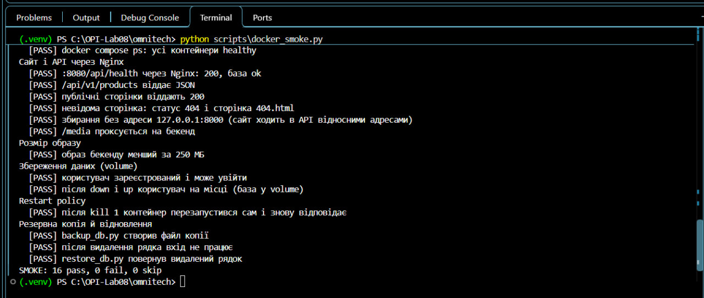

# Звіт з лабораторної роботи 08 «Контейнеризація проєкту»

## Загальні відомості

| | |
|---|---|
| **ПІБ** | Бардюк Станіслав Олександрович |
| **Група** | ІПЗ-22 |
| **Роль у команді** | QA |
| **Склад команди** | Дмитрук Назар (Team Lead), Махнюк Андрій (Developer), Бардюк Станіслав (QA) |
| **Тема проєкту** | OmniTech — запуск у Docker (образ сайту, Nginx як reverse proxy, перевірка запуску) |
| **Репозиторій** | <https://github.com/Hyrysake/omnitech> |

## Особистий внесок

Я зробив образ сайту з Nginx і скрипт, який перевіряє, що весь проєкт збирається, запускається, зберігає дані й відновлюється після збою. Робота йшла трьома Pull Request: образ сайту, скрипт перевірки з документом і PR зі звітом. Першу гілку я створив від мітки `lab08-base`, яку Назар поставив після злиття спільної основи. Мої файли не збігаються з файлами Назара й Андрія, тому наші PR зливалися в будь-якому порядку. Код сайту (`frontend/src`) я не змінював. Як QA, також перевіряв PR Назара.

1. **Образ сайту (PR `feature/docker-frontend-image`).**
   - `frontend/Dockerfile`: етапи `deps` (`npm ci`), `build` (`npm run build`) і фінальний `nginx:alpine`. У фінальний образ потрапляє лише готовий `dist/` і конфіг Nginx, без Node.js та `node_modules`; образ близько 99 МБ. Є ще етап `dev` для `compose.dev.yaml` (сервер Vite). `package.json` і `package-lock.json` копіюються раніше за решту, тому `npm ci` береться з кешу, поки залежності не змінились.
   - `VITE_API_URL` під час збирання порожня. Vite вбудовує змінні `VITE_*` у код саме під час збирання, а порожня адреса означає запити на `/api/...` на тій самій адресі. Тому CORS не потрібен, а Nginx пересилає запити бекенду.
   - `frontend/nginx/default.conf`: віддає зібраний сайт; `/api/`, `/media/`, `/docs`, `/redoc`, `/openapi.json` пересилає на `backend:8000` (`proxy_pass`, заголовки `X-Real-IP`, `X-Forwarded-For`, `X-Forwarded-Proto`). Адресу бекенду задано змінною разом з `resolver 127.0.0.11`: Nginx шукає її під час запиту, тож проксі не ламається, коли контейнер `backend` перестворено з новою адресою. Невідома адреса дає нашу `404.html` зі статусом 404 (сайт багатосторінковий, «запасна» головна не потрібна). `/healthz` відповідає сам Nginx. Файли з `/assets/` кешуються на рік, `client_max_body_size 6m` відповідає ліміту картинок бекенду, додано заголовки `X-Content-Type-Options`, `X-Frame-Options`, `Referrer-Policy`.
   - `frontend/.dockerignore` (без `node_modules`, `dist`, `.env`), `compose/frontend.yaml` (порт `HTTP_PORT`, `depends_on: backend: condition: service_healthy`, `healthcheck`, `read_only`, `cap_drop: ALL` і чотири потрібні права для Nginx, ротація логів) і `compose/frontend.dev.yaml` (етап `dev`, код з папки, порт 5173, `!override` для портів).
2. **Скрипт перевірки (PR `feature/docker-smoke`).**
   - `scripts/docker_smoke.py` (лише стандартна бібліотека Python): збирає й запускає проєкт, перевіряє 13 речей і зупиняє його. Перевіряє: коректність `compose.yaml` і `compose.dev.yaml`; `up --build --wait`; `healthy` усіх контейнерів; `/api/health` і `/api/v1/products` через Nginx; шість публічних сторінок; 404 для невідомої адреси; відсутність `127.0.0.1:8000` у зібраному JS; `/media`; розмір образу бекенду менший за 250 МБ; збереження даних після `down` і `up`; перезапуск після `kill 1`; резервну копію й відновлення.
   - Якщо якась частина ще заглушка (стан `lab08-base`), перевірки отримують `SKIP`, а не `FAIL`, тож скрипт проходить у будь-якому стані. Прапорці `--no-up` (стек уже запущено, так працює GitHub Actions) і `--keep` (нічого не зупиняти).
   - `docs/docker/testing.md`: як запустити, таблиця з 13 перевірок і що кожна доводить, пояснення про `SKIP`, GitHub Actions, перевірка вручну.
3. **Звіт (PR `docs/report-lab08-bardiuk`):** цей файл і мої знімки екрана.
4. **Рев'ю:** перевірив PR Назара (основа, образ бекенду, документи, останній PR зі звітом) за чеклістом з інструкції: піднімав проєкт командою `docker compose up --build --wait`, запускав `docker_smoke.py` і порівнював результат із таблицею очікуваного для стану гілки, запускав `pytest`, дивився `git status` (`.env` у репозиторій не потрапляє) і що змінено лише файли його пакета.

Скрипт перевірки не додає тестів у pytest, тому в мене 0 нових тестів: його перевірка — запуск контейнерів.

**Посилання:**
- мої коміти: <https://github.com/Hyrysake/omnitech/commits?author=st009bar-dot>
- мої Pull Request: <https://github.com/Hyrysake/omnitech/pulls?q=is%3Apr+author%3Ast009bar-dot> (#51 образ сайту й Nginx, #52 скрипт перевірки docker_smoke)

**Інструменти:** VS Code, Git, GitHub, GitHub Actions, Docker Desktop, Docker Compose, Nginx, Node.js (збирання сайту в контейнері), Python. Частину коду зроблено з допомогою AI (Claude), розібрано й перевірено мною.

## Тестування

| Що перевіряв | Результат |
|---|---|
| Де запускав Docker | Docker Desktop на власному комп'ютері (Windows, WSL 2) |
| `docker compose up --build --wait` на моїй гілці (сайт справжній, бекенд заглушка) | обидва контейнери `Healthy` |
| `curl.exe -I http://localhost:8080/` | `200 OK`, `Server: nginx` |
| `curl.exe http://localhost:8080/healthz` | `ok` |
| `curl.exe http://localhost:8080/no-such-page.html` | статус 404 і сторінка `404.html` |
| `curl.exe http://localhost:8080/api/health` на моїй гілці | `{"status": "stub"}`: запит пройшов через Nginx до заглушки бекенду, `proxy_pass` працює |
| `docker images omnitech-frontend` | близько 99 МБ |
| `python scripts\docker_smoke.py` на моїй гілці (бекенд заглушка) | 6 pass, 0 fail, 2 skip |
| `python scripts\docker_smoke.py`, усі частини злито | `SMOKE: 16 pass, 0 fail, 0 skip` |
| Навмисна помилка: `VITE_API_URL` замінив на `http://127.0.0.1:8000` у `compose/frontend.yaml` | сайт відкривається, але запити до API ідуть на `127.0.0.1:8000` (на вкладці Network червоні); повернув порожнє значення — запити знову на `/api/...` |
| `pytest` у папці `backend/` | 284 passed на моїй гілці, 317 passed коли злито всі частини |
| GitHub Actions у моїх PR | зелена перевірка «Тести»; про «Docker» див. знімок нижче |

## Скріншоти

Сайт OmniTech через Nginx на порту 8080:

Невідома адреса: сторінка 404 зі статусом 404:

Результат скрипта перевірки:

## Технічні рішення

- **Порожня `VITE_API_URL`.** Адреса API вбудовується в код під час збирання, а не під час запуску, тому її треба задавати у Dockerfile (аргумент збирання), а не в `environment` контейнера. З порожньою адресою сайт ходить на ту саму адресу, з якої завантажений, тож CORS не потрібен. Скрипт шукає `127.0.0.1:8000` у зібраному JS, щоб не забути про це.
- **Змінна в `proxy_pass`.** Якщо записати `proxy_pass http://backend:8000;` напряму, Nginx визначить IP-адресу один раз при старті й після перестворення `backend` дасть 502. Змінна разом з `resolver 127.0.0.11` (DNS Docker) змушує шукати адресу під час запиту.
- **404 замість запасної головної.** Для односторінкових сайтів Nginx віддає `index.html` на будь-яку адресу. У нас кожна сторінка — окремий `.html`, тому невідома адреса має давати 404, і це перевіряє скрипт.
- **Три етапи й кеш `npm ci`.** Node.js потрібен лише для збирання, у фінальний образ він не потрапляє. Образ близько 99 МБ, з них майже все — сам `nginx:alpine`.
- **`SKIP`, а не `FAIL` для заглушок.** Інакше перевірка в кожному PR була б червоною, поки не злито чужі частини. Скрипт розпізнає заглушку за відповіддю `{"status": "stub"}`, заголовком `X-OmniTech-Stub` і образом `busybox`. Результат залежить від злитого: 3 pass і 3 skip в основі, 9 і 2 з бекендом, 6 і 2 із сайтом, 13 і 1 з обома, 16 і 0 з усім. `fail` має бути 0 завжди.
- **Скрипт видаляє томи.** У кінці він виконує `docker compose --profile ops down -v`, щоб нічого не лишалось на комп'ютері. Тому перед запуском я не тримаю на цьому проєкті даних, які шкода втратити; для цього є прапорець `--keep`.
- **Права Nginx.** Після `cap_drop: ALL` Nginx отримує лише `CHOWN`, `SETGID`, `SETUID` і `NET_BIND_SERVICE`: щоб змінити власника тимчасових папок, перемкнутись на користувача `nginx` і зайняти порт 80.

## Висновки

Як QA я переконався, що для контейнерів звичайних тестів замало: pytest не бачить, що забули `VITE_API_URL`, що проксі втрачає бекенд після перестворення або що дані пропадають при `down -v`. Усе це ловить лише запуск справжніх контейнерів, тому я написав один скрипт, який робить це за 2–3 хвилини і дає код виходу для GitHub Actions. Заглушки в основі дозволили запускати той самий скрипт на моїй гілці ще до того, як були готові бекенд і копії. Найкорисніше було бачити різницю між `SKIP` і `FAIL`: перше означає «чужа частина ще не злита», друге — «щось зламано». Окремо варто пам'ятати, що скрипт видаляє томи в кінці, а перевірка `docker.yml` на самому GitHub залежить від першого запуску в PR.
