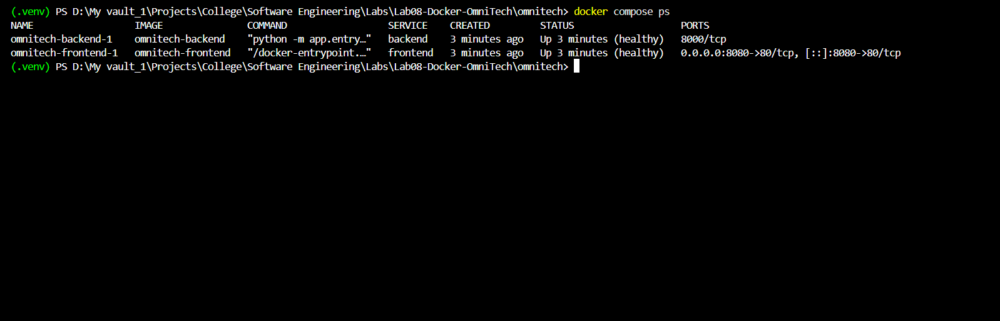
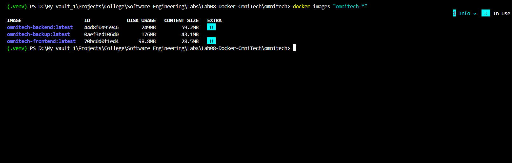
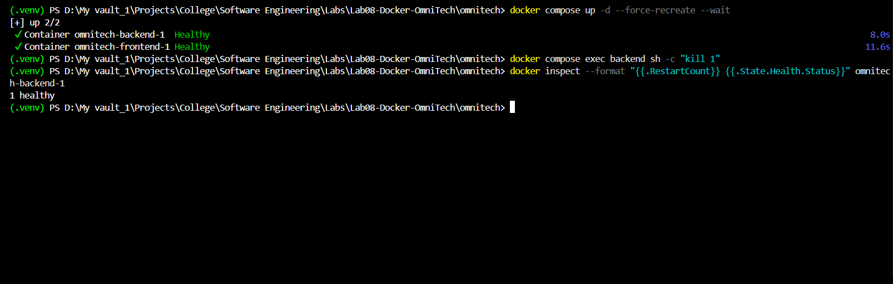
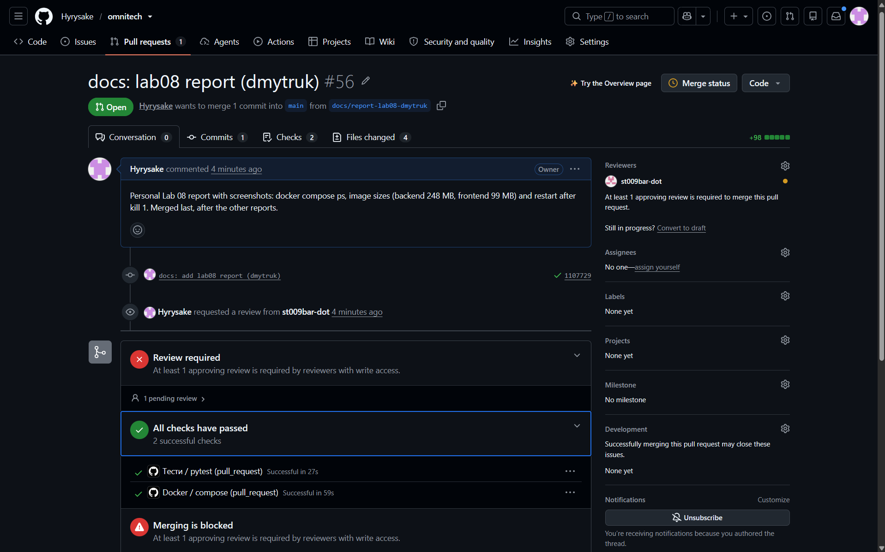

# Звіт з лабораторної роботи 08 «Контейнеризація проєкту»

## Загальні відомості

| | |
|---|---|
| **ПІБ** | Дмитрук Назар Сергійович |
| **Група** | ІПЗ-22 |
| **Роль у команді** | Team Lead |
| **Склад команди** | Дмитрук Назар (Team Lead), Махнюк Андрій (Developer), Бардюк Станіслав (QA) |
| **Тема проєкту** | OmniTech — запуск у Docker (образ FastAPI, Compose, SQLite у volume, Nginx) |
| **Репозиторій** | <https://github.com/Hyrysake/omnitech> |

## Особистий внесок

Я зробив спільну основу лабораторної, образ бекенду з його запуском і документи про архітектуру та конфігурацію. Робота йшла чотирма Pull Request: основа, образ бекенду, документація і останній PR зі звітом. Кожен учасник працював зі своїми файлами, тому ми зливали PR у будь-якому порядку. Тільки мій останній PR треба було злити після всіх інших.

1. **Спільна основа (PR `feature/docker-base`, мітка `lab08-base`).**
   - `compose.yaml` і `compose.dev.yaml`: назва проєкту `omnitech`, `include:` файлів з теки `compose/` і три томи (`omnitech-data`, `omnitech-media`, `omnitech-backups`).
   - П'ять файлів у `compose/` в основі є **заглушками** з публічних образів: «бекенд» відповідає `{"status": "stub"}`, «сайт» показує сторінку «в розробці» і пересилає `/api` на бекенд, `backup` — `busybox` з профілем `ops`. Завдяки цьому `docker compose up` працює вже після основи, і Станіслав та Андрій перевіряли свої частини, не чекаючи мою. Справжні файли замінили заглушки в їхніх PR.
   - `.env.example`, `.gitattributes` (закінчення рядків LF), доповнення `.gitignore` (`backups/`, `*.db-wal`, `*.db-shm`), `.github/workflows/docker.yml`.
   - У бекенді три нові налаштування в `config.py` (`app_env`, `log_level`, `seed_on_start`), виклик `setup_logging()` у `main.py` і порожня заглушка `core/logging.py`, яку потім замінив Андрій.
   - Розділ «Запуск у Docker» у README (порожній) і шість документів-заглушок у `docs/docker/`.
   - Після злиття основи я поставив мітку `lab08-base`, від неї пішли перші гілки всіх трьох учасників.
2. **Образ бекенду (PR `feature/docker-backend-image`, 13 тестів).**
   - `backend/Dockerfile`: два етапи на `python:3.13-slim`. У першому віртуальне середовище `/opt/venv` з бібліотеками, у другому лише воно і код. `requirements.txt` копіюється раніше за код, тому після зміни коду крок `pip install` береться з кешу (`CACHED`). Користувач `app` з номером 10001, папки `/app/data` і `/app/media` належать йому. `HEALTHCHECK` звертається до `/api/health` самим Python, бо в slim-образі немає `curl`.
   - Розмір образу: спочатку 295 МБ, після `pip install --no-compile` (мінус ≈ 27 МБ) і видалення `pip` з середовища (мінус ≈ 13 МБ) вийшло близько 248 МБ, під порогом 250 МБ.
   - `backend/.dockerignore`: без `.venv`, `data/`, `media/`, `tests/`, `.env`.
   - `backend/app/entrypoint.py`: перевіряє порт, створює таблиці, за `SEED_ON_START=true` наповнює порожню базу демо-даними і замінює себе на Uvicorn через `os.execvp`. Uvicorn стає процесом PID 1 і отримує сигнал зупинки від Docker. Один процес, бо SQLite пускає одного писача.
   - `compose/backend.yaml`: змінні з `.env` (`SECRET_KEY` обов'язковий), томи на папках `/app/data` і `/app/media`, `healthcheck`, `restart: unless-stopped`, `read_only`, `cap_drop: ALL`, ротація логів. `compose/backend.dev.yaml`: `--reload`, код з папки через bind mount, DEBUG-логи.
   - `backend/tests/unit/test_entrypoint.py` (13): порт за замовчуванням і з середовища, шість неправильних значень порту, додаткові аргументи для Uvicorn, створення таблиць, наповнення демо-даними без дублікатів, заміна процесу.
3. **Документація (PR `docs/docker-architecture`).**
   - `docs/docker/architecture.md`: схема Mermaid, таблиця сервісів, опис образів, SQLite у контейнері, prod і dev, безпека, таблиця «Чому саме так».
   - `docs/docker/config.md`: усі змінні `.env`, файли Compose, health checks, логи, шпаргалка команд.
   - `README.md`: розділ «Запуск у Docker» (команди від клонування до браузера, образи, томи, «чому так», дерево файлів) і розділ «Результати (лабораторна 08)».
4. **Останній PR (`docs/report-lab08-dmytruk`):** цей звіт і мої знімки екрана. Після його злиття я поставив мітку `lab08`.
5. **Рев'ю:** перевірив і схвалив PR Станіслава (образ сайту, скрипт перевірки) та Андрія (логування, копії, документи): для кожного дивився, що змінено лише файли з його пакета, піднімав проєкт командою `docker compose up --build --wait` і запускав `pytest`.

Разом у мене 13 нових тестів. Усього в проєкті 317 тестів: 284 з лабораторної 07 і 33 нових (13 мої, 20 Андрія).

**Посилання:**
- мої коміти: <https://github.com/Hyrysake/omnitech/commits?author=Hyrysake>
- мої Pull Request: <https://github.com/Hyrysake/omnitech/pulls?q=is%3Apr+author%3AHyrysake> (#48 основа, #49 образ бекенду, #50 архітектура й конфігурація)
**Інструменти:** VS Code, Git, GitHub, GitHub Actions, Docker Desktop, Docker Compose, Python, pytest. Частину коду зроблено з допомогою AI (Claude), розібрано й перевірено мною.

## Тестування

| Що перевіряв | Результат |
|---|---|
| Де запускав Docker | Docker Desktop на власному комп'ютері (Windows, WSL 2) |
| `pytest` у папці `backend/`, усі частини злито | 317 passed, близько 20 с |
| `pytest tests/unit/test_entrypoint.py` | 13 passed |
| `pytest --cov=app --cov-report=term-missing`, усі частини | 96 % покриття `app/`; `entrypoint.py` 94 %, `core/logging.py` 100 % |
| `docker compose up --build --wait` | обидва контейнери `Healthy` |
| `docker compose ps` | у STATUS `healthy` у `backend` і `frontend` |
| `curl.exe http://localhost:8080/api/health` | `{"status":"ok","database":"ok"}` |
| `docker images` | `omnitech-backend` близько 248 МБ (було 295), `omnitech-frontend` близько 99 МБ |
| Кеш шарів: змінив код у `app/`, `docker compose build backend` | кроки `COPY requirements.txt` і `pip install` позначені `CACHED` |
| `docker compose exec backend id` | `uid=10001(app)`: процес не від root |
| `docker compose exec backend sh -c "kill 1"`, через кілька секунд `docker inspect …` | `RestartCount` дорівнює 1, контейнер знову `healthy`, дані на місці |
| Навмисний збій: перейменував `.env`, `docker compose config --quiet` | помилка `required variable SECRET_KEY is missing a value` з нашою підказкою; після повернення файлу помилки немає |
| `python scripts\docker_smoke.py` (скрипт Станіслава) | `SMOKE: 16 pass, 0 fail, 0 skip` |
| `compose.dev.yaml up --wait` | сайт `:5173` і API `:8000` відповідають 200; Uvicorn перезапускається при зміні файлу |
| GitHub Actions у PR | перевірка «Тести» зелена; про перевірку «Docker» див. знімок нижче |

## Скріншоти

`docker compose ps`: обидва сервіси healthy:

`docker images`: розміри образів бекенду й сайту:

Перезапуск після `kill 1`: лічильник перезапусків 1, контейнер знову healthy:

GitHub Actions: перевірки в Pull Request:

## Технічні рішення

- **Заглушки в основі.** Якби в основі лежав лише порожній `compose.yaml`, Станіславу й Андрію довелось би чекати мій образ. Заглушки мають ті самі імена сервісів, порти й адресу `/api/health`, тому решта файлів працює відразу, а мої PR та їхні зливаються в будь-якому порядку. Це перевірено автоматично: основа плюс три пакети в усіх шести порядках дають однаковий результат.
- **Два етапи на одному образі.** Бібліотеки ставляться в першому етапі, у фінальний образ іде лише готове середовище без кешу pip. Обидва етапи на `python:3.13-slim` (Debian): argon2 і pillow зібрані під glibc, а на Alpine (musl) могли б не запуститися.
- **Кеш шарів.** Спершу `COPY requirements.txt` і `pip install`, потім код. Тому зміна одного файлу в `app/` перебудовує лише останній шар, і збірка займає секунди.
- **Том на папці, а не на файлі.** У режимі WAL SQLite створює поруч із базою файли `omnitech.db-wal` і `omnitech.db-shm`. Для них потрібна папка, в яку можна писати. Власника папки (uid 10001) задано в образі: коли Docker створює порожній том на такій папці, він копіює власника з образу. Bind mount для бази не використовуємо: на Windows блокування файлів у спільних папках ненадійні. Bind mount лише для коду в режимі розробки.
- **`ENTRYPOINT` в exec-формі й `os.execvp`.** PID 1 — це сам Uvicorn, не оболонка. Він отримує `SIGTERM` від `docker stop`, а після збою його піднімає `restart: unless-stopped`. У `python:3.13-slim` немає програми `kill`, тому перевірку роблю командою `sh -c "kill 1"`.
- **Один процес Uvicorn.** SQLite пускає одного писача за раз; кілька процесів лише змагались би за блокування.
- **`SECRET_KEY` з `:?`.** Запис `${SECRET_KEY:?…}` зупиняє запуск із підказкою, якщо немає `.env`. Краще зупинитись, ніж запустити бекенд з порожнім ключем. Ключ у `.env.example` демонстраційний і публічний, про це попереджає `config.md`; на справжньому сервері треба свій.
- **Обмеження контейнера.** Не від root, коренева файлова система лише для читання (`read_only`, `tmpfs` для `/tmp`), `cap_drop: ALL`, `no-new-privileges`, порт бекенду не публікується назовні.
- **Томи в двох кореневих файлах.** Томи оголошені і в `compose.yaml`, і в `compose.dev.yaml`: на пробному запуску підключений файл, використаний через другий корінь, без цього видавав «refers to undefined volume».

## Висновки

Лабораторна показала, що Docker не змінює застосунок, а описує, як його запустити, тому більшість часу пішла не на сам Dockerfile, а на дрібниці навколо бази. Файл SQLite потрапляє в образ або в volume, і від цього залежить, чи переживуть дані `docker compose down`; режим WAL вимагає том саме на папці; права на неї треба задати в образі. Кеш шарів і багатоетапна збірка дали образ 248 МБ замість 295 і збірку за секунди після зміни коду. Робота із заглушками в основі дозволила трьом людям перевіряти свої частини незалежно. Перевірка `docker_smoke.py` і тести перетворили «у мене запускається» на повторюване правило команди. Не перевірено: робота `docker.yml` на самому GitHub залежить від першого запуску в PR, ми можемо судити про неї лише за локальним повторенням кроків.
