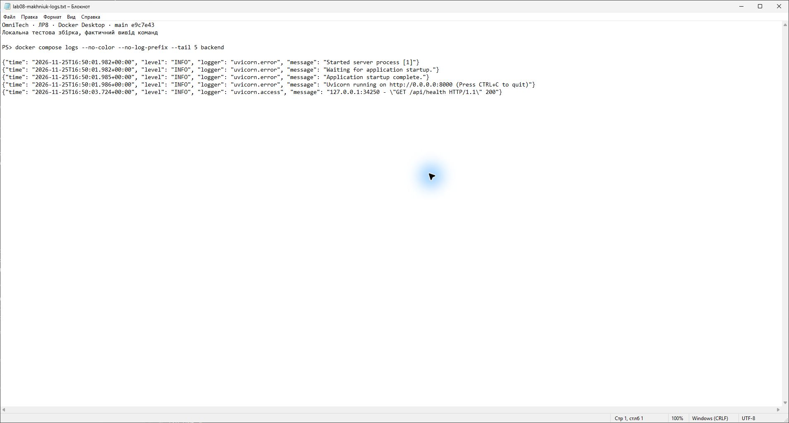
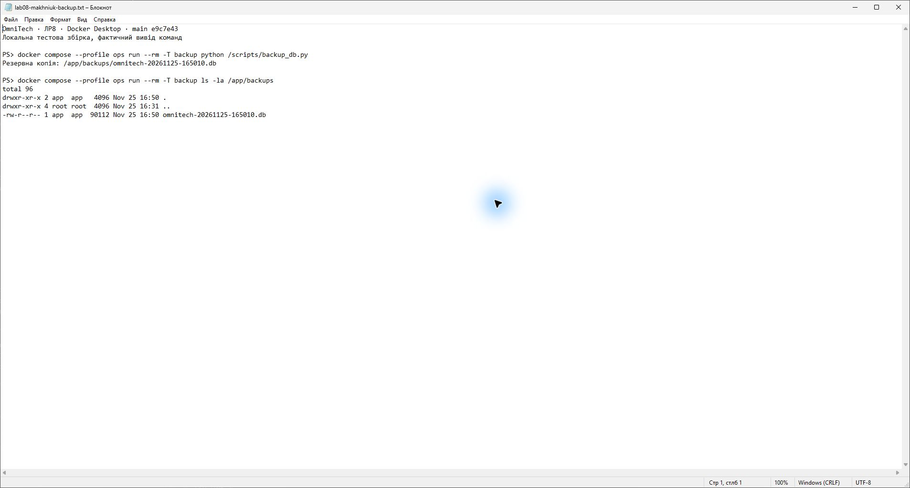
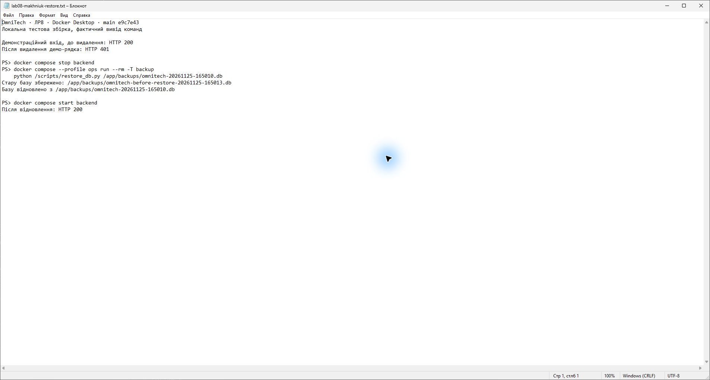

# Звіт з лабораторної роботи 08 «Контейнеризація проєкту»

## Загальні відомості

| | |
|---|---|
| **ПІБ** | Махнюк Андрій Сергійович |
| **Група** | ІПЗ-22 |
| **Роль у команді** | Developer |
| **Склад команди** | `Hyrysake` (Team Lead), `rotterdamsterdam` (Developer), `st009bar-dot` (QA) |
| **Тема проєкту** | OmniTech — запуск у Docker (логування, резервні копії бази, типові проблеми) |
| **Репозиторій** | <https://github.com/Hyrysake/omnitech> |

## Особистий внесок

Моя частина проєкту охоплює логування бекенду, резервування й відновлення SQLite, сервіс backup у Compose та два посібники. Файли отримано в командному пакеті `3-andrii`, інтегровано у двох PR під акаунтом `rotterdamsterdam`. Першу гілку створено від оновленого `main` після появи мітки `lab08-base`.

1. **Логування і копії (PR `feature/docker-logging-backup`, 20 тестів).**
   - `backend/app/core/logging.py` замінив заглушку з основи. Логи пишуться в stdout, а Docker збирає їх сам (`docker compose logs -f backend`); файлів логів у контейнері немає. Якщо `APP_ENV=production`, кожен рядок — один JSON з полями `time`, `level`, `logger`, `message` (і `exception`, якщо була помилка). У `development` рядок звичайний, читабельний. `LOG_LEVEL` задає рівень. Рядки Uvicorn ідуть тим самим форматом, а SQL-запити й перевірку змін файлів приглушено до `WARNING`. Конфігурація зібрана в окремій функції `build_config`, щоб її можна було перевірити тестом.
   - `scripts/backup_db.py`: копія бази через `sqlite3.Connection.backup()`, а не копіюванням файлу. У режимі WAL частина даних лежить у файлі `-wal`, і простий `cp` їх би загубив. Копія спершу пишеться у файл `.part`, перевіряється `PRAGMA integrity_check` і лише тоді отримує ім'я `omnitech-РРРРММДД-ГГххсс.db`. Ротація лишає `BACKUP_KEEP` (7) найновіших копій. З параметром `--every 86400` скрипт працює постійно й робить копію раз на добу; `docker stop` зупиняє його одразу (обробник `SIGTERM`).
   - `scripts/restore_db.py`: перевіряє файл копії, зберігає поточну базу як `omnitech-before-restore-<час>.db` (щоб відновлення можна було скасувати) і копіює копію в базу через `backup()`. Пошкоджену копію не приймає.
   - `compose/ops.yaml` замінив заглушку: сервіс `backup` з профілем `ops` (звичайний `docker compose up` його не запускає). Образ збирається прямо в файлі (`dockerfile_inline`): `python:3.13-slim` і два скрипти, користувач 10001 як у бекенду, тому він має право читати том `omnitech-data` і писати в `omnitech-backups`.
   - `test_logging.py` (7): один рядок JSON, поле `exception`, JSON у production і текст у development, вивід у stdout, а не у файл, логери Uvicorn через кореневий, застосування `LOG_LEVEL`, тихий SQL-логер.
   - `test_backup.py` (13): шлях бази з `DATABASE_URL`, відмова для не-SQLite, усі рядки в копії, копія бачить дані, які лише у файлі `-wal`, ім'я з часом і відсутність `.part`, дві копії за одну секунду не затирають одна одну, ротація, зрозуміла помилка без бази, параметри зі змінних середовища, відновлення видаленого рядка, копія безпеки перед відновленням, відмова для пошкодженої копії і для відсутнього файлу.
2. **Документи (PR `docs/docker-troubleshooting`).**
   - `docs/docker/troubleshooting.md`: що робити, коли Docker Desktop не запускається (WSL 2, віртуалізація в BIOS, пам'ять), таблиця помилок запуску проєкту з причиною й рішенням, таблиця «Як перевірити конкретну річ», і три шляхи для тих, у кого Docker не працює: Codespaces, GitHub Actions як доказ, перевірки без Docker.
   - `docs/docker/backup.md`: чому не просто копіювати файл, де що лежить, разова й щоденна копія, відновлення, копія на комп'ютер, робота без Docker, застереження про `down -v` і обмеження.
3. **Звіт (PR `docs/report-lab08-makhniuk`):** цей файл і мої знімки екрана.

Разом у мене 20 нових тестів: 13 для копій і 7 для логування.

**Посилання:**
- мої коміти: <https://github.com/Hyrysake/omnitech/commits?author=rotterdamsterdam>
- мої Pull Request: [№53 — логування й резервні копії](https://github.com/Hyrysake/omnitech/pull/53), [№54 — типові проблеми й резервування](https://github.com/Hyrysake/omnitech/pull/54).

**Інструменти:** VS Code, Git, GitHub, GitHub Actions, Docker Desktop, Docker Compose, Python (`sqlite3`, `logging`), pytest. Для інтеграції, запуску локальних перевірок і підготовки звіту використано Codex.

## Тестування

| Що перевірено | Результат |
|---|---|
| Середовище | Docker Desktop на локальному ПК, Windows і WSL 2. Docker 29.9.3, Compose v5.7.1. Ручну перевірку зроблено в окремому тестовому проєкті з портом на `127.0.0.1`. |
| `pytest tests/unit/test_backup.py tests/unit/test_logging.py` у гілці кроку 2А-1 | 20 тестів пройшли |
| Повний `pytest` у гілці кроку 2А-1 і на зібраному `main` (`e9c7e43`) | 317 тестів пройшли в обох запусках |
| `pytest --cov=app` на зібраному `main` | Модуль `app/core/logging.py` — 100%, весь `app/` — 96% |
| Копія й відновлення без Docker на демонстраційній SQLite | Обидва скрипти завершилися успішно. Перевірка `integrity_check` пройшла, контрольна таблиця залишилася лише в копії стану до відновлення. |
| `docker compose --profile ops build backup` | Образ зібрано. `docker image ls` показав 176 MB для `omnitech-backup`, 249 MB для `omnitech-backend` і 107 MB для `omnitech-frontend`. |
| Контейнер без запущеного бекенду | `backup_db.py --help` показав параметри. Запуск без створеної бази повідомив «Базу не знайдено». |
| `docker compose logs --no-color --no-log-prefix --tail 5 backend` | П’ять рядків розібрано як валідні JSON-записи. |
| Разова копія й `ls -la /app/backups` | Створено `omnitech-20261125-165010.db` розміром 90 112 байтів. |
| Відновлення в Docker | Вхід із демонстраційним обліковим записом дав HTTP 200. Після вилучення рядка — 401, після відновлення з копії — 200. Стан перед відновленням збережено окремим файлом. |
| `python scripts/docker_smoke.py` на зібраному `main` | `SMOKE: 16 pass, 0 fail, 0 skip`. Пройшли перевірки сайту й API, збереження даних після перезапуску, резервування й відновлення. |
| GitHub Actions у PR №53 і №54 | «Тести» й «Docker» пройшли в обох PR. |

Знімки нижче показують фактичний вивід команд, відкритий у Блокноті після локальних запусків.

## Скріншоти

Логи бекенду в Docker: один рядок — один JSON:

Резервна копія бази: файл у томі `omnitech-backups`:

Відновлення бази з копії:

## Технічні рішення

- **`backup()`, а не `cp`.** SQLite у режимі WAL спершу пише зміни у `omnitech.db-wal` і лише потім переносить їх в основний файл. Копія самого `omnitech.db` не містить свіжих змін, а копія під час запису може вийти пошкодженою. `Connection.backup()` дає цілісну копію, навіть коли застосунок працює. Тест `test_backup_sees_data_that_is_only_in_wal_file` перевіряє саме це.
- **`.part` і `integrity_check`.** Напівготова або пошкоджена копія ніколи не виглядає як справжня: ім'я вона отримує лише після перевірки.
- **Копія безпеки перед відновленням.** Відновлення перезаписує поточну базу, тож скрипт спершу зберігає її поруч. Ротація ці файли не чіпає (шаблон імені `omnitech-2*.db`).
- **Профіль `ops`.** Копія потрібна за розкладом або перед ризикованою дією, а не при кожному `docker compose up`. Побічний ефект: звичайний `down -v` не бачить сервіс `backup` і не видаляє том `omnitech-backups`. Це корисно (копії переживають повне скидання бази), але про це написано в `backup.md`.
- **Та сама папка в контейнері `backup` і uid 10001.** Скрипту потрібні права на читання бази з `omnitech-data` і запис у `omnitech-backups`. Власник — той самий користувач, що й у бекенду.
- **Логи в stdout.** Коренева файлова система бекенду лише для читання, і файли логів там не потрібні: Docker сам зберігає stdout у форматі `json-file` з ротацією (10 МБ, три файли).
- **JSON у production.** Один рядок — один запис з полями, його легко шукати й передати в систему збору логів. У development за `APP_ENV=development` логи звичайні, бо їх читає людина.
- **Автоматичну копію ми обмежили.** Сервіс `backup` з `--every 86400` працює, лише поки запущений Docker. Якщо Docker Desktop на комп'ютері запущений не завжди, надійніше планувальник завдань Windows з разовою командою `run --rm backup`. Копія на тому самому диску не рятує від втрати диска; картинки з тому `omnitech-media` скрипт не зберігає. Про це написано в `backup.md`.

## Висновки

Лабораторна показала, що «просто скопіювати файл бази» для SQLite у режимі WAL не завжди правильно, і що копію варто перевіряти так само ретельно, як і саму базу: тому `integrity_check`, ім'я `.part` і копія безпеки перед відновленням. Важливо було, щоб відновлення можна було скасувати. Логування в stdout у форматі JSON простіше для контейнера, ніж файли: Docker бере на себе збір і ротацію. На зібраному `main` перевірено, що після вилучення демонстраційного користувача вхід повертає HTTP 401, а після відновлення копії знову повертає HTTP 200.
